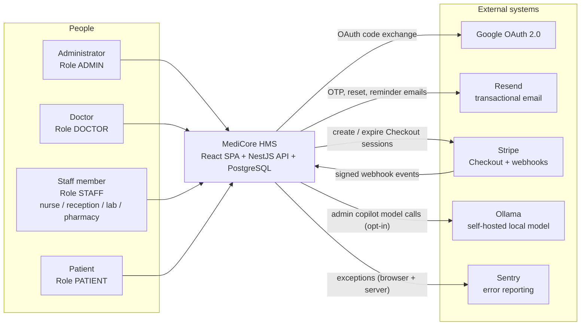
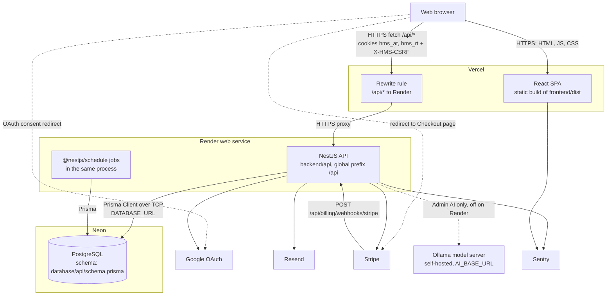
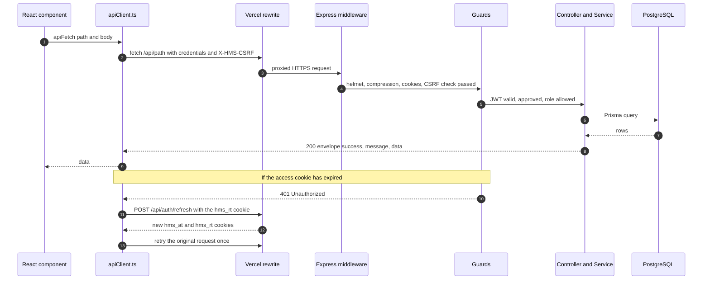
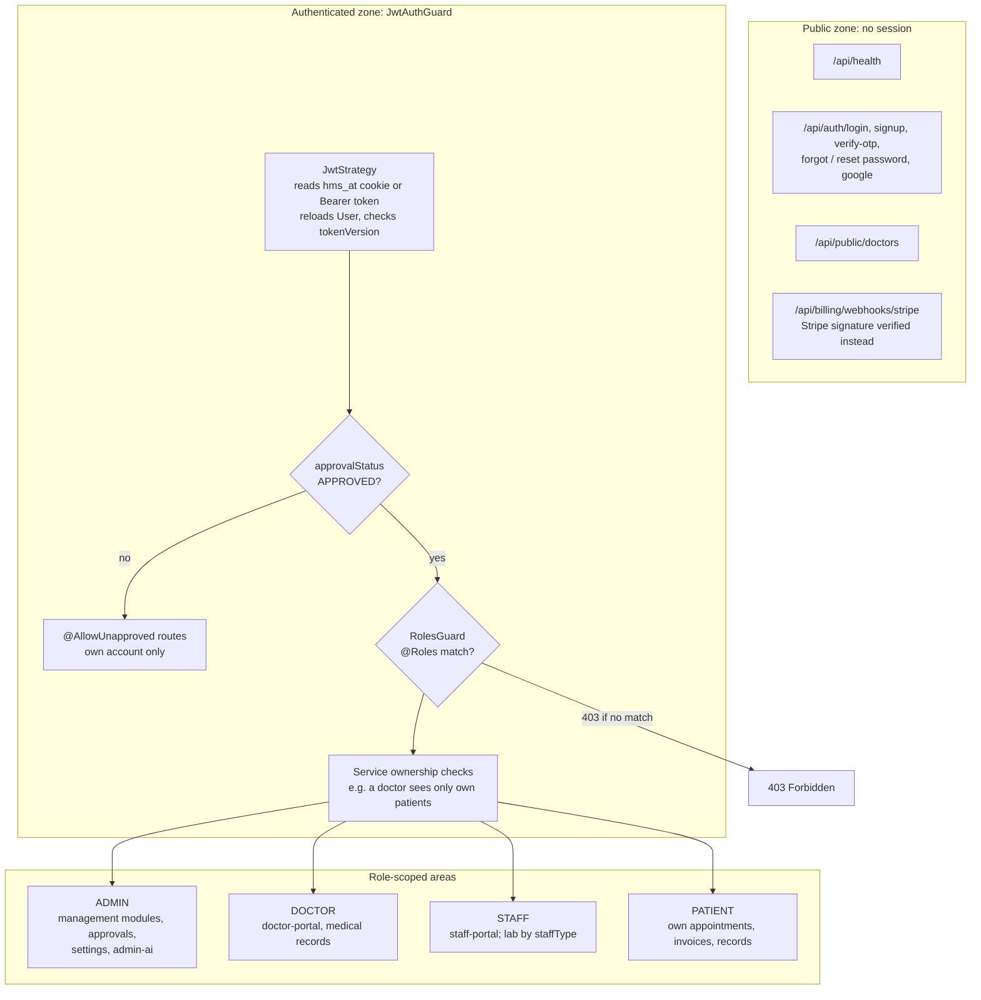
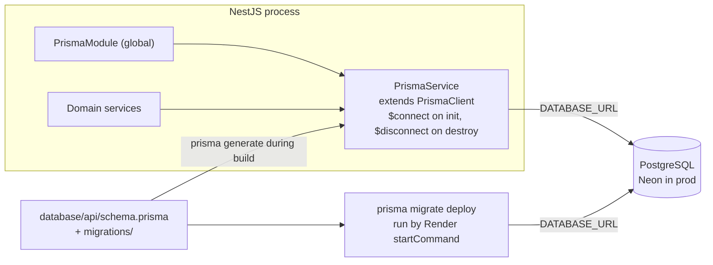
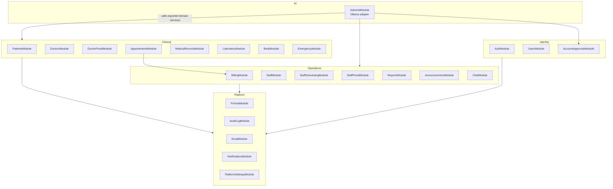
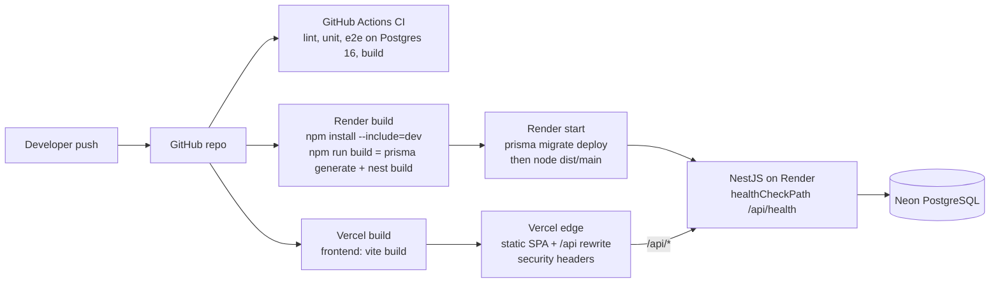

# MediCore HMS — System Architecture

> **Scope.** This is the whole-system view: how the React frontend, the NestJS API, PostgreSQL and the external services fit together. It deliberately stops at container and module boundaries. For implementation detail see:
>
> - **Frontend:** [`frontend/ARCHITECTURE.md`](frontend/ARCHITECTURE.md) (routing, state, components, API client, auth UI)
> - **Backend:** [`backend/api/ARCHITECTURE.md`](backend/api/ARCHITECTURE.md) (modules, endpoints, guards, database/ER diagrams, workflows)
> - **Admin AI Copilot:** [`docs/ai/AI_ARCHITECTURE.md`](docs/ai/AI_ARCHITECTURE.md), [`docs/ai/AI_SECURITY_PLAN.md`](docs/ai/AI_SECURITY_PLAN.md), [`docs/ai/AI_DEPLOYMENT.md`](docs/ai/AI_DEPLOYMENT.md)
>
> Everything here was verified against the source on branch `feature/admin-ai-ollama` (2026-11-20). Each statement is labelled as **implemented** (seen in code), **inferred** (a relationship the code supports but does not state outright), **gap** (missing or unverifiable) or **recommendation** (future work, never drawn as if it exists).

## Table of contents

1. [Purpose](#1-purpose)
2. [System overview](#2-system-overview)
3. [Verified technology stack](#3-verified-technology-stack)
4. [Architecture principles](#4-architecture-principles)
5. [Repository structure](#5-repository-structure)
6. [System context diagram](#6-system-context-diagram)
7. [Container diagram (C4 level 2)](#7-container-diagram-c4-level-2)
8. [Frontend-to-backend communication](#8-frontend-to-backend-communication)
9. [Authentication and authorization boundaries](#9-authentication-and-authorization-boundaries)
10. [API request lifecycle](#10-api-request-lifecycle)
11. [Database connectivity](#11-database-connectivity)
12. [Major domain dependencies](#12-major-domain-dependencies)
13. [Background processing](#13-background-processing)
14. [Deployment architecture](#14-deployment-architecture)
15. [Testing and CI](#15-testing-and-ci)
16. [Security boundaries](#16-security-boundaries)
17. [Source-code references](#17-source-code-references)
18. [Known gaps and limitations](#18-known-gaps-and-limitations)
19. [Future recommendations](#19-future-recommendations)

---

## 1. Purpose

This document gives developers, reviewers and AI agents one accurate map of the running system. It answers three questions:

- Which processes exist?
- How do they talk to each other?
- Where are the trust boundaries?

It is the entry point for onboarding and debugging. The two linked documents hold the detail.

## 2. System overview

MediCore is a **modular monolith**: a single-page React app talks to a single NestJS REST API, which owns one PostgreSQL database through Prisma. There are four user roles (`Role` enum in `database/api/schema.prisma`):

| Role | Who | Notes |
|---|---|---|
| `ADMIN` | Hospital administrators | Full management dashboard and the Admin AI Copilot (opt-in) |
| `DOCTOR` | Physicians | Doctor portal: own appointments, patients, records and prescriptions. Must be admin-approved. |
| `PATIENT` | Patients | Self-service booking, records, billing and messages |
| `STAFF` | Every non-doctor employee | Nurse, receptionist, pharmacist, lab technician or other. The specific job is `Staff.staffType`, not the role. Must be admin-approved. |

> There is **no separate `NURSE` or `RECEPTIONIST` role**. Behaviour that is specific to a job type is decided in services from `Staff.staffType`, for example `LaboratoryService.requireLabAccess`.

## 3. Verified technology stack

| Layer | Technology (from `package.json` and config) |
|---|---|
| Frontend | React 19, TypeScript, Vite, Tailwind CSS 4, `react-router` v8 (data router via `RouterProvider`), `react-hook-form` + `zod` (forms), `react-hot-toast`, `recharts`, `jspdf` (PDF export), `@sentry/react`, `lucide-react`. No global state or server-cache library is installed (no Redux, Zustand or React Query). |
| Backend | NestJS 10 (Express platform), TypeScript, `class-validator` and `class-transformer`, Passport (`passport-jwt` and Google OAuth 2.0 strategy), `@nestjs/jwt`, `@nestjs/throttler`, `@nestjs/schedule`, `@nestjs/swagger` (outside production only), `helmet`, `compression`, `cookie-parser`, `bcryptjs`, `otplib` with `qrcode` (TOTP MFA), `@sentry/node`, `zod` (Admin AI tools only). The Admin AI talks to Ollama over native `fetch` (no AI SDK). |
| Data | Prisma 6 ORM; PostgreSQL (Neon in production, local Postgres in development and CI) |
| External | Google OAuth, Resend (email), Stripe (Checkout and webhooks), Sentry (errors), Ollama (self-hosted local model server for the opt-in Admin AI Copilot) |
| Hosting | Vercel (static SPA and `/api` rewrite), Render (Node web service), Neon (Postgres) |
| CI | GitHub Actions (`.github/workflows/`): backend lint, unit tests, e2e against Postgres 16, and build; frontend job |

## 4. Architecture principles

These come from the code, not from aspiration:

1. **One API, one database.** All business rules live in NestJS services. The frontend never talks to the database or to third parties directly. The only exception is the browser redirect to Stripe Checkout, which uses a URL the API creates.
2. **First-party cookie sessions.** Tokens are httpOnly cookies, never `localStorage`. Vercel proxies `/api`, so the cookies are same-site.
3. **The server decides who you are.** `JwtStrategy` re-reads the user row on every request (role, approval status, `tokenVersion`). A role or user id in a request body is never trusted.
4. **Defence in layers.** The layers run in this order: Helmet, then CSRF middleware, then the global throttler, then `JwtAuthGuard` (authentication and approval), then `RolesGuard`, then a `ValidationPipe` whitelist, then service-level ownership checks.
5. **A uniform response envelope.** Success responses are `{success, message, data}` (`ResponseInterceptor`). Errors are normalised by `HttpExceptionFilter`.
6. **Additive feature modules.** Each domain is a Nest module. Cross-domain use goes through exported services, never another module's controller.

## 5. Repository structure

```text
hospital-management-system/          (monorepo without workspaces — each app has its own package.json)
├── ARCHITECTURE.md                  ← this file
├── render.yaml                      Render blueprint for the API
├── .github/workflows/               CI
├── docs/                            DEPLOYMENT, SECURITY, TESTING, PROJECT_AUDIT, ai/*
├── frontend/                        React SPA (Vite)  → frontend/ARCHITECTURE.md
│   ├── src/{routes,layouts,pages,features,components,hooks,lib,types,utils}
│   └── vercel.json                  /api rewrite + SPA fallback + security headers
├── backend/api/                     NestJS API        → backend/api/ARCHITECTURE.md
│   ├── src/<domain modules>
│   └── test/                        e2e suites
├── database/api/
│   ├── schema.prisma                single Prisma schema (34 models)
│   └── migrations/                  Prisma migrations
├── package.json                     root: only prisma + @prisma/client (tooling convenience)
└── server-nest/                     empty, untracked directory — not part of the system
```

The root `package.json` declares only Prisma packages. It has no workspaces, and nothing in it is imported by the apps.

## 6. System context diagram



## 7. Container diagram (C4 level 2)



| Container | Technology | Responsibility | Source |
|---|---|---|---|
| React SPA | React 19 and Vite | UI, routing, role-based navigation, API calls | `frontend/src/main.tsx`, `frontend/src/App.tsx`, `frontend/src/routes/router.tsx` |
| Vercel rewrite | `vercel.json` | Proxies `/api/*` to Render so cookies stay first-party; falls back to the SPA | `frontend/vercel.json` |
| NestJS API | NestJS 10 on Express | All business logic, authentication and integrations | `backend/api/src/main.ts`, `backend/api/src/app.module.ts` |
| Scheduled jobs | `@nestjs/schedule` | Reminder emails and notifications; see [§13](#13-background-processing) | `*-reminders.service.ts` |
| PostgreSQL | Neon (prod) | The single source of truth | `database/api/schema.prisma` |

## 8. Frontend-to-backend communication

All HTTP goes through one client, `frontend/src/lib/apiClient.ts`:

- Base URL: `${VITE_API_URL ?? ''}/api`. In development, Vite proxies `/api` to `http://localhost:3000` (`frontend/vite.config.ts`). In production the base URL is empty and Vercel rewrites the request.
- Every request sends `credentials: 'include'` (cookies). Unsafe methods also send the `X-HMS-CSRF: 1` header.
- On a 401 from a non-`/auth` path, the client makes one shared `POST /api/auth/refresh` and retries the request once (`refreshInFlight` de-duplicates concurrent refreshes).
- Responses are unwrapped from the `{success, message, data}` envelope. Errors become an `ApiError`.
- One exception is the Admin Copilot. It streams Server-Sent Events from `POST /api/admin-ai/conversations/:id/messages`, using `fetchWithSession` from the same client.



**API namespace map** (controllers under `backend/api/src`; all paths are prefixed with `/api`):

| Namespace | Backend module | Main consumers (frontend area) |
|---|---|---|
| `auth` | `auth` | Login, signup, OTP, password reset, Google OAuth, MFA (`features/auth`, `features/mfa`) |
| `users` | `users` | Profile, admin user management (`features/profile`) |
| `patients`, `medical-records` | `patients`, `medical-records` | Patients, records (`features/patients`, `features/medicalRecords`, `features/patientMedicalRecords`) |
| `doctors`, `public/doctors` | `doctors` | Doctors admin, find-a-doctor (`features/doctors`) |
| `doctor-portal` | `doctor-portal` | Doctor dashboard (`features/doctorDashboard`, `features/doctorMedicalRecords`) |
| `appointments` | `appointments` | Appointments (`features/appointments`) |
| `beds` | `beds` | Bed management (`features/beds`) |
| `laboratory` | `laboratory` | Lab orders and results (`features/laboratory`) |
| `billing`, `billing/webhooks` | `billing` | Invoices, payments, Stripe (`features/billing`) |
| `emergency` | `emergency` | Emergency board (`features/emergency`) |
| `reports` | `reports` | Reports (`features/reports`) |
| `staff` | `staff` | Staff directory (`features/staff`) |
| `staff-scheduling/*` | `staff-scheduling` | Shifts, templates, openings, applications, attendance, availability, tasks (`features/staffScheduling`) |
| `staff-portal` | `staff-portal` | Staff self-service (`features/staffPortal`) |
| `announcements` | `announcements` | Announcements (`features/announcements`) |
| `notifications` | `notifications` | Notification bell and page (`features/notifications`) |
| `chat` | `chat` | Messages page (`pages/messages`) |
| `account-approvals` | `account-approvals` | Approvals queue (`features/accountApprovals`) |
| `platform-settings` | `platform-settings` | Settings page (`pages/settings`) |
| `admin-ai` | `admin-ai` | Admin Copilot (`features/adminCopilot`); returns 404 unless `ADMIN_AI_ENABLED=true` |
| `health` | `health` | Render health check only |

> The table maps each namespace to the frontend *area* that calls it. For the exact component, hook and endpoint calls, see the frontend document, section "Feature modules". For the full endpoint inventory, see the backend document, section "REST API".

## 9. Authentication and authorization boundaries



**Session model (implemented):**

| Item | Value | Source |
|---|---|---|
| Access token | JWT in the httpOnly cookie `hms_at`, path `/api`; lifetime from `JWT_EXPIRES_IN` (`15m` in `render.yaml`) | `backend/api/src/auth/auth-cookies.ts` |
| Refresh token | JWT in the httpOnly cookie `hms_rt`, path `/api/auth` only; lifetime from `JWT_REFRESH_EXPIRES_IN` (`7d`) | same |
| Cookie flags | `httpOnly`; `secure` in production or when `SameSite=None`; `sameSite` from `COOKIE_SAMESITE` (default `lax`) | `backend/api/src/config/configuration.ts` |
| CSRF | A state-changing request carrying a session cookie must send `X-HMS-CSRF: 1`, otherwise it gets 403 | `backend/api/src/common/middleware/csrf.middleware.ts` |
| Revocation | `User.tokenVersion` is compared on every request; logout and password changes bump it | `backend/api/src/auth/strategies/jwt.strategy.ts` |
| Google OAuth | Passport Google strategy; the callback sets cookies and redirects to `CLIENT_URL`; if MFA is enabled it hands off to `POST /auth/mfa/verify` | `backend/api/src/auth/auth.controller.ts`, `strategies/google.strategy.ts` |
| MFA | TOTP via `otplib`, plus hashed backup codes. The TOTP secret is encrypted at rest with AES-256-GCM using `MFA_ENCRYPTION_KEY` (required in production; legacy plain-text values are still read) | `backend/api/src/auth/mfa.service.ts`, `mfa-secret-crypto.ts` |
| Auth audit | Logins (password and Google), failed logins, logout, password reset/set/change and MFA events are written to `AuditLog` by `AuthAuditService` | `backend/api/src/auth/auth-audit.service.ts` |
| Frontend gate | `AuthProvider` holds the current user; `ProtectedRoute` requires a session; `RoleRoute` restricts by role and shows `AccessDenied` to a signed-in user whose role is not allowed | `frontend/src/features/auth/AuthContext.tsx`, `frontend/src/routes/ProtectedRoute.tsx`, `RoleRoute.tsx` |

The frontend route guards are **UX only**. The real boundary is the API guard chain: every protected controller uses `@UseGuards(JwtAuthGuard, RolesGuard)`.

## 10. API request lifecycle

The Nest pipeline as configured in `backend/api/src/main.ts` and `app.module.ts`:

```mermaid
flowchart LR
    Req["HTTPS request"] --> Raw{"path is<br/>/api/billing/webhooks/stripe?"}
    Raw -->|"yes"| RawBody["express.raw<br/>keeps bytes for signature"]
    Raw -->|"no"| Json["express.json / urlencoded<br/>limit 3mb"]
    RawBody --> Helmet
    Json --> Helmet["helmet"]
    Helmet --> Comp["compression"]
    Comp --> Cookie["cookie-parser"]
    Cookie --> Log["access log<br/>X-Request-Id, off in tests"]
    Log --> Csrf["csrfProtection"]
    Csrf --> Cors["CORS<br/>origin CLIENT_URL, credentials"]
    Cors --> Thr["ThrottlerGuard (APP_GUARD)<br/>120 req per 60 s, off in tests"]
    Thr --> Jwt["JwtAuthGuard"]
    Jwt --> Roles["RolesGuard"]
    Roles --> Pipe["ValidationPipe<br/>whitelist, forbidNonWhitelisted, transform"]
    Pipe --> Ctrl["Controller"]
    Ctrl --> Svc["Service"]
    Svc --> Prisma["PrismaService"]
    Prisma --> PG[("PostgreSQL")]
    Svc --> Int["ResponseInterceptor<br/>success envelope"]
    Int --> Res["HTTP response"]
    Ctrl -.->|"thrown exception"| Filter["HttpExceptionFilter<br/>error envelope"]
    Filter -.-> Res
```



> **Note on ordering.** Express middleware (Helmet to CORS) always runs before Nest's guards. Nest applies its stages in a fixed order: guards, then interceptors (before), then pipes, then the handler, then interceptors (after), with filters on any exception. The diagram shows the interceptor after the service because it maps the returned value. Per-route `@Throttle` overrides exist on sensitive endpoints such as login and admin-ai; see the backend document.

## 11. Database connectivity



- **Implemented:** one datasource, `provider = "postgresql"` and `url = env("DATABASE_URL")`. There is no `directUrl`, so migrations and the app use the same connection string.
- **Implemented:** `app.enableShutdownHooks()` lets Prisma disconnect cleanly when Render sends SIGTERM.
- **Gap:** no pooling configuration exists in code; connection pooling depends on the URL used (for example Neon's pooled endpoint). Whether production uses the pooled or direct Neon host cannot be verified from the repository.

The full ER diagrams, data dictionary, indexes and transaction sites are in the backend document, section "Database architecture".

## 12. Major domain dependencies

This shows the most important cross-module dependencies, taken from the module `imports` arrays and constructor injections. The backend document has the complete graph.



> **Simplification.** Subgraph-level arrows mean "modules in this group depend on platform modules". They are **inferred** from the common pattern, and not every module imports every platform module. Exact edges are in the backend module dependency diagram.

## 13. Background processing

**Implemented:** `ScheduleModule.forRoot()` in `AppModule`, with three in-process cron jobs:

| Job | Schedule | Source |
|---|---|---|
| Appointment reminders | `EVERY_10_MINUTES` | `backend/api/src/appointments/appointment-reminders.service.ts` |
| Invoice reminders | `EVERY_10_MINUTES` | `backend/api/src/billing/invoice-reminders.service.ts` |
| Staff task reminders | `EVERY_10_MINUTES` | `backend/api/src/staff-scheduling/task-reminders.service.ts` |

Each job claims a row with a conditional `updateMany` (for example `where reminderSentAt IS NULL`) **before** sending, so overlapping runs or several instances cannot send the same reminder twice (at-most-once delivery).

**Not found:** message queues (BullMQ, Redis), worker processes and event emitters.

On Render's free plan the service sleeps when idle, so these jobs run only while the instance is awake. This is **inferred** from the plan type in `render.yaml`; it is not observable in code.

## 14. Deployment architecture



| Concern | Configuration | Source |
|---|---|---|
| Frontend hosting | Vercel; `/api/:path*` is rewritten to `https://YOUR-RENDER-SERVICE.onrender.com/api/:path*` (a placeholder that must be edited); SPA fallback; `nosniff`, `X-Frame-Options`, `Referrer-Policy` and `Permissions-Policy` headers | `frontend/vercel.json` |
| Backend hosting | Render web service, free plan, `rootDir: backend/api`, health check `/api/health`, `TRUST_PROXY_HOPS=2` | `render.yaml` |
| Migrations | `prisma migrate deploy` on every start | `render.yaml` |
| Backend env vars | `DATABASE_URL`, `JWT_SECRET`, `JWT_EXPIRES_IN`, `JWT_REFRESH_SECRET`, `JWT_REFRESH_EXPIRES_IN`, `COOKIE_SAMESITE`, `TRUST_PROXY_HOPS`, `CLIENT_URL`, `GOOGLE_CLIENT_ID`, `GOOGLE_CLIENT_SECRET`, `GOOGLE_CALLBACK_URL`, `RESEND_API_KEY`, `RESEND_FROM_EMAIL`, `STRIPE_SECRET_KEY`, `STRIPE_WEBHOOK_SECRET`, `SENTRY_DSN`, `SENTRY_ENVIRONMENT`, `PORT`, `NODE_ENV`, `MFA_ENCRYPTION_KEY` (required in production), `DEMO_MODE` (`render.yaml` only, `"false"`), and `ADMIN_AI_ENABLED` and the `AI_*` flags (`AI_PROVIDER`, `AI_BASE_URL`, `AI_MODEL`, `AI_API_KEY`, `AI_CONTEXT_TOKENS` and the budgets; `render.yaml` keeps `ADMIN_AI_ENABLED="false"`) | `render.yaml`, `backend/api/.env.example` |
| Frontend env vars | `VITE_API_URL`, `VITE_SENTRY_DSN`, `VITE_SENTRY_ENVIRONMENT`, `VITE_DEMO_MODE` | `frontend/.env.example` |
| CORS | `origin: CLIENT_URL`, `credentials: true` (same-origin through the rewrite in production) | `backend/api/src/main.ts` |
| API docs | Swagger at `/api/docs`, **disabled when `NODE_ENV=production`** | `backend/api/src/main.ts` |

> **Build output.** `backend/api/tsconfig.build.json` limits the build to `src/**/*`, so `nest build` emits `dist/main.js`, which matches the `render.yaml` start command (`node dist/main`) and `npm run start:prod`.

## 15. Testing and CI

| Suite | Location | Runner |
|---|---|---|
| Backend unit | `backend/api/src/**/*.spec.ts` | Jest (`backend/api/jest.config.ts`) |
| Backend e2e | `backend/api/test/*.e2e-spec.ts` against a real Postgres test DB | Jest (`test/jest-e2e.json`, `test/setup-e2e.ts`) |
| Frontend unit and component | `frontend/src/**/*.test.ts(x)` | Vitest and Testing Library (`frontend/vitest.config.ts`) |
| CI | Backend: `npm ci`, `prisma generate`, lint, unit tests, `migrate deploy`, e2e, build. Plus a frontend job. | `.github/workflows/` |

## 16. Security boundaries

| Boundary | Control | Status |
|---|---|---|
| Browser to API | HTTPS, httpOnly cookies, CSRF header, CORS limited to `CLIENT_URL`, Helmet headers | Implemented |
| Abuse | Global throttler at 120 requests per minute per IP (proxy-aware through `trust proxy`); tighter per-route `@Throttle` on authentication; `/api/health` and the Stripe webhook are exempt (`@SkipThrottle()`) | Implemented |
| Identity | JWT re-validated against the DB on every request; `tokenVersion` revocation; admin approval gate for DOCTOR and STAFF | Implemented |
| Authorization | `RolesGuard` per route, plus ownership checks in services | Implemented |
| Input | Global `ValidationPipe` (whitelist and `forbidNonWhitelisted`) on bodies and on query strings (every `@Query()` is bound to a DTO class); request body limit 3 MB | Implemented |
| Payments | The Stripe webhook verifies its signature over the raw body | Implemented |
| Audit | `AuditLog` model and `AuditLogModule`, written by sensitive flows and by authentication events (`AuthAuditService`) | Implemented (coverage per flow is listed in the backend document) |
| AI | Admin AI: feature flag, admin-only, tool allowlist, PHI masking (on by default), human-approved writes. The model runs locally in Ollama, so prompts and tool results stay on the machine running it unless `AI_BASE_URL` points elsewhere. See `docs/ai/AI_SECURITY_PLAN.md`. | Implemented, off by default |
| Secrets at rest | Passwords and one-time codes are bcrypt-hashed; the MFA TOTP secret is AES-256-GCM encrypted with `MFA_ENCRYPTION_KEY` | Implemented |
| Request logging | One access-log line per request with an `X-Request-Id`, registered before the CSRF check so rejections are logged too | Implemented |
| Secrets | Only names appear in docs; values are in Render/Vercel env or set by `sync: false` | Implemented |

## 17. Source-code references

| Component | Path |
|---|---|
| Frontend entry, root providers | `frontend/src/main.tsx`, `frontend/src/App.tsx` |
| Router and guards | `frontend/src/routes/router.tsx`, `ProtectedRoute.tsx`, `RoleRoute.tsx`, `RouteErrorBoundary.tsx` |
| Auth state | `frontend/src/features/auth/AuthContext.tsx` |
| API client | `frontend/src/lib/apiClient.ts` |
| Dashboard shell | `frontend/src/layouts/DashboardLayout.tsx` |
| Backend bootstrap | `backend/api/src/main.ts` |
| Root module | `backend/api/src/app.module.ts` |
| Config and env validation | `backend/api/src/config/configuration.ts`, `backend/api/src/config/env.validation.ts` |
| Auth | `backend/api/src/auth/` (controller, service, `strategies/`, `guards/`, `auth-cookies.ts`, `mfa.service.ts`, `mfa-secret-crypto.ts`, `auth-audit.service.ts`) |
| Cross-cutting | `backend/api/src/common/` (`guards/roles.guard.ts`, `decorators/`, `filters/http-exception.filter.ts`, `interceptors/response.interceptor.ts`, `middleware/csrf.middleware.ts`, `middleware/access-log.middleware.ts`, `validators/query-fields.ts`) |
| Prisma | `backend/api/src/prisma/prisma.service.ts`, `database/api/schema.prisma`, `database/api/migrations/` |
| Integrations | `backend/api/src/email/email.service.ts` (Resend), `backend/api/src/billing/stripe.service.ts`, `backend/api/src/auth/strategies/google.strategy.ts`, `backend/api/src/admin-ai/providers/adapters/ollama.provider.ts` |
| Deployment | `render.yaml`, `frontend/vercel.json`, `.github/workflows/` |

## 18. Known gaps and limitations

These are observations, not fixes.

1. **Vercel rewrite placeholder.** `frontend/vercel.json` contains `YOUR-RENDER-SERVICE`, so the real host must be set before deploying.
2. **No dedicated job runner.** Cron jobs run inside the web process and pause while a free-plan instance sleeps (inferred).
3. **One connection string.** There is no `directUrl`, and pooled versus direct Neon usage cannot be verified from the repository.
4. **Coarse roles.** `STAFF` covers several jobs; differences by job type are enforced in a few services only, not by a guard.
5. **Admin AI is unverified live.** No run against a real Ollama server has been made yet (the adapter is tested with a mocked `fetch`), the default model `llama3.1:8b` is a placeholder until a model is chosen for the hardware, and SSE streaming through the Vercel rewrite is unverified.
6. **Admin AI is off on Render.** A Render service cannot reach an Ollama running on a local machine, so `render.yaml` keeps `ADMIN_AI_ENABLED=false`. A "Local AI Bridge" is planned as a later phase.
7. **No real-time push.** There are no WebSockets. The frontend polls: notifications every 30 s and the emergency board every 15 s. The only streaming response is the Admin Copilot's SSE.
8. **Stray directory.** `server-nest/` at the root is empty and untracked.

## 19. Future recommendations

> These are **not implemented**, and none of them is drawn in the diagrams above.

- Add a `directUrl` for migrations and use Neon's pooled URL for the app.
- If reminder volume grows or the plan changes, move cron work to a scheduled job or worker.
- Consider a guard keyed on `staffType` if job-specific permissions spread beyond the laboratory.
- Remove the empty `server-nest/` directory.
