# MediCore HMS — Backend Architecture (NestJS API)

> Source-verified architecture reference for `backend/api`. Every statement in this document was checked against the code on branch `feature/admin-ai`. File paths are relative to `backend/api/` unless they start with `../../` (repository root).

## Table of contents

1. [Purpose](#purpose)
2. [Overview](#overview)
3. [Verified technology stack](#verified-technology-stack)
4. [Architecture principles](#architecture-principles)
5. [Project structure](#project-structure)
6. [High-level architecture](#high-level-architecture)
7. [Cross-cutting components](#cross-cutting-components)
8. [Request lifecycle and data flow](#request-lifecycle-and-data-flow)
9. [Authentication and authorization](#authentication-and-authorization)
10. [Module architecture](#module-architecture)
11. [Database architecture](#database-architecture)
12. [REST API reference](#rest-api-reference)
13. [Business workflows](#business-workflows)
14. [External integrations](#external-integrations)
15. [Background processing](#background-processing)
16. [Error handling and logging](#error-handling-and-logging)
17. [Deployment](#deployment)
18. [Testing](#testing)
19. [Security boundaries](#security-boundaries)
20. [Source references](#source-references)
21. [Known gaps](#known-gaps)
22. [Future recommendations](#future-recommendations)

---

## Purpose

This document describes the backend **as it is implemented**: the NestJS application in `backend/api`, the Prisma client it uses against PostgreSQL, and the external services it calls. It is written for engineers who need to change, review, operate or audit the API.

It does not describe planned features as if they existed. Anything not found in the code is labelled **NOT FOUND**.

### Status and evidence legend

| Label | Meaning |
| --- | --- |
| **IMPLEMENTED** | Present in code and wired into the running application. |
| **PARTIALLY IMPLEMENTED** | Present but incomplete, configuration-dependent, or only covering part of the scope. |
| **NOT FOUND** | Searched for and not present in the code. |
| `[A]` | Existing implementation, read directly from code (default; usually not marked). |
| `[B]` | Inferred relationship that the code supports but does not state literally. |
| `[C]` | Missing or undocumented capability. |
| `[D]` | Future recommendation. Never drawn as implemented. |

---

## Overview

The API is a single NestJS 10 process (`src/main.ts`) that exposes a REST interface under the global prefix `/api`. There is **no URI or header versioning** (`enableVersioning` is not called); the Swagger document is labelled version `1.0` only as metadata.

Key facts:

- **Root module:** `AppModule` in `src/app.module.ts` imports 25 application modules (`EmailModule` is reached transitively) plus `ConfigModule`, `ScheduleModule` and `ThrottlerModule`.
- **Controllers:** 32 controller classes expose **144 HTTP endpoints** (see [REST API reference](#rest-api-reference)).
- **Persistence:** Prisma Client 6 (`src/prisma/prisma.service.ts`) against PostgreSQL. The schema lives outside the backend at `../../database/api/schema.prisma`; migrations are in `../../database/api/migrations/`.
- **Session model:** short-lived JWT access token and longer-lived refresh token, both delivered as httpOnly cookies (`hms_at`, `hms_rt`). A Bearer header is also accepted for API clients and tests.
- **Authorization:** opt-in per controller with `@UseGuards(JwtAuthGuard, RolesGuard)` and `@Roles(...)`, plus service-level data scoping (doctor-to-patient relationships, staff sub-type checks).
- **Response envelope:** every successful handler result is wrapped as `{ success: true, message, data }`; every error as `{ success: false, message, errors }`.
- **Integrations:** Google OAuth 2.0 (Passport), Resend (email), Stripe (Checkout, refunds, webhooks), Anthropic (patient/doctor AI Assistant and the Admin AI Copilot), Sentry (error reporting).
- **Background work:** three in-process `@Cron` jobs (every 10 minutes). No queues, workers or event emitters.
- **Hosting:** Render web service (`../../render.yaml`) behind the Vercel frontend, which rewrites `/api/*` to Render (`../../frontend/vercel.json`).

---

## Verified technology stack

All versions are the ranges declared in `package.json`.

| Concern | Technology | Version range | Evidence |
| --- | --- | --- | --- |
| Runtime framework | NestJS (`@nestjs/core`, `common`, `platform-express`) | ^10.0.0 | `package.json`, `src/main.ts` |
| HTTP server | Express | ^4.22.1 | `src/main.ts` (`express.raw`, `express.json`) |
| Language | TypeScript (strict mode) | ^5.4.0 | `tsconfig.json` |
| ORM | Prisma Client / Prisma CLI | ^6.0.0 | `src/prisma/prisma.service.ts` |
| Database | PostgreSQL (`provider = "postgresql"`) | — | `../../database/api/schema.prisma` |
| Configuration | `@nestjs/config` with class-validator env validation | ^3.0.0 | `src/config/configuration.ts`, `src/config/env.validation.ts` |
| Validation | class-validator, class-transformer | ^0.14.1, ^0.5.1 | global `ValidationPipe` in `src/main.ts` |
| Authentication | `@nestjs/passport`, `passport-jwt`, `passport-google-oauth20`, `@nestjs/jwt` | ^10 / ^4.0.1 / ^2.0.0 / ^10 | `src/auth/` |
| Password hashing | bcryptjs | ^3.0.3 | `src/auth/password.util.ts` |
| MFA | otplib (TOTP), qrcode | ^13.5.0, ^1.5.4 | `src/auth/mfa.service.ts` |
| Rate limiting | `@nestjs/throttler` | ^6.5.0 | `src/app.module.ts` |
| Scheduling | `@nestjs/schedule` | ^4.1.2 | `src/app.module.ts`, three `*-reminders.service.ts` |
| Security headers / misc | helmet, compression, cookie-parser | ^8.0.0, ^1.8.2, ^1.4.7 | `src/main.ts` |
| API docs | `@nestjs/swagger` (non-production only) | ^7.4.2 | `src/main.ts` |
| Email | Resend SDK | ^6.18.1 | `src/email/email.service.ts` |
| Payments | Stripe SDK | ^22.6.0 | `src/billing/stripe.service.ts` |
| AI | `@anthropic-ai/sdk` | ^0.122.0 | `src/assistant/assistant.service.ts`, `src/admin-ai/providers/adapters/anthropic.provider.ts` |
| Schema validation (AI tools) | zod | ^4.4.3 | `package.json` (used by `src/admin-ai`) |
| Phone validation | libphonenumber-js | ^1.13.11 | `src/common/validators/is-e164-phone-number.validator.ts` |
| Error tracking | `@sentry/node` | ^11.0.0 | `src/main.ts`, `src/common/filters/http-exception.filter.ts` |
| Testing | Jest 30, ts-jest, supertest, `@nestjs/testing` | see `package.json` | `jest.config.ts`, `test/jest-e2e.json` |

**NOT FOUND:** GraphQL, WebSockets/Socket.IO, message brokers (Bull/BullMQ/RabbitMQ/Kafka), Redis, file/object storage SDKs (S3, Cloudinary), `@nestjs/event-emitter`, `@nestjs/terminus`.

---

## Architecture principles

These principles are visible in the code itself (not aspirational):

1. **Thin controllers, fat services.** Controllers resolve the caller (`@CurrentUser()`), call one service method, and wrap the result in a named key (for example `{ appointment }`). Business rules live in services.
2. **Defence in depth for authorization.** Route-level `@Roles` is a coarse gate. Services then scope data to the caller: doctors only see patients they have an appointment or chat with (`src/common/doctor-patient.ts`), and `Role.STAFF` callers are further checked by `Staff.staffType` (lab technician for laboratory, nurse for emergency).
3. **Server is the source of truth.** Comments in `ShiftsController` and `AppointmentsService.book()` state that conflicts are enforced server-side regardless of frontend validation.
4. **Concurrency-safe writes.** Conflict checks run inside `Serializable` transactions (appointments, emergencies, shifts), money operations take a `SELECT ... FOR UPDATE` row lock (`src/billing/invoice-lock.ts`), and status changes use conditional updates (`where: { id, status }`) that turn races into HTTP 409.
5. **Enumeration resistance.** Login, OTP, password reset and resource lookups return the same error for "does not exist" and "not yours".
6. **Optional integrations degrade cleanly.** Missing `RESEND_API_KEY`, `STRIPE_SECRET_KEY` or `ANTHROPIC_API_KEY` does not stop the app from booting; the feature raises a clear error only when used.
7. **Consistent envelopes.** One global interceptor and one global filter shape every JSON response.

---

## Project structure

```text
backend/api/
├── src/
│   ├── main.ts                    # bootstrap: Sentry, body parsers, helmet, CSRF, CORS, prefix, pipes, filter, interceptor, Swagger
│   ├── app.module.ts              # root module, global ThrottlerGuard (APP_GUARD)
│   ├── config/                    # configuration.ts (typed config), env.validation.ts
│   ├── prisma/                    # @Global PrismaModule + PrismaService
│   ├── common/                    # decorators, RolesGuard, ResponseInterceptor, HttpExceptionFilter,
│   │                              # CSRF middleware, mappers, validators, doctor-patient scoping helpers
│   ├── auth/                      # AuthController, AuthService, MfaService, strategies, guards, cookies
│   ├── users/                     # /users/me self-service + MFA setup
│   ├── account-approvals/         # admin review queue for doctor/staff self-signups
│   ├── audit-log/                 # @Global AuditLogService (no controller)
│   ├── email/                     # EmailService (Resend), no controller
│   ├── demo/                      # DemoAccountGuard + demo account list (not a Nest module)
│   ├── health/                    # GET /api/health
│   ├── patients/  doctors/  doctor-portal/  appointments/  chat/  medical-records/
│   ├── beds/  billing/  laboratory/  reports/  notifications/  announcements/
│   ├── staff/  staff-scheduling/  staff-portal/  emergency/  platform-settings/
│   ├── assistant/                 # role-aware AI Assistant (Anthropic tool use)
│   └── admin-ai/                  # Admin AI Copilot (see ../../docs/ai/)
├── test/                          # e2e suites (*.e2e-spec.ts), jest-e2e.json, setup-e2e.ts, session-cookies.ts
├── scripts/                       # seed-beds.ts, seed-demo.ts, normalize-phone-data.ts
├── jest.config.ts                 # unit test config (rootDir: src)
├── nest-cli.json, tsconfig.json, tsconfig.build.json
├── .env.example                   # variable names for local setup
└── package.json

../../database/api/schema.prisma   # Prisma schema (generator output -> backend/api/node_modules/.prisma/client)
../../database/api/migrations/     # 47 migration folders
../../render.yaml                  # Render blueprint
../../frontend/vercel.json         # /api/* rewrite to Render
../../.github/workflows/ci.yml     # CI: lint, unit, migrate, e2e, build
```

`src/demo/` contains `demo-account.guard.ts` and `demo-accounts.ts` only; it has no `@Module`. `src/email/` and `src/audit-log/` have modules but no controllers.

---

## High-level architecture

### System context (C4 level 1)

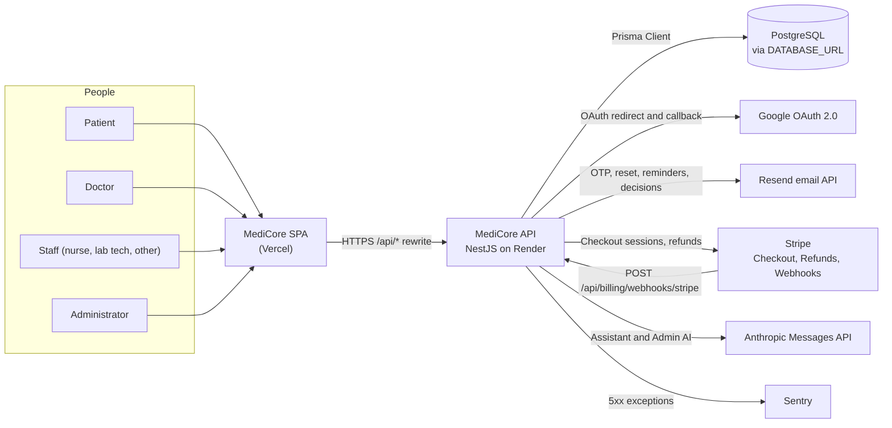

### Container and component view (C4 level 2–3)

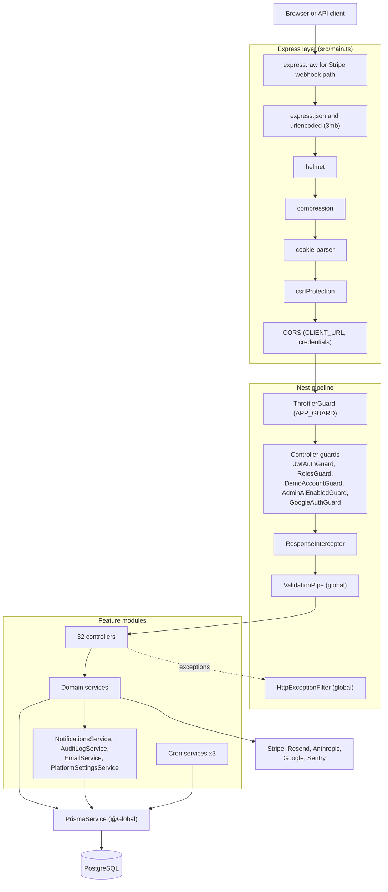

`[B]` The position of CORS in the chain reflects registration order in `main.ts` (`enableCors` is called after the `app.use(...)` calls). Preflight `OPTIONS` requests pass the CSRF middleware because it treats `OPTIONS` as a safe method.

---

## Cross-cutting components

Only components that exist in code are listed. Searches for `@Cron`, `ScheduleModule`, `EventEmitter`, `APP_GUARD`, `APP_FILTER`, `APP_INTERCEPTOR`, `APP_PIPE`, `useGlobal*`, `app.use`, `NestMiddleware`, `@Catch`, `@Throttle`, `@SkipThrottle` and `@Public` were run across `src/`.

| Kind | Name | Scope / registration | Source | Status |
| --- | --- | --- | --- | --- |
| Express middleware | `express.raw({ type: 'application/json' })` | Only `/api/billing/webhooks/stripe` | `src/main.ts` `bootstrap()` | IMPLEMENTED |
| Express middleware | `express.json({ limit: '3mb' })`, `express.urlencoded({ limit: '3mb' })` | All routes (Nest body parser disabled with `bodyParser: false`) | `src/main.ts` | IMPLEMENTED |
| Express middleware | `helmet()`, `compression()`, `cookieParser()` | All routes | `src/main.ts` | IMPLEMENTED |
| Express middleware | `csrfProtection` | All routes; enforces `X-HMS-CSRF: 1` on non-GET/HEAD/OPTIONS requests that carry `hms_at` or `hms_rt` cookies | `src/common/middleware/csrf.middleware.ts` | IMPLEMENTED |
| CORS | `app.enableCors({ origin: clientUrl, credentials: true })` | Single origin from `CLIENT_URL` | `src/main.ts` | IMPLEMENTED |
| Global prefix | `app.setGlobalPrefix('api')` | All controllers | `src/main.ts` | IMPLEMENTED |
| Global guard | `ThrottlerGuard` via `APP_GUARD`; default 120 requests / 60 s per IP | All routes, **disabled when `NODE_ENV=test`** | `src/app.module.ts` | IMPLEMENTED |
| Route guard | `JwtAuthGuard` (extends `AuthGuard('jwt')`) + approval check | Per controller via `@UseGuards` | `src/auth/guards/jwt-auth.guard.ts` | IMPLEMENTED |
| Route guard | `RolesGuard` reading `@Roles(...)` | Per controller | `src/common/guards/roles.guard.ts` | IMPLEMENTED |
| Route guard | `GoogleAuthGuard` (extends `AuthGuard('google')`, OAuth `state` cookie) | `GET /auth/google`, `GET /auth/google/callback` | `src/auth/guards/google-auth.guard.ts` | IMPLEMENTED |
| Route guard | `DemoAccountGuard` (blocks shared demo logins when `DEMO_MODE=true`) | Mutating `/users/me*` routes | `src/demo/demo-account.guard.ts` | IMPLEMENTED |
| Route guard | `AdminAiEnabledGuard` (404 when Admin AI disabled) | `AdminAiController` | `src/admin-ai/admin-ai-enabled.guard.ts` | IMPLEMENTED |
| Global pipe | `ValidationPipe({ whitelist, forbidNonWhitelisted, transform })` | All DTO-typed params | `src/main.ts` | IMPLEMENTED |
| Global interceptor | `ResponseInterceptor` → `{ success: true, message: 'Request successful', data }` | All handlers that return a value (not `@Res()` handlers) | `src/common/interceptors/response.interceptor.ts` | IMPLEMENTED |
| Global filter | `HttpExceptionFilter` (`@Catch()` everything) → `{ success: false, message, errors }`; logs; Sentry for 5xx | All routes | `src/common/filters/http-exception.filter.ts` | IMPLEMENTED |
| Decorators | `@Roles(...)`, `@CurrentUser()`, `@AllowUnapproved()` | — | `src/common/decorators/` | IMPLEMENTED |
| Decorator | `@Public()` | — | — | **NOT FOUND** (public routes are simply controllers without `@UseGuards`) |
| Cron | `AppointmentRemindersService.handleDueReminders`, `InvoiceRemindersService.handleOverdueInvoices`, `TaskRemindersService.handleDueTasks` | `CronExpression.EVERY_10_MINUTES` each | see [Background processing](#background-processing) | IMPLEMENTED |
| Event emitter / queues / workers | — | — | — | **NOT FOUND** |
| `APP_FILTER`, `APP_INTERCEPTOR`, `APP_PIPE`, `NestMiddleware` classes | — | — | — | **NOT FOUND** (globals are registered imperatively in `main.ts`) |
| Shutdown hooks | `app.enableShutdownHooks()`; `PrismaService.onModuleDestroy` disconnects | Process | `src/main.ts`, `src/prisma/prisma.service.ts` | IMPLEMENTED |

### Guard and strategy relationships

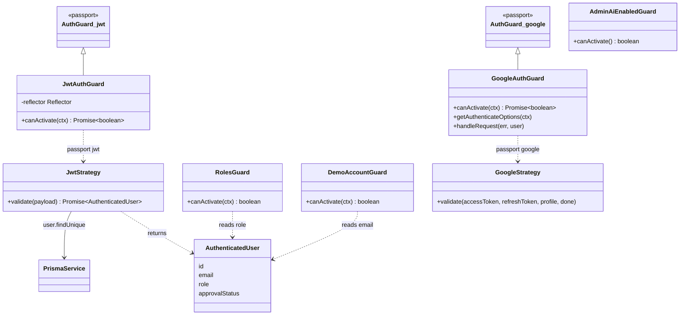

---

## Request lifecycle and data flow

### Normal request

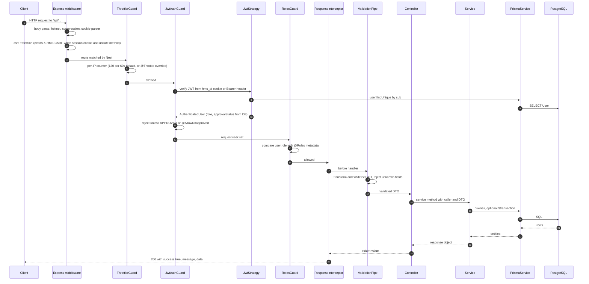

### Error path

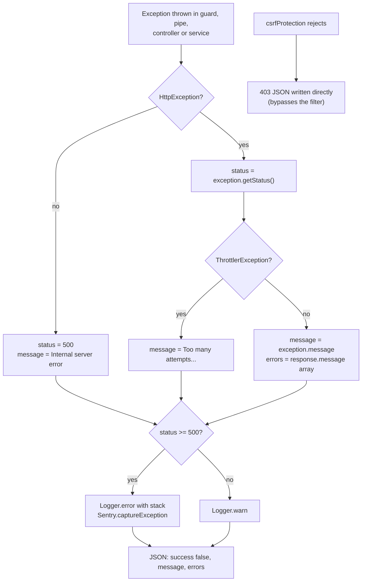

Notes:

- Validation failures from `ValidationPipe` become `400` with each constraint message in `errors`.
- Prisma errors that services do not translate (for example an unexpected `P2002`) reach the filter as non-HTTP errors and become `500`. Services translate the expected ones: `P2034` (serialization failure) → `409`, `P2025` (conditional update missed) → `409`, `P2002` (unique constraint) → `409`.
- Handlers that use `@Res()` without `passthrough` bypass `ResponseInterceptor`: `AuthController.googleCallback` (redirect) and `AdminAiController.sendMessage` (Server-Sent Events).

### Data flow example — patient books an appointment

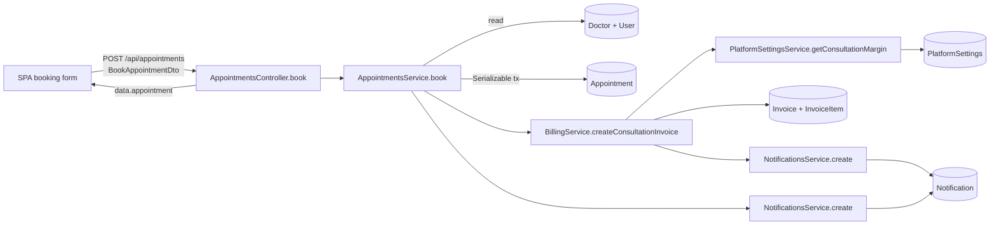

The full sequence, with the transaction boundary, is in [Appointment booking](#appointment-booking).

---

## Authentication and authorization

### Mechanisms

| Concern | Implementation | Source | Status |
| --- | --- | --- | --- |
| Local signup | `POST /auth/signup` creates `User` (+ `Doctor` and `Department` upsert for doctors) in one `$transaction`; email OTP sent afterwards | `AuthService.signupLocal` | IMPLEMENTED |
| Email verification | 6-digit OTP, bcrypt-hashed, 10-minute expiry, 5 attempts, 60 s resend cooldown, attempt claimed atomically with `updateMany` | `AuthService.verifyOtp`, `resendOtp`, `generateAndSendOtp` | IMPLEMENTED |
| Local login | bcrypt verify (constant-time dummy hash for unknown emails), account lockout after 10 failures for 15 minutes, lazy re-hash, role in request must match stored role, email must be verified | `AuthService.loginLocal`, `registerFailedLogin` | IMPLEMENTED |
| MFA (TOTP) | Opt-in; setup → confirm (8 bcrypt-hashed backup codes) → challenge JWT (`purpose: 'mfa-challenge'`, 5 min, single-use `jti` stored as `User.mfaChallengeId`), 5 wrong codes → 15-minute MFA lock | `MfaService` | IMPLEMENTED |
| Google OAuth | Passport `google` strategy, scopes `email profile`, `prompt=select_account`, CSRF-style `state` nonce in `hms_oauth_state` cookie (path `/api/auth/google`, 10 min, SameSite Lax), first login creates a `PATIENT` user with `emailVerified: true` | `GoogleStrategy`, `GoogleAuthGuard`, `AuthService.validateGoogleUser`, `AuthController.googleCallback` | IMPLEMENTED |
| Access token | JWT signed with `JWT_SECRET`, expiry `JWT_EXPIRES_IN` (default `15m`); payload `sub`, `email`, `role`, `tokenVersion` | `AuthService.issueAccessToken`, `AuthModule` | IMPLEMENTED |
| Refresh token | JWT signed with `JWT_REFRESH_SECRET` (falls back to `JWT_SECRET`), expiry `JWT_REFRESH_EXPIRES_IN` (default `7d`), payload `purpose: 'refresh'` | `AuthService.issueTokens`, `refreshSession` | IMPLEMENTED |
| Token transport | httpOnly cookies `hms_at` (path `/api`) and `hms_rt` (path `/api/auth`); `Secure` in production or when `COOKIE_SAMESITE=none`; `SameSite` from `COOKIE_SAMESITE` (default `lax`). Tokens are never returned in response bodies. Bearer header accepted by `JwtStrategy` | `src/auth/auth-cookies.ts`, `JwtStrategy` | IMPLEMENTED |
| Revocation | `User.tokenVersion` incremented on logout, password reset and password change; `JwtStrategy.validate` and `refreshSession` reject mismatches | `AuthService.logout`, `resetPassword`, `UsersService.setPassword` | IMPLEMENTED |
| Per-request re-validation | `JwtStrategy.validate` loads the user on every request, so role and approval changes apply immediately; tokens with any `purpose` are rejected as access tokens | `src/auth/strategies/jwt.strategy.ts` | IMPLEMENTED |
| Approval gate | `JwtAuthGuard` refuses users whose `approvalStatus` is not `APPROVED` (403) unless the handler or class has `@AllowUnapproved()` (only `UsersController`) | `src/auth/guards/jwt-auth.guard.ts` | IMPLEMENTED |
| RBAC | Roles `ADMIN`, `DOCTOR`, `PATIENT`, `STAFF` (Prisma enum). `@Roles` metadata on class, overridable per handler (`getAllAndOverride`) | `src/common/guards/roles.guard.ts`, `src/common/decorators/roles.decorator.ts` | IMPLEMENTED |
| Sub-role permissions | `STAFF` callers checked by `Staff.staffType` inside services: `LAB_TECHNICIAN` for laboratory (`LaboratoryService.requireLabAccess`), `NURSE` for emergency (`EmergencyService.hasResponderAccess`) | services | IMPLEMENTED |
| Data scoping | Doctors limited to patients with an `Appointment` or `ChatMessage` relationship | `src/common/doctor-patient.ts` (`doctorPatientIds`, `doctorHasPatient`), `PatientsService`, `BillingService`, `LaboratoryService`, `BedsService`, `AppointmentsService.findAllForAdmin` | IMPLEMENTED |
| Admin self-registration | Blocked at signup (`ForbiddenException`) and in role selection | `AuthService.signupLocal`, `UsersService.selectRole` | IMPLEMENTED |
| Fine-grained permission table | — | — | **NOT FOUND** (authorization is role + service logic only) |

### Local login with optional MFA

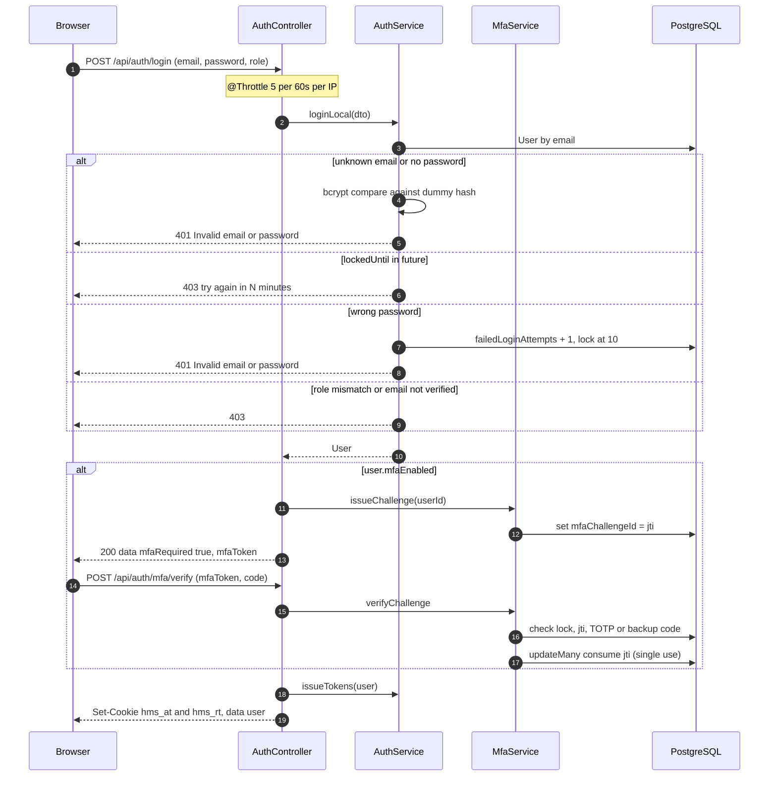

### Google OAuth

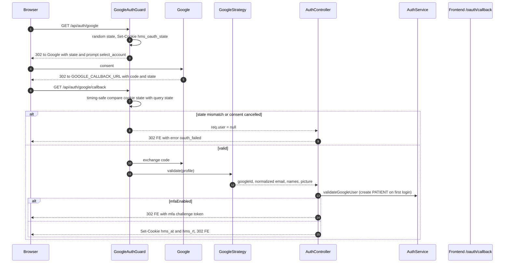

### Session refresh, logout and unauthorized requests

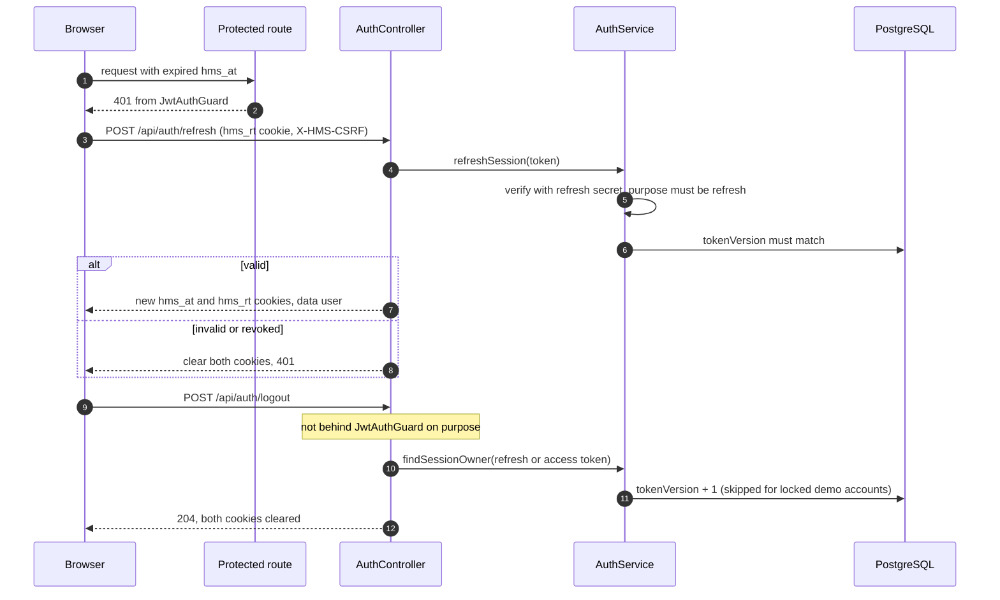

Unauthorized outcomes: missing/invalid/expired token → `401` (Passport); revoked token → `401 Session has been revoked`; unapproved account → `403`; wrong role → `403 Forbidden resource` (Nest default for a `false` guard); missing CSRF header with session cookie → `403 Missing CSRF header`; throttled → `429`.

---

## Module architecture

### Module dependency graph (domain modules)

Built from the real `imports` arrays. `AppModule` imports every module below and is omitted to keep the graph readable. `PrismaModule` and `AuditLogModule` are `@Global()` and available everywhere without an import edge. `ConfigModule` is global (`isGlobal: true`).

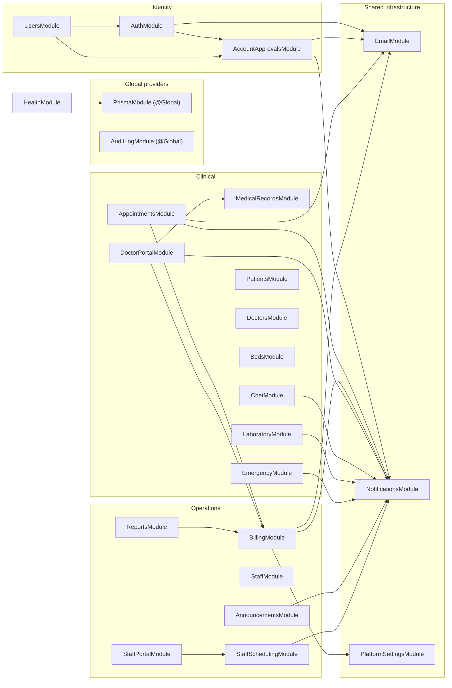

Modules with no `imports` (they rely on the global Prisma and audit providers): `PatientsModule`, `DoctorsModule`, `BedsModule`, `MedicalRecordsModule`, `StaffModule`, `NotificationsModule`, `PlatformSettingsModule`, `EmailModule`, `AuditLogModule`, `PrismaModule`.

**Circular dependencies:** none. `forwardRef` does not appear in `src/`, and the graph above is acyclic.

### AI module fan-out

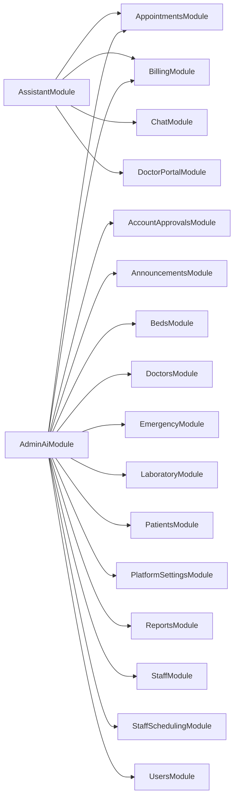

### Module catalogue

"Endpoints" counts HTTP routes. Prisma models are the main ones each module's services read or write.

| Module | Controllers | Providers | Imports | Main Prisma models | Integrations | Endpoints | Status |
| --- | --- | --- | --- | --- | --- | --- | --- |
| `PrismaModule` (`@Global`) | — | `PrismaService` | — | all | PostgreSQL | 0 | IMPLEMENTED |
| `AuditLogModule` (`@Global`) | — | `AuditLogService` | — | `AuditLog` | — | 0 | IMPLEMENTED |
| `EmailModule` | — | `EmailService` | — | — | Resend | 0 | IMPLEMENTED |
| `HealthModule` | `HealthController` | — | `PrismaModule` | raw `SELECT 1` | — | 1 | IMPLEMENTED |
| `AuthModule` | `AuthController` | `AuthService`, `MfaService`, `GoogleStrategy`, `JwtStrategy` | `PassportModule`, `EmailModule`, `AccountApprovalsModule`, `JwtModule.registerAsync` | `User`, `Doctor`, `Department` | Google OAuth, Resend | 11 | IMPLEMENTED |
| `UsersModule` | `UsersController` | `UsersService` | `AuthModule`, `AccountApprovalsModule` | `User`, `Bed` | — | 8 | IMPLEMENTED |
| `AccountApprovalsModule` | `AccountApprovalsController` | `AccountApprovalsService` | `NotificationsModule`, `EmailModule` | `User`, `Doctor` | Resend | 2 | IMPLEMENTED |
| `PatientsModule` | `PatientsController` | `PatientsService` | — | `User`, `Doctor`, `Appointment`, `ChatMessage` | — | 3 | IMPLEMENTED |
| `DoctorsModule` | `DoctorsController`, `PublicDoctorsController` | `DoctorsService` | — | `Doctor`, `User`, `Department` | — | 2 | IMPLEMENTED |
| `DoctorPortalModule` | `DoctorPortalController` | `DoctorPortalService` | `NotificationsModule`, `MedicalRecordsModule`, `BillingModule` | `Doctor`, `Department`, `Appointment`, `ChatMessage`, `MedicalRecord` | — | 11 | IMPLEMENTED |
| `AppointmentsModule` | `AppointmentsController` | `AppointmentsService`, `AppointmentRemindersService` | `NotificationsModule`, `EmailModule`, `BillingModule` | `Appointment`, `Doctor`, `User` | Resend (reminders) | 5 | IMPLEMENTED |
| `ChatModule` | `ChatController` | `ChatService` | `NotificationsModule` | `ChatMessage`, `Doctor`, `User` | — | 3 | IMPLEMENTED |
| `MedicalRecordsModule` | `MedicalRecordsController` | `MedicalRecordsService` | — | `MedicalRecord`, `Prescription`, `Appointment` | — | 1 | IMPLEMENTED |
| `BedsModule` | `BedsController` | `BedsService` | — | `Bed`, `User`, `Doctor` | — | 3 | IMPLEMENTED |
| `BillingModule` | `BillingController`, `StripeWebhookController` | `BillingService`, `StripeService`, `InvoiceRemindersService` | `NotificationsModule`, `EmailModule`, `PlatformSettingsModule` | `Invoice`, `InvoiceItem`, `Payment`, `Refund`, `User`, `Doctor`, `Appointment`, `ChatMessage` | Stripe, Resend | 11 | IMPLEMENTED |
| `NotificationsModule` | `NotificationsController` | `NotificationsService` | — | `Notification` | — | 3 | IMPLEMENTED |
| `LaboratoryModule` | `LaboratoryController` | `LaboratoryService` | `NotificationsModule` | `LabTest`, `Doctor`, `User`, `Staff`, `Appointment`, `ChatMessage` | — | 3 | IMPLEMENTED |
| `ReportsModule` | `ReportsController` | `ReportsService` | `BillingModule` | `Appointment`, `Invoice` (via `BillingService`) | — | 3 | IMPLEMENTED |
| `StaffModule` | `StaffController` (`src/staff`) | `StaffService` (`src/staff`) | — | `User`, `Doctor`, `Department` | — | 2 | IMPLEMENTED |
| `StaffSchedulingModule` | 8 controllers (staff, shifts, templates, availability, attendance, shift-openings, shift-applications, tasks) | 8 services + `TaskRemindersService` | `NotificationsModule` | `Staff`, `StaffShift`, `ShiftTemplate`, `StaffAvailability`, `StaffLeave`, `Attendance`, `ShiftOpening`, `ShiftApplication`, `Task`, `Department`, `User` | — | 32 | IMPLEMENTED |
| `StaffPortalModule` | `StaffPortalController` | `StaffPortalService` | `StaffSchedulingModule` | `Staff`, `StaffShift`, `ShiftOpening`, `ShiftApplication`, `Task` | — | 8 | IMPLEMENTED |
| `AnnouncementsModule` | `AnnouncementsController` | `AnnouncementsService` | `NotificationsModule` | `Announcement`, `Staff` | — | 2 | IMPLEMENTED |
| `PlatformSettingsModule` | `PlatformSettingsController` | `PlatformSettingsService` | — | `PlatformSettings` | — | 2 | IMPLEMENTED |
| `EmergencyModule` | `EmergencyController` | `EmergencyService` | `NotificationsModule` | `EmergencyCase`, `EmergencyNote`, `User`, `Doctor`, `Staff`, `AuditLog` (timeline) | — | 13 | IMPLEMENTED |
| `AssistantModule` | `AssistantController` | `AssistantService` | `AppointmentsModule`, `BillingModule`, `ChatModule`, `DoctorPortalModule` | via imported services | Anthropic | 1 | IMPLEMENTED (needs `ANTHROPIC_API_KEY`, else 503) |
| `AdminAiModule` | `AdminAiController` | orchestrator, gateway, registry, dispatcher, policy, store, metrics, proposals, 15 domain tool providers | 14 domain modules (see fan-out) | `AiConversation`, `AiMessage`, `AiRun`, `AiToolInvocation`, `AiActionProposal`, `AiFeedback` + domain models via tools | Anthropic | 14 | PARTIALLY IMPLEMENTED (off unless `ADMIN_AI_ENABLED`; writes off unless `AI_ENABLE_WRITES`; RAG reported `false`) |

Two classes named `StaffController` and two named `StaffService` exist: `src/staff/` (admin account provisioning for doctor/staff logins, route `/staff`) and `src/staff-scheduling/` (scheduling roster, route `/staff-scheduling/staff`). They are distinct Nest providers.

### Admin AI Copilot (summary)

`src/admin-ai` is documented in depth in [`../../docs/ai/AI_ARCHITECTURE.md`](../../docs/ai/AI_ARCHITECTURE.md) and [`../../docs/ai/AI_SECURITY_PLAN.md`](../../docs/ai/AI_SECURITY_PLAN.md). In brief, from the code:

- **Entry:** `AdminAiController` (`/api/admin-ai/*`), guarded by `AdminAiEnabledGuard` (404 when disabled), `JwtAuthGuard`, `RolesGuard` with `@Roles(Role.ADMIN)`.
- **Core:** `AiOrchestratorService` (`prepare` then `execute`, streamed to the client as Server-Sent Events over the POST response with a 15 s heartbeat), `ModelGatewayService` with an Anthropic adapter (`providers/adapters/anthropic.provider.ts`), `ToolRegistryService`, `ToolDispatcherService`, `AiPolicyService`, `phi-masker.ts`.
- **Tools:** 15 domain tool files in `src/admin-ai/domain-tools/` (appointments, approvals, announcements, beds, billing, dashboard, doctors, emergency, laboratory, patients, profile, reports, scheduling, settings, staff).
- **Writes:** never executed directly by the model. Write tools create an `AiActionProposal` that an admin approves (`POST /admin-ai/proposals/:id/approve` with a `paramsHash`) or rejects.
- **Persistence and metrics:** `AiStoreService` (one `$transaction` in `persistence/ai-store.service.ts`), `AiMetricsService` (`GET /admin-ai/usage`).
- **Configuration:** `src/admin-ai/admin-ai.config.ts`, every flag defaulting to the safe value.

---

## Database architecture

> Source of truth: [`database/api/schema.prisma`](../../database/api/schema.prisma) (1356 lines, **34 models, 29 enums**). Everything below is taken from that file, the migrations folder, `backend/api/src/prisma/`, `backend/api/package.json`, `render.yaml` and `.github/workflows/ci.yml`. Labels used: **[A]** existing implementation, **[B]** inferred from code, **[C]** missing or undocumented, **[D]** recommendation (never implemented).

### Prisma configuration

| Item | Value | Source | Status |
|---|---|---|---|
| Generator | `prisma-client-js` | `schema.prisma` lines 1-4 | IMPLEMENTED [A] |
| Client output | `../../backend/api/node_modules/.prisma/client` (relative to the schema), so the client is generated into the API's `node_modules` and imported as `@prisma/client` | `schema.prisma` line 3; `prisma.service.ts` | IMPLEMENTED [A] |
| Datasource | `provider = "postgresql"`, `url = env("DATABASE_URL")` | `schema.prisma` lines 6-9 | IMPLEMENTED [A] |
| `directUrl` / `shadowDatabaseUrl` | **Not defined.** Migrations and runtime queries both use `DATABASE_URL` | `schema.prisma` | NOT FOUND [C] |
| `previewFeatures`, driver adapters | None. No `@prisma/adapter-*` or `@neondatabase/serverless` package | `schema.prisma`, `backend/api/package.json` | NOT FOUND |
| Prisma versions | `prisma` ^6.0.0 (dev), `@prisma/client` ^6.0.0 | `backend/api/package.json` | IMPLEMENTED [A] |
| Table and column naming | No `@map` or `@@map` anywhere. Tables and columns use the Prisma model and field names verbatim (PascalCase tables, camelCase columns, quoted in SQL, for example `"Invoice"`) | `schema.prisma`; raw SQL in `billing/invoice-lock.ts` | IMPLEMENTED [A] |
| IDs | Every model uses `String @id @default(cuid())`, except `PlatformSettings.id` (plain `String @id`, no default; the app uses the single row id `"default"`) | `schema.prisma` | IMPLEMENTED [A] |

The schema lives outside the backend package, in `database/api/`, so every Prisma CLI call passes `--schema=../../database/api/schema.prisma`.

**npm scripts** (`backend/api/package.json`):

| Script | Command | Used by |
|---|---|---|
| `build` | `prisma generate --schema=../../database/api/schema.prisma && nest build` | Render `buildCommand`, CI |
| `prisma:generate` | `prisma generate --schema=...` | local |
| `prisma:migrate` | `prisma migrate dev --schema=...` | local development (creates new migrations) |
| `prisma:deploy` | `prisma migrate deploy --schema=...` | manual deploy of pending migrations |
| `prisma:studio` | `prisma studio --schema=...` | local inspection |
| `db:seed:beds` / `db:seed:demo` | `ts-node scripts/seed-beds.ts` / `scripts/seed-demo.ts` | manual seeding. There is no `prisma.seed` config, so `prisma db seed` is not wired |

**Migration workflow** [A]:

1. Development: edit `schema.prisma`, then `npm run prisma:migrate` creates `database/api/migrations/<timestamp>_<name>/migration.sql`.
2. CI (`.github/workflows/ci.yml`, backend job): `npx prisma generate`, then lint and unit tests, then `npx prisma migrate deploy` against a local Postgres service container, then `npm run test:e2e`, then `npm run build`.
3. Production (Render, `render.yaml`): `buildCommand: npm install --include=dev && npm run build`; `startCommand: npx prisma migrate deploy --schema=../../database/api/schema.prisma && node dist/main`. Pending migrations are applied on every boot, before the app starts listening.
4. `docs/DEPLOYMENT.md` forbids `prisma db push` and `migrate reset` against production.

**Migrations folder** (`database/api/migrations/`): one directory per migration, each holding a single `migration.sql`, plus `migration_lock.toml` (`provider = "postgresql"`, the standard "do not edit" header). There are **47 migrations**:

| # | Migration | # | Migration |
|---|---|---|---|
| 1 | `20260806171944_init` | 25 | `20260823122313_add_task_overdue_notified_at` |
| 2 | `20260806192240_add_role_selected` | 26 | `20260824120000_merge_lab_staff_into_staff_role` |
| 3 | `20260806205300_add_local_auth` | 27 | `20260829182648_add_staff_email_unique` |
| 4 | `20260807102434_add_doctor_directory_appointments_chat` | 28 | `20260829220352_add_invoice_stripe_checkout_session` |
| 5 | `20260808212839_add_beds_and_invoices` | 29 | `20260830105322_add_user_mfa` |
| 6 | `20260810201628_add_email_otp_verification` | 30 | `20260830172318_add_doctor_consultation_fee` |
| 7 | `20260810204217_cascade_doctor_deletion` | 31 | `20260831082024_add_invoice_payments_and_discounts` |
| 8 | `20260810215138_add_notifications` | 32 | `20260831091018_add_appointment_fee_snapshot_and_duration` |
| 9 | `20260812211120_add_token_version` | 33 | `20260831103813_add_billing_notification_types` |
| 10 | `20260813020000_add_departments_medical_records_prescriptions_audit_logs` | 34 | `20260831202954_add_profile_fields` |
| 11 | `20260813030000_add_medical_record_notification_type` | 35 | `20260906130000_add_appointment_indexes_and_bed_patient_unique` |
| 12 | `20260814181556_add_staff_roles` | 36 | `20260910084155_add_doctor_social_links_and_chat_images` |
| 13 | `20260814184211_add_laboratory_module` | 37 | `20260915191006_add_login_lockout_fields` |
| 14 | `20260814185313_add_pharmacy_module` | 38 | `20260916090444_split_emergency_contact` |
| 15 | `20260814195516_add_user_phone` | 39 | `20260916090715_drop_old_emergency_contact` |
| 16 | `20260815160437_remove_receptionist_role` | 40 | `20260916142554_add_refunds_and_reminders` |
| 17 | `20260815190542_remove_pharmacy_module` | 41 | `20260917202521_add_chatmessage_invoice_indexes` |
| 18 | `20260818070315_add_shifts_module` | 42 | `20260919034520_add_platform_settings` |
| 19 | `20260819093300_add_staff_scheduling` | 43 | `20260922204219_add_emergency_response_system` |
| 20 | `20260819101108_add_shift_templates_availability_attendance` | 44 | `20261016120000_payment_intent_unique` |
| 21 | `20260819104610_add_shift_notification_types` | 45 | `20261016150000_add_account_approval` |
| 22 | `20260821194410_add_invoice_items_and_appointment_reminders` | 46 | `20261116120000_mfa_guard_and_opening_local_time` |
| 23 | `20260822103939_add_password_reset` | 47 | `20261117183437_admin_ai_copilot` |
| 24 | `20260823115935_add_staff_portal` | | |

Migrations 14 and 17 add and then remove a pharmacy module. No pharmacy model exists in the current schema.

**`PrismaService`** (`backend/api/src/prisma/prisma.service.ts`) [A]: `PrismaService extends PrismaClient` and implements `OnModuleInit` / `OnModuleDestroy`. `onModuleInit()` calls `this.$connect()` and logs `Connected to the database`. `onModuleDestroy()` calls `this.$disconnect()`. The constructor passes no options (no `datasources` override, no `log` config), so the client reads `DATABASE_URL` from the environment. `PrismaModule` (`prisma.module.ts`) is `@Global()` and provides and exports `PrismaService`, so every feature module injects it without importing the module.

### Entity reference (all 34 models)

| # | Model | Domain | Responsibility | Key fields | Relations (FK -> target) |
|---|---|---|---|---|---|
| 1 | `User` | Identity and auth | Every login account (all four roles); patient profile fields; auth, OTP, password-reset, lockout and MFA state | `id`, `email` UK, `googleId` UK, `password`, `role`, `approvalStatus`, `tokenVersion`, `mfaEnabled` | Parent of 28 FK relations. 1:0..1 with `Doctor` and `Staff` |
| 2 | `Department` | Appointments and doctors | Ward or specialty | `id`, `name` UK | 1:N `Doctor`, `Bed`, `Staff`, `StaffShift`, `ShiftOpening`, `Task` |
| 3 | `Doctor` | Appointments and doctors | Doctor profile for a DOCTOR user | `userId` UK, `departmentId`, `specialization`, `consultationFee`, `isAvailable` | `userId` -> User; `departmentId` -> Department |
| 4 | `Appointment` | Appointments and doctors | Booked consultation | `patientId`, `doctorId`, `scheduledAt`, `mode`, `status`, `consultationFee` (snapshot), `reminderSentAt` | -> User (patient), -> Doctor; 1:0..1 `MedicalRecord`, `Invoice` |
| 5 | `ChatMessage` | Communication | Patient to doctor message | `patientId`, `doctorId`, `sender`, `body`, `imageUrl` | -> User, -> Doctor |
| 6 | `Bed` | Beds, lab, emergency | Bed and its current occupant | `label`, `status`, `departmentId`, `patientId` UK | -> Department; -> User (optional) |
| 7 | `Invoice` | Billing | Patient invoice | `invoiceNumber` UK autoincrement, `amount`, `discount`, `tax`, `status`, `dueDate`, `stripeCheckoutSessionId` UK, `appointmentId` UK | -> User (patient); -> Appointment (optional, 1:1) |
| 8 | `InvoiceItem` | Billing | Invoice line | `invoiceId`, `quantity`, `unitPrice`, `discount` | -> Invoice |
| 9 | `Payment` | Billing | Full or partial payment | `invoiceId`, `amount`, `method`, `stripePaymentIntentId` UK, `recordedById` | -> Invoice; -> User (optional, "PaymentsRecorded") |
| 10 | `Refund` | Billing | Reversal of a payment | `paymentId`, `amount`, `stripeRefundId` UK, `refundedById` | -> Payment; -> User (optional, "RefundsIssued") |
| 11 | `Notification` | Communication | In-app notification | `userId`, `type`, `title`, `isRead` | -> User |
| 12 | `MedicalRecord` | Patients and clinical | Clinical note | `patientId`, `doctorId`, `appointmentId` UK, `diagnosis`, `notes` | -> User, -> Doctor, -> Appointment (optional, 1:1) |
| 13 | `Prescription` | Patients and clinical | Medication on a record | `medicalRecordId`, `medicationName`, `dosage`, `durationDays` | -> MedicalRecord |
| 14 | `LabTest` | Beds, lab, emergency | Lab order and result | `patientId`, `doctorId`, `assignedToId`, `category`, `status`, `resultSummary` | -> User ("LabTestPatient"), -> Doctor, -> User (optional, "LabTestAssignee") |
| 15 | `Staff` | Staff and scheduling | Schedulable roster entry | `staffType`, `fullName`, `email` UK, `userId` UK, `isActive` | -> User (optional, 1:1); -> Department (optional) |
| 16 | `StaffShift` | Staff and scheduling | Assigned shift for one person | `staffId`, `date`, `startTime`, `endTime`, `shiftType`, `status`, `groupId` | -> Staff, -> Department (opt.), -> User (opt., "StaffShiftCreatedBy"); 1:0..1 `Attendance`, `ShiftApplication` |
| 17 | `ShiftOpening` | Staff and scheduling | Posted shift opportunity | `requiredStaffType`, `date`, `positions`, `applicationDeadline`, `isOpen`, `localStartTime` | -> Department (opt.), -> User (opt., "ShiftOpeningCreatedBy") |
| 18 | `ShiftApplication` | Staff and scheduling | Application to an opening | (`openingId`, `staffId`) UK, `status`, `resultingShiftId` UK | -> ShiftOpening, -> Staff, -> User (opt., "ShiftApplicationRespondedBy"), -> StaffShift (opt., 1:1) |
| 19 | `Task` | Staff and scheduling | Task assigned to a staff member | `title`, `dueAt`, `priority`, `status`, `assignedToId`, `reminderSentAt`, `overdueNotifiedAt` | -> Staff, -> Department (opt.), -> User (opt., "TaskAssignedBy") |
| 20 | `Announcement` | Communication | Hospital-wide announcement | `title`, `description`, `priority`, `authorId` | -> User (optional) |
| 21 | `ShiftTemplate` | Staff and scheduling | Reusable shift time preset | `name` UK, `shiftType`, `startTime`, `endTime` (HH:mm strings) | none (standalone) |
| 22 | `StaffAvailability` | Staff and scheduling | Weekly availability, one row per day | (`staffId`, `dayOfWeek`) UK, `isAvailable`, `availableFrom`, `availableTo` | -> Staff |
| 23 | `StaffLeave` | Staff and scheduling | Leave date | (`staffId`, `date`) UK, `reason` | -> Staff |
| 24 | `Attendance` | Staff and scheduling | Attendance for one shift | `shiftId` UK, `staffId`, `status`, `checkIn`, `checkOut` | -> StaffShift (1:1), -> Staff |
| 25 | `AuditLog` | Platform | Append-only change trail; also the emergency timeline source | `actorId`, `action`, `entityType`, `entityId`, `metadata` | -> User (optional) |
| 26 | `PlatformSettings` | Platform | Single-row billing settings | `id` (`"default"`), `consultationMargin` | none (standalone) |
| 27 | `EmergencyCase` | Beds, lab, emergency | Patient emergency request and its lifecycle | `patientId`, `emergencyType`, `priority`, `status`, `locationShared`, lifecycle actor ids and timestamps | -> User x4 (patient, acknowledgedBy, assignedBy, resolvedBy), -> Doctor (opt.), -> Staff (opt.) |
| 28 | `EmergencyNote` | Beds, lab, emergency | Responder note on a case | `caseId`, `authorId`, `body` | -> EmergencyCase, -> User (optional) |
| 29 | `AiConversation` | Admin AI | Copilot conversation | `userId`, `title`, `activeModule` | -> User ("AiConversationOwner") |
| 30 | `AiMessage` | Admin AI | Conversation message | `conversationId`, `role`, `content`, `runId` (plain column, no relation) | -> AiConversation |
| 31 | `AiRun` | Admin AI | One model run with telemetry | (`userId`, `requestKey`) UK, `status`, `provider`, `model`, token counts | -> AiConversation, -> User ("AiRunUser") |
| 32 | `AiToolInvocation` | Admin AI | Tool call telemetry (argument names only) | `runId`, `toolName`, `domain`, `status`, `argKeys` | -> AiRun |
| 33 | `AiActionProposal` | Admin AI | State-changing action awaiting admin approval | `actionType`, `params`, `paramsHash`, `status`, `expiresAt`, `decidedById` | -> AiConversation, -> AiRun (opt.), -> User ("AiProposalRequester"), -> User (opt., "AiProposalDecider") |
| 34 | `AiFeedback` | Admin AI | Thumbs up or down on a message | (`messageId`, `userId`) UK, `rating`, `comment` | -> AiMessage, -> User ("AiFeedbackUser") |

There are **no implicit many-to-many relations and no explicit join tables**. Every relation is a 1:N or 1:0..1 with a scalar FK. `ShiftApplication` sits between `ShiftOpening` and `Staff`, but it carries its own state, so it is an entity rather than a pure join table.

#### Enums (29)

| Enum | Values | Used by |
|---|---|---|
| `Role` | ADMIN, DOCTOR, PATIENT, STAFF | `User.role` |
| `ApprovalStatus` | PENDING, APPROVED, REJECTED | `User.approvalStatus` |
| `AppointmentMode` | ONLINE, IN_PERSON | `Appointment.mode` |
| `AppointmentStatus` | SCHEDULED, COMPLETED, CANCELLED | `Appointment.status` |
| `ChatSender` | PATIENT, DOCTOR | `ChatMessage.sender` |
| `BedStatus` | AVAILABLE, OCCUPIED, MAINTENANCE | `Bed.status` |
| `InvoiceStatus` | PENDING, PARTIALLY_PAID, PAID, CANCELLED | `Invoice.status` |
| `PaymentMethod` | CASH, CARD, BANK_TRANSFER, OTHER | `Payment.method` |
| `NotificationType` | APPOINTMENT_BOOKED, APPOINTMENT_CANCELLED, APPOINTMENT_REMINDER, CHAT_MESSAGE, MEDICAL_RECORD_ADDED, LAB_RESULT_READY, SHIFT_SCHEDULED, SHIFT_UPDATED, SHIFT_CANCELLED, SHIFT_APPLICATION_APPROVED, SHIFT_APPLICATION_REJECTED, TASK_ASSIGNED, TASK_DUE_SOON, TASK_OVERDUE, ANNOUNCEMENT_PUBLISHED, INVOICE_CREATED, PAYMENT_RECEIVED, PAYMENT_REFUNDED, INVOICE_OVERDUE, EMERGENCY_CREATED, EMERGENCY_ACKNOWLEDGED, EMERGENCY_TEAM_ASSIGNED, EMERGENCY_STATUS_UPDATED, EMERGENCY_RESOLVED, EMERGENCY_CANCELLED, ACCOUNT_APPROVAL_REQUESTED, ACCOUNT_APPROVED, ACCOUNT_REJECTED (28 values) | `Notification.type` |
| `LabTestCategory` | HEMATOLOGY, BIOCHEMISTRY, MICROBIOLOGY, RADIOLOGY, PATHOLOGY | `LabTest.category` |
| `LabTestStatus` | PENDING, IN_PROGRESS, COMPLETED | `LabTest.status` |
| `StaffType` | DOCTOR, NURSE, RECEPTIONIST, PHARMACIST, LAB_TECHNICIAN, OTHER | `Staff.staffType`, `ShiftOpening.requiredStaffType` |
| `ShiftType` | MORNING, EVENING, NIGHT, CUSTOM | `StaffShift`, `ShiftOpening`, `ShiftTemplate` |
| `ShiftStatus` | SCHEDULED, CONFIRMED, IN_PROGRESS, COMPLETED, CANCELLED, ABSENT | `StaffShift.status` |
| `ApplicationStatus` | PENDING, APPROVED, REJECTED, WITHDRAWN | `ShiftApplication.status` |
| `TaskPriority` | LOW, MEDIUM, HIGH, URGENT | `Task.priority` |
| `TaskStatus` | PENDING, IN_PROGRESS, COMPLETED | `Task.status` |
| `AnnouncementPriority` | NORMAL, IMPORTANT, URGENT | `Announcement.priority` |
| `DayOfWeek` | MONDAY, TUESDAY, WEDNESDAY, THURSDAY, FRIDAY, SATURDAY, SUNDAY | `StaffAvailability.dayOfWeek` |
| `AttendanceStatus` | SCHEDULED, PRESENT, LATE, ABSENT, LEAVE | `Attendance.status` |
| `AuditAction` | CREATE, UPDATE, DELETE, VIEW | `AuditLog.action` |
| `EmergencyType` | MEDICAL, ACCIDENT_INJURY, BREATHING_DIFFICULTY, CHEST_RELATED, UNCONSCIOUS_PERSON, SEVERE_BLEEDING, OTHER | `EmergencyCase.emergencyType` |
| `EmergencyPriority` | CRITICAL, HIGH, NORMAL | `EmergencyCase.priority` |
| `EmergencyStatus` | NEW, ACKNOWLEDGED, TEAM_ASSIGNED, RESPONDING, ARRIVED, RESOLVED, CANCELLED | `EmergencyCase.status` |
| `AiMessageRole` | USER, ASSISTANT | `AiMessage.role` |
| `AiRunStatus` | RUNNING, SUCCEEDED, FAILED, CANCELLED, BUDGET_EXCEEDED | `AiRun.status` |
| `AiToolStatus` | SUCCEEDED, FAILED, DENIED, INVALID | `AiToolInvocation.status` |
| `AiProposalStatus` | PENDING, EXECUTING, EXECUTED, FAILED, REJECTED, EXPIRED | `AiActionProposal.status` |
| `AiFeedbackRating` | UP, DOWN | `AiFeedback.rating` |

Derived, not stored [A]: invoice "overdue" (from `status` + `dueDate`) and task "overdue" (from `dueAt` vs now). The emergency case timeline is read from `AuditLog` rows where `entityType = "EmergencyCase"` (per schema comments).

### Domain ER diagrams

Notation: `||--o{` required parent with zero or more children; `|o--o{` optional FK (the child may have no parent); `||--o|` required unique FK (1 to 0..1); `|o--o|` optional unique FK. In each diagram, entities that belong to another domain are shown as stubs carrying only `id`. `Float` is the actual Prisma type of every money field. Arrays (`String[]`) are shown as `String` with "array" in the comment.

#### 1. Identity and auth

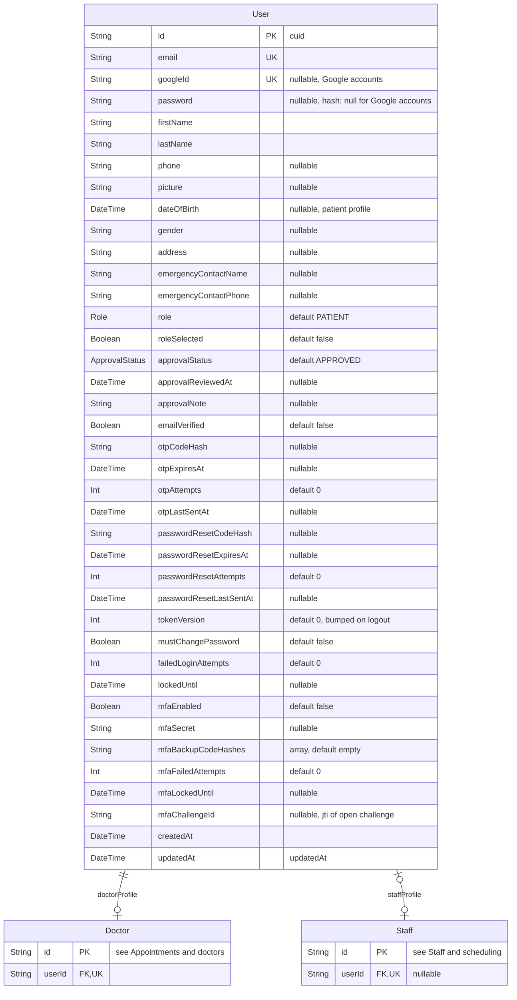

`User` is the FK target of 28 relations in total. The other 26 appear in the domain diagrams below.

#### 2. Patients and clinical

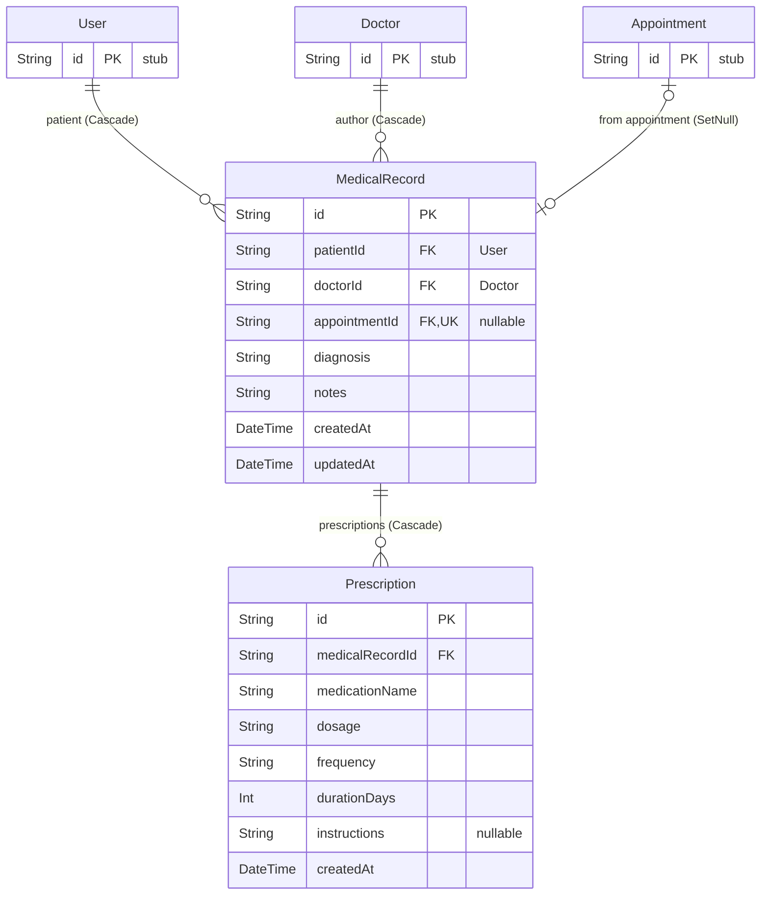

Patients have no table of their own. A patient is a `User` with `role = PATIENT`, and the patient profile fields are on `User` (see the schema comment on `User.dateOfBirth`). Lab tests are in diagram 5.

#### 3. Appointments and doctors

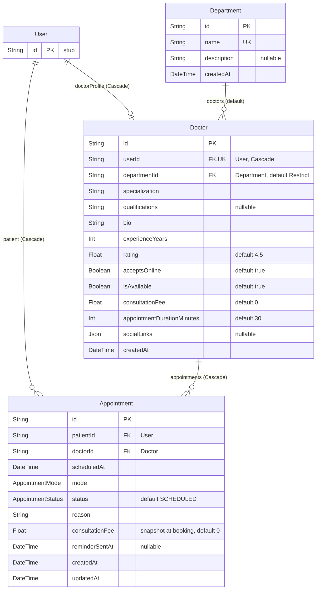

`Appointment` is also the optional 1:1 parent of `MedicalRecord` (diagram 2) and `Invoice` (diagram 4).

#### 4. Billing

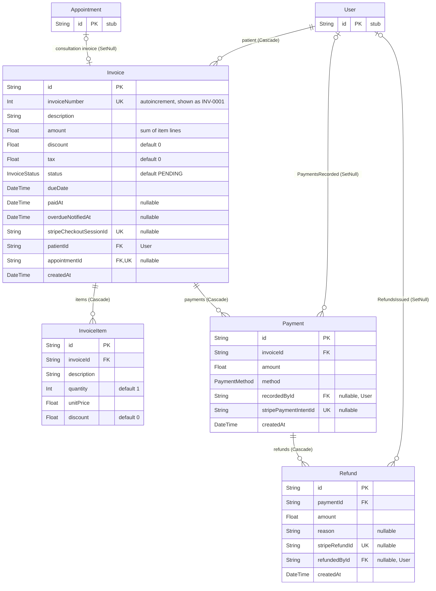

`PlatformSettings.consultationMargin` (diagram 9) is added to consultation invoices at creation time. There is no FK between them.

#### 5. Beds, laboratory and emergency

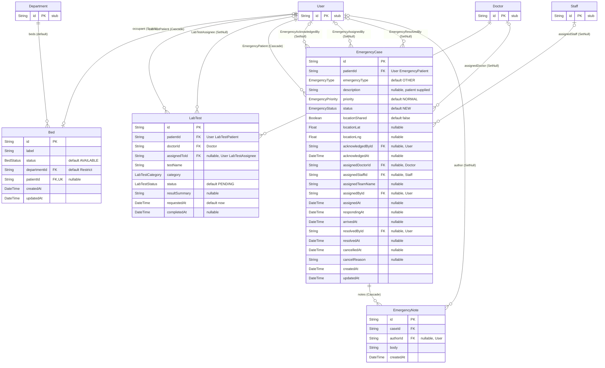

#### 6. Staff roster, availability and tasks

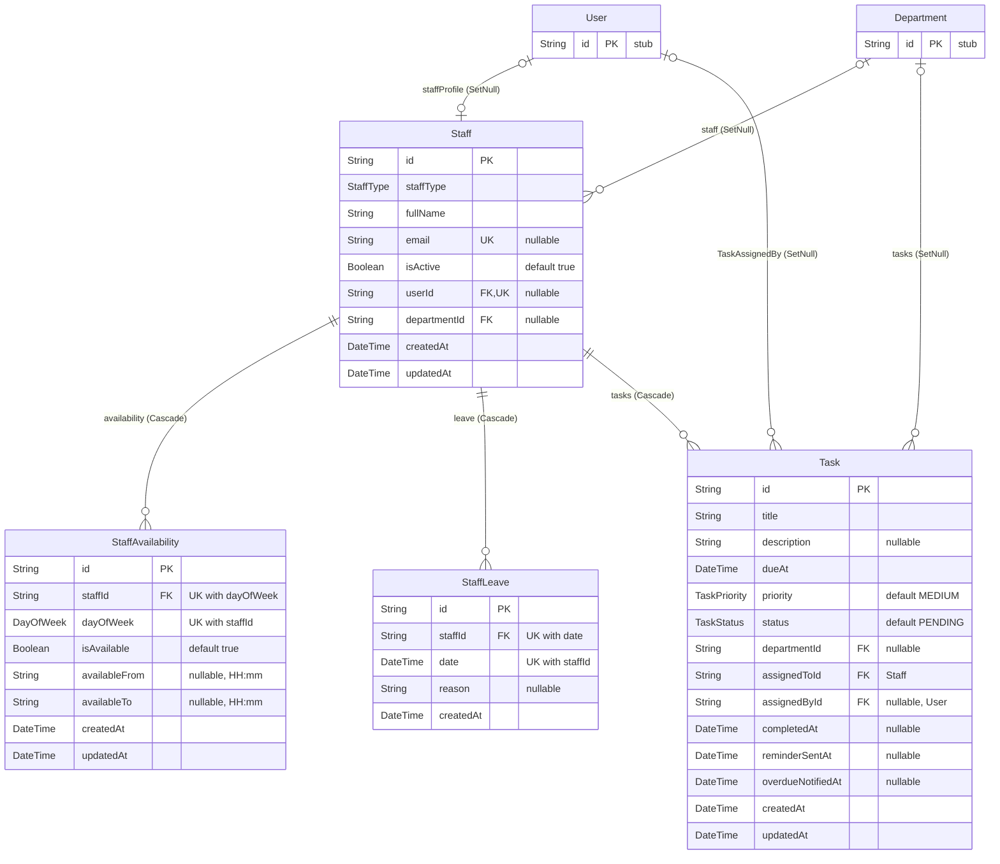

#### 7. Shifts, openings and attendance

```mermaid
erDiagram
    StaffShift {
        String id PK
        String staffId FK
        String departmentId FK "nullable"
        DateTime date
        DateTime startTime
        DateTime endTime
        ShiftType shiftType
        ShiftStatus status "default SCHEDULED"
        String notes "nullable"
        String groupId "nullable, groups multi-person shifts, no FK"
        String createdById FK "nullable, User"
        DateTime createdAt
        DateTime updatedAt
    }
    ShiftOpening {
        String id PK
        StaffType requiredStaffType
        String departmentId FK "nullable"
        DateTime date
        DateTime startTime
        String localStartTime "nullable, HH:mm local"
        DateTime endTime
        ShiftType shiftType
        Int positions "default 1"
        DateTime applicationDeadline
        String notes "nullable"
        Boolean isOpen "default true"
        String createdById FK "nullable, User"
        DateTime createdAt
        DateTime updatedAt
    }
    ShiftApplication {
        String id PK
        String openingId FK "UK with staffId"
        String staffId FK "UK with openingId"
        ApplicationStatus status "default PENDING"
        String message "nullable"
        String adminNotes "nullable"
        String respondedById FK "nullable, User"
        DateTime respondedAt "nullable"
        String resultingShiftId FK, UK "nullable"
        DateTime appliedAt "default now"
        DateTime updatedAt
    }
    Attendance {
        String id PK
        String shiftId FK, UK
        String staffId FK
        AttendanceStatus status "default SCHEDULED"
        DateTime checkIn "nullable"
        DateTime checkOut "nullable"
        String notes "nullable"
        DateTime createdAt
        DateTime updatedAt
    }
    ShiftTemplate {
        String id PK
        String name UK
        ShiftType shiftType
        String startTime "HH:mm"
        String endTime "HH:mm"
        String description "nullable"
        DateTime createdAt
        DateTime updatedAt
    }
    Staff {
        String id PK "stub"
    }
    Department {
        String id PK "stub"
    }
    User {
        String id PK "stub"
    }
    Staff ||--o{ StaffShift : "shifts (Cascade)"
    Department |o--o{ StaffShift : "shifts (SetNull)"
    User |o--o{ StaffShift : "StaffShiftCreatedBy (SetNull)"
    Department |o--o{ ShiftOpening : "openings (SetNull)"
    User |o--o{ ShiftOpening : "ShiftOpeningCreatedBy (SetNull)"
    ShiftOpening ||--o{ ShiftApplication : "applications (Cascade)"
    Staff ||--o{ ShiftApplication : "applications (Cascade)"
    User |o--o{ ShiftApplication : "ShiftApplicationRespondedBy (SetNull)"
    StaffShift |o--o| ShiftApplication : "resultingShift (SetNull)"
    StaffShift ||--o| Attendance : "attendance (Cascade)"
    Staff ||--o{ Attendance : "attendance (Cascade)"
```

`ShiftTemplate` has no relations. The schema comment states it is a frontend convenience picker that `StaffShift` does not reference.

#### 8. Communication: chat, notifications, announcements

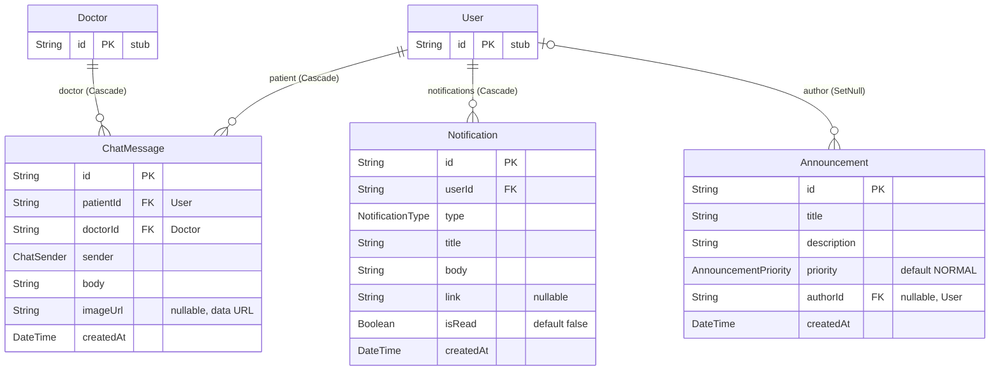

#### 9. Platform: settings, audit and approvals

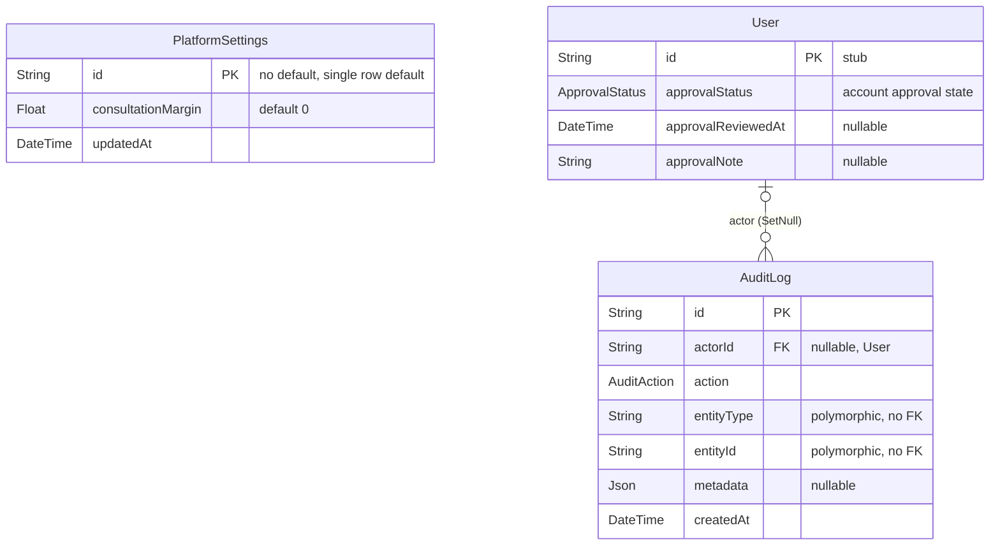

Account approval has no table of its own. It is stored in the three `User.approval*` columns (diagram 1). `AuditLog.entityType` + `entityId` form a polymorphic reference with no database FK. `AiActionProposal` (diagram 10) is the approval workflow for Admin AI actions.

#### 10. Admin AI Copilot

```mermaid
erDiagram
    AiConversation {
        String id PK
        String userId FK
        String title
        String activeModule "nullable, UI context only"
        DateTime createdAt
        DateTime updatedAt
    }
    AiMessage {
        String id PK
        String conversationId FK
        AiMessageRole role
        String content
        String runId "nullable, plain column, no FK"
        DateTime createdAt
    }
    AiRun {
        String id PK
        String conversationId FK
        String userId FK "UK with requestKey"
        String requestKey "UK with userId, idempotency key"
        AiRunStatus status "default RUNNING"
        String provider
        String model
        String promptVersion
        String activeModule "nullable"
        Int inputTokens "default 0"
        Int outputTokens "default 0"
        Int toolCalls "default 0"
        Int latencyMs "nullable"
        String errorCode "nullable"
        DateTime startedAt "default now"
        DateTime finishedAt "nullable"
    }
    AiToolInvocation {
        String id PK
        String runId FK
        String toolName
        String domain
        AiToolStatus status
        String argKeys "array, argument names only"
        Int durationMs
        String errorCode "nullable"
        DateTime createdAt
    }
    AiActionProposal {
        String id PK
        String conversationId FK
        String runId FK "nullable"
        String requestedById FK "User"
        String actionType
        Json params
        String paramsHash
        String summary
        AiProposalStatus status "default PENDING"
        DateTime expiresAt
        String decidedById FK "nullable, User"
        DateTime decidedAt "nullable"
        String decisionNote "nullable"
        DateTime executedAt "nullable"
        Json result "nullable"
        String errorMessage "nullable"
        DateTime createdAt
        DateTime updatedAt
    }
    AiFeedback {
        String id PK
        String messageId FK "UK with userId"
        String userId FK "UK with messageId"
        AiFeedbackRating rating
        String comment "nullable"
        DateTime createdAt
        DateTime updatedAt
    }
    User {
        String id PK "stub"
    }
    User ||--o{ AiConversation : "AiConversationOwner (Cascade)"
    AiConversation ||--o{ AiMessage : "messages (Cascade)"
    AiConversation ||--o{ AiRun : "runs (Cascade)"
    User ||--o{ AiRun : "AiRunUser (Cascade)"
    AiRun ||--o{ AiToolInvocation : "toolInvocations (Cascade)"
    AiConversation ||--o{ AiActionProposal : "proposals (Cascade)"
    AiRun |o--o{ AiActionProposal : "proposals (SetNull)"
    User ||--o{ AiActionProposal : "AiProposalRequester (Cascade)"
    User |o--o{ AiActionProposal : "AiProposalDecider (SetNull)"
    AiMessage ||--o{ AiFeedback : "feedback (Cascade)"
    User ||--o{ AiFeedback : "AiFeedbackUser (Cascade)"
```

#### Relationship overview (all 34 models, relationships only)

```mermaid
erDiagram
    User ||--o| Doctor : "doctorProfile"
    User |o--o| Staff : "staffProfile"
    Department ||--o{ Doctor : "doctors"
    Department ||--o{ Bed : "beds"
    Department |o--o{ Staff : "staff"
    Department |o--o{ StaffShift : "shifts"
    Department |o--o{ ShiftOpening : "openings"
    Department |o--o{ Task : "tasks"
    User ||--o{ Appointment : "patient"
    Doctor ||--o{ Appointment : "doctor"
    User ||--o{ MedicalRecord : "patient"
    Doctor ||--o{ MedicalRecord : "author"
    Appointment |o--o| MedicalRecord : "record"
    MedicalRecord ||--o{ Prescription : "prescriptions"
    User ||--o{ Invoice : "patient"
    Appointment |o--o| Invoice : "invoice"
    Invoice ||--o{ InvoiceItem : "items"
    Invoice ||--o{ Payment : "payments"
    Payment ||--o{ Refund : "refunds"
    User |o--o{ Payment : "recordedBy"
    User |o--o{ Refund : "refundedBy"
    User |o--o| Bed : "occupant"
    User ||--o{ LabTest : "patient"
    Doctor ||--o{ LabTest : "doctor"
    User |o--o{ LabTest : "assignee"
    User ||--o{ EmergencyCase : "patient"
    User |o--o{ EmergencyCase : "ack, assign, resolve"
    Doctor |o--o{ EmergencyCase : "assignedDoctor"
    Staff |o--o{ EmergencyCase : "assignedStaff"
    EmergencyCase ||--o{ EmergencyNote : "notes"
    User |o--o{ EmergencyNote : "author"
    Staff ||--o{ StaffShift : "shifts"
    User |o--o{ StaffShift : "createdBy"
    User |o--o{ ShiftOpening : "createdBy"
    ShiftOpening ||--o{ ShiftApplication : "applications"
    Staff ||--o{ ShiftApplication : "applications"
    User |o--o{ ShiftApplication : "respondedBy"
    StaffShift |o--o| ShiftApplication : "resultingShift"
    StaffShift ||--o| Attendance : "attendance"
    Staff ||--o{ Attendance : "attendance"
    Staff ||--o{ StaffAvailability : "availability"
    Staff ||--o{ StaffLeave : "leave"
    Staff ||--o{ Task : "tasks"
    User |o--o{ Task : "assignedBy"
    User ||--o{ ChatMessage : "patient"
    Doctor ||--o{ ChatMessage : "doctor"
    User ||--o{ Notification : "notifications"
    User |o--o{ Announcement : "author"
    User |o--o{ AuditLog : "actor"
    User ||--o{ AiConversation : "owner"
    AiConversation ||--o{ AiMessage : "messages"
    AiConversation ||--o{ AiRun : "runs"
    User ||--o{ AiRun : "user"
    AiRun ||--o{ AiToolInvocation : "toolInvocations"
    AiConversation ||--o{ AiActionProposal : "proposals"
    AiRun |o--o{ AiActionProposal : "proposals"
    User ||--o{ AiActionProposal : "requester"
    User |o--o{ AiActionProposal : "decider"
    AiMessage ||--o{ AiFeedback : "feedback"
    User ||--o{ AiFeedback : "user"
    ShiftTemplate {
        String id PK "standalone, no relations"
    }
    PlatformSettings {
        String id PK "standalone, no relations"
    }
```

The three optional `EmergencyCase` actor relations to `User` are collapsed into one line in the overview. `ShiftTemplate` and `PlatformSettings` have no relations. They are declared with only their PK so that they still appear.

### Data dictionary (key models)

Only fields with non-obvious semantics are listed. Types are Prisma types; "?" means nullable. The full column lists are in the diagrams above.

**`User`**

| Field | Type | Default | Meaning |
|---|---|---|---|
| `googleId` | String? UK | | Set for Google sign-in accounts |
| `password` | String? | | Password hash. Null for Google-only accounts |
| `role` | Role | PATIENT | Login role. Specific staff job is `Staff.staffType` |
| `roleSelected` | Boolean | false | Post-signup role picker completed |
| `approvalStatus` | ApprovalStatus | APPROVED | Self-registered DOCTOR/STAFF start PENDING. Enforced by `JwtAuthGuard` (per schema comment) |
| `emailVerified` | Boolean | false | Local accounts must pass OTP verification |
| `otpCodeHash` / `otpAttempts` / `otpExpiresAt` / `otpLastSentAt` | | 0 attempts | Email verification OTP state |
| `passwordResetCodeHash` / `...Attempts` / `...ExpiresAt` / `...LastSentAt` | | 0 attempts | Forgot-password code state, kept separate from the OTP fields |
| `tokenVersion` | Int | 0 | Embedded in JWTs. Incremented on logout or password reset to invalidate issued tokens |
| `mustChangePassword` | Boolean | false | Admin-provisioned temp-password accounts |
| `failedLoginAttempts` / `lockedUntil` | Int / DateTime? | 0 | Per-account login lockout |
| `mfaEnabled` / `mfaSecret` / `mfaBackupCodeHashes` | Boolean / String? / String[] | false / [] | TOTP MFA. Backup codes are hashed and single-use |
| `mfaFailedAttempts` / `mfaLockedUntil` / `mfaChallengeId` | | 0 | MFA brute-force guard. `mfaChallengeId` holds the jti of the single open challenge |

**`Doctor`**: `consultationFee` Float (default 0) is the base charge for a booking. `appointmentDurationMinutes` Int (default 30) is informational only (schema comment: no working-hours model). `socialLinks` Json? holds public links. `rating` Float (default 4.5).

**`Appointment`**: `consultationFee` Float is a snapshot of the doctor's fee at booking time. `reminderSentAt` DateTime? is stamped once by the reminder cron. `status` AppointmentStatus defaults to SCHEDULED.

**`Invoice`**

| Field | Type | Default | Meaning |
|---|---|---|---|
| `invoiceNumber` | Int UK | autoincrement() | Human-facing number (INV-0001) |
| `amount` | Float | | Sum of item lines (qty * unitPrice - item discount), recomputed server-side |
| `discount`, `tax` | Float | 0 | Invoice-level, applied after `amount` |
| `status` | InvoiceStatus | PENDING | Kept in sync with Payment rows. "Overdue" is derived |
| `stripeCheckoutSessionId` | String? UK | | Latest Checkout Session. Replaced via compare-and-swap |
| `appointmentId` | String? UK | | Set on auto-generated consultation invoices |
| `overdueNotifiedAt` | DateTime? | | One-time overdue reminder stamp |

**`Payment` / `Refund`**: the paid amount is always the sum of `Payment.amount`, and the refundable balance is `Payment.amount` minus the sum of `Refund.amount`. Neither is stored. `stripePaymentIntentId` and `stripeRefundId` are unique so that redelivered webhooks cannot double-insert. `recordedById` / `refundedById` are null for Stripe-originated rows.

**`EmergencyCase`**: `status` follows NEW, ACKNOWLEDGED, TEAM_ASSIGNED, RESPONDING, ARRIVED, then RESOLVED or CANCELLED. Each step has its own actor and timestamp column. `locationLat` / `locationLng` are only set when `locationShared` is true (explicit consent). `description` is patient-supplied only.

**`StaffShift` / `ShiftOpening` / `ShiftApplication`**: `StaffShift.groupId` (no FK) groups rows that the UI presents as one multi-person shift. `ShiftOpening.positions` caps approvals. `localStartTime` is wall-clock HH:mm, used for availability comparison. `ShiftApplication.resultingShiftId` links to the shift created on approval.

**`AiActionProposal`**: `params` Json plus `paramsHash` String are the exact payload executed on approval. `status` moves PENDING, then EXECUTING, then EXECUTED or FAILED; or PENDING to REJECTED or EXPIRED. `expiresAt` bounds approval. `result` Json? holds a small confirmation payload.

**`AiRun` / `AiToolInvocation`**: `requestKey` is a client idempotency key, unique per user. Token, tool-call and latency counters are telemetry. `AiToolInvocation.argKeys` stores argument names only, never values.

### Indexes and constraints

All entries below are copied from `schema.prisma`. There are no `@map` or `@@map` attributes, and no `onUpdate` is set on any relation.

| Model | `@unique` | `@@unique` | `@@index` | `@updatedAt` | Notable `@default`s (besides `id` cuid and `createdAt` now) |
|---|---|---|---|---|---|
| User | `googleId`, `email` | | `[role]`, `[approvalStatus]` | `updatedAt` | role PATIENT, roleSelected false, approvalStatus APPROVED, emailVerified false, otpAttempts 0, passwordResetAttempts 0, tokenVersion 0, mustChangePassword false, failedLoginAttempts 0, mfaEnabled false, mfaBackupCodeHashes [], mfaFailedAttempts 0 |
| Department | `name` | | | | |
| Doctor | `userId` | | `[departmentId]` | | rating 4.5, acceptsOnline true, isAvailable true, consultationFee 0, appointmentDurationMinutes 30 |
| Appointment | | | `[doctorId, scheduledAt]`, `[patientId]` | `updatedAt` | status SCHEDULED, consultationFee 0 |
| ChatMessage | | | `[doctorId, patientId]`, `[patientId]` | | |
| Bed | `patientId` | | `[departmentId]` | `updatedAt` | status AVAILABLE |
| Invoice | `invoiceNumber`, `stripeCheckoutSessionId`, `appointmentId` | | `[patientId]` | | invoiceNumber autoincrement(), discount 0, tax 0, status PENDING |
| InvoiceItem | | | `[invoiceId]` | | quantity 1, discount 0 (no createdAt) |
| Payment | `stripePaymentIntentId` | | `[invoiceId]` | | |
| Refund | `stripeRefundId` | | `[paymentId]` | | |
| Notification | | | `[userId, isRead]`, `[userId, createdAt]` | | isRead false |
| MedicalRecord | `appointmentId` | | `[patientId]`, `[doctorId]` | `updatedAt` | |
| Prescription | | | `[medicalRecordId]` | | |
| LabTest | | | `[patientId]`, `[doctorId]`, `[assignedToId]` | | status PENDING, requestedAt now() |
| Staff | `email`, `userId` | | `[staffType]`, `[departmentId]` | `updatedAt` | isActive true |
| StaffShift | | | `[staffId]`, `[departmentId]`, `[date]`, `[groupId]`, `[status]` | `updatedAt` | status SCHEDULED |
| ShiftOpening | | | `[date]`, `[requiredStaffType]`, `[isOpen]` | `updatedAt` | positions 1, isOpen true |
| ShiftApplication | `resultingShiftId` | `[openingId, staffId]` | `[staffId]`, `[status]` | `updatedAt` | status PENDING, appliedAt now() |
| Task | | | `[assignedToId]`, `[dueAt]`, `[status]` | `updatedAt` | priority MEDIUM, status PENDING |
| Announcement | | | `[createdAt]` | | priority NORMAL |
| ShiftTemplate | `name` | | | `updatedAt` | |
| StaffAvailability | | `[staffId, dayOfWeek]` | `[staffId]` | `updatedAt` | isAvailable true |
| StaffLeave | | `[staffId, date]` | `[staffId]`, `[date]` | | |
| Attendance | `shiftId` | | `[staffId]` | `updatedAt` | status SCHEDULED |
| AuditLog | | | `[entityType, entityId]`, `[actorId]`, `[createdAt]` | | |
| PlatformSettings | | | | `updatedAt` | `id` has **no** default; consultationMargin 0; no createdAt |
| EmergencyCase | | | `[patientId]`, `[status]`, `[priority]`, `[createdAt]`, `[assignedStaffId]`, `[assignedDoctorId]` | `updatedAt` | emergencyType OTHER, priority NORMAL, status NEW, locationShared false |
| EmergencyNote | | | `[caseId]` | | |
| AiConversation | | | `[userId, updatedAt]` | `updatedAt` | |
| AiMessage | | | `[conversationId, createdAt]` | | |
| AiRun | | `[userId, requestKey]` | `[userId, startedAt]`, `[startedAt]` | | status RUNNING, inputTokens 0, outputTokens 0, toolCalls 0, startedAt now() (no createdAt) |
| AiToolInvocation | | | `[runId]`, `[toolName, createdAt]` | | argKeys [] |
| AiActionProposal | | | `[conversationId]`, `[requestedById, status]`, `[status, expiresAt]` | `updatedAt` | status PENDING |
| AiFeedback | | `[messageId, userId]` | `[createdAt]` | `updatedAt` | |

Unique constraints that the code relies on as concurrency or idempotency backstops [B]: `Bed.patientId` (one bed per patient; `beds/beds.service.ts` maps P2002), `Payment.stripePaymentIntentId` and `Refund.stripeRefundId` (webhook dedupe; `billing/stripe.service.ts` maps P2002), `MedicalRecord.appointmentId` (`medical-records/medical-records.service.ts` maps P2002), and `AiRun[userId, requestKey]` (`admin-ai/core/ai-orchestrator.service.ts` maps P2002). The `Appointment[doctorId, scheduledAt]` index is deliberately non-unique. The schema comment explains that double-booking is prevented by a Serializable transaction instead, because a unique constraint would block re-booking a cancelled slot.

#### Referential actions (`onDelete`)

No relation sets `onUpdate`, so the Prisma default applies to all of them (`Cascade` on update). Of the 62 FK relations, 60 set `onDelete` explicitly:

| onDelete | Relations (child.field -> parent) |
|---|---|
| **Cascade** (34) | Doctor.userId -> User; Appointment.patientId -> User; Appointment.doctorId -> Doctor; ChatMessage.patientId -> User; ChatMessage.doctorId -> Doctor; Invoice.patientId -> User; InvoiceItem.invoiceId -> Invoice; Payment.invoiceId -> Invoice; Refund.paymentId -> Payment; Notification.userId -> User; MedicalRecord.patientId -> User; MedicalRecord.doctorId -> Doctor; Prescription.medicalRecordId -> MedicalRecord; LabTest.patientId -> User; LabTest.doctorId -> Doctor; StaffShift.staffId -> Staff; ShiftApplication.openingId -> ShiftOpening; ShiftApplication.staffId -> Staff; Task.assignedToId -> Staff; StaffAvailability.staffId -> Staff; StaffLeave.staffId -> Staff; Attendance.shiftId -> StaffShift; Attendance.staffId -> Staff; EmergencyCase.patientId -> User; EmergencyNote.caseId -> EmergencyCase; AiConversation.userId -> User; AiMessage.conversationId -> AiConversation; AiRun.conversationId -> AiConversation; AiRun.userId -> User; AiToolInvocation.runId -> AiRun; AiActionProposal.conversationId -> AiConversation; AiActionProposal.requestedById -> User; AiFeedback.messageId -> AiMessage; AiFeedback.userId -> User |
| **SetNull** (26) | Bed.patientId -> User; Invoice.appointmentId -> Appointment; Payment.recordedById -> User; Refund.refundedById -> User; MedicalRecord.appointmentId -> Appointment; LabTest.assignedToId -> User; Staff.userId -> User; Staff.departmentId -> Department; StaffShift.departmentId -> Department; StaffShift.createdById -> User; ShiftOpening.departmentId -> Department; ShiftOpening.createdById -> User; ShiftApplication.respondedById -> User; ShiftApplication.resultingShiftId -> StaffShift; Task.departmentId -> Department; Task.assignedById -> User; Announcement.authorId -> User; AuditLog.actorId -> User; EmergencyCase.acknowledgedById -> User; EmergencyCase.assignedDoctorId -> Doctor; EmergencyCase.assignedStaffId -> Staff; EmergencyCase.assignedById -> User; EmergencyCase.resolvedById -> User; EmergencyNote.authorId -> User; AiActionProposal.runId -> AiRun; AiActionProposal.decidedById -> User |
| **Not set (Prisma default)** (2) | Doctor.departmentId -> Department; Bed.departmentId -> Department. Both are required relations, so the Prisma default is `Restrict`: a Department cannot be deleted while doctors or beds reference it |

Count check: the Cascade row lists 34 relations and the SetNull row lists 26, which with the 2 defaults gives 62.

### Transaction patterns

All paths are under `backend/api/src/`. Raw row locks: `billing/invoice-lock.ts` `lockInvoice(tx, invoiceId)` runs `SELECT id FROM "Invoice" WHERE id = $1 FOR UPDATE` inside an interactive transaction.

**Serializable interactive transactions** (`isolationLevel: Prisma.TransactionIsolationLevel.Serializable`, 7 sites). Each catches `P2034` (serialization failure) and returns `409 Conflict`.

| File | Method | Purpose |
|---|---|---|
| `appointments/appointments.service.ts` | `book()` | Checks overlapping doctor and patient appointments, then inserts (`createAppointmentRow`), so no double-booking |
| `emergency/emergency.service.ts` | `create()` | Enforces one active emergency case per patient (`createCaseRow`) |
| `staff-scheduling/shifts.service.ts` | `create()` | Shift conflict and availability check plus insert |
| `staff-scheduling/shifts.service.ts` | `createRecurring()` | Same as `create()`, one transaction per occurrence |
| `staff-scheduling/shifts.service.ts` | `update()` (two sites) | Re-validates on time change; on unchanged times re-checks the active flag and overlaps |
| `staff-scheduling/shifts.service.ts` | `assignFromOpening()` | Conflict-checked shift creation for an approved application |

**Interactive transactions at default isolation** (Read Committed):

| File | Method | Purpose |
|---|---|---|
| `billing/billing.service.ts` | `recordPayment()` | `lockInvoice`, then balance check, Payment insert and status update |
| `billing/billing.service.ts` | `refundPayment()` | `lockInvoice`, then refundable-balance check and Refund insert. Serialises with the `charge.refunded` webhook |
| `billing/billing.service.ts` | `cancel()` | `lockInvoice`, then cancel when nothing is paid and clear the checkout session |
| `billing/billing.service.ts` | `cancelInvoiceForAppointment()` | `lockInvoice`, then cancel the linked unpaid consultation invoice |
| `billing/stripe.service.ts` | `recordCheckoutPayment()` | `lockInvoice`, then idempotently record a Checkout payment (dedupe on PaymentIntent, P2002 handled) |
| `billing/stripe.service.ts` | `syncChargeRefunds()` | `lockInvoice`, then insert Stripe refunds not yet recorded |
| `billing/stripe.service.ts` | `reverseFailedRefund()` | `lockInvoice`, then delete a failed refund row and recompute the invoice |
| `staff-scheduling/shift-applications.service.ts` | `respond()` | `SELECT ... FROM "ShiftOpening" ... FOR UPDATE`, then capacity check, CAS approval and possibly close the opening |
| `staff-scheduling/shifts.service.ts` | `remove()` | Releases the linked opening slot, then deletes the shift (order matters because of SetNull on `resultingShiftId`) |
| `auth/auth.service.ts` | `signupLocal()` | Creates the User and, for doctors, upserts the Department and creates the Doctor profile |
| `staff/staff.service.ts` | `create()` | Same pattern for admin-provisioned accounts (temp password) |
| `admin-ai/persistence/ai-store.service.ts` | `addMessage()` | Inserts the AiMessage and bumps `AiConversation.updatedAt` |

**Batch (array) transactions**:

| File | Method | Purpose |
|---|---|---|
| `users/users.service.ts` | `deleteAccount()` | Frees OCCUPIED beds held by the user, then deletes the User (which cascades, see the gaps below) |
| `staff-scheduling/shift-applications.service.ts` | `respond()` (catch branch) | Compensation: reverts the application to PENDING and reopens the opening if shift creation failed |
| `staff-scheduling/availability.service.ts` | `upsertForStaff()` | Upserts all weekday rows on `staffId_dayOfWeek` atomically |

**`updateMany` as compare-and-swap** (the WHERE clause carries the expected state, and `count === 0` means another request won; 11 sites):

| File | Method | Guarded transition |
|---|---|---|
| `billing/stripe.service.ts` | `createCheckoutSession()` | Sets `stripeCheckoutSessionId` only if it still equals the previous value. The loser expires its new session and returns 409 |
| `auth/auth.service.ts` | `verifyOtp()` | Spends an OTP attempt only while `otpAttempts < max` and the hash is unchanged |
| `auth/auth.service.ts` | `resetPassword()` (first site) | Spends a reset attempt atomically |
| `auth/auth.service.ts` | `resetPassword()` (second site) | Single-use reset: applies only if `passwordResetCodeHash` is unchanged |
| `auth/mfa.service.ts` | `verifyChallenge()` | Consumes the MFA challenge where `mfaChallengeId = jti` |
| `account-approvals/account-approvals.service.ts` | `review()` | Approval transition only from the allowed `approvalStatus` values |
| `appointments/appointment-reminders.service.ts` | `sendDueReminders()` | Claims a reminder where `reminderSentAt IS NULL` (at-most-once) |
| `staff-scheduling/shift-applications.service.ts` | `respond()` | PENDING to APPROVED, inside the locked transaction |
| `admin-ai/workflows/ai-proposal.service.ts` | `approve()` | PENDING to EXECUTING, only before `expiresAt` (single-use) |
| `admin-ai/workflows/ai-proposal.service.ts` | `reject()` | PENDING to REJECTED |
| `admin-ai/workflows/ai-proposal.service.ts` | `expireIfDue()` | PENDING to EXPIRED |

Two other `updateMany` calls are plain bulk updates, not CAS: `notifications/notifications.service.ts` `markAllRead()` and the bed release inside `users.service.ts` `deleteAccount()`.

### Neon connectivity

| Aspect | Finding | Source | Status |
|---|---|---|---|
| Connection env var | `DATABASE_URL` only. Validated as a required non-empty string at boot | `schema.prisma`; `config/env.validation.ts` | IMPLEMENTED [A] |
| Neon as production DB | Stated in deployment docs and `render.yaml` comments (external managed Postgres, "e.g. Neon"); docs say the URL should include `sslmode=require` | `render.yaml`, `docs/DEPLOYMENT.md` | Documented [B] (the actual value is not in the repo) |
| `DATABASE_URL` on Render | `sync: false` (entered in the dashboard, not committed) | `render.yaml` | IMPLEMENTED [A] |
| Migrations in production | `prisma migrate deploy` runs in the Render `startCommand` using the same `DATABASE_URL` | `render.yaml` | IMPLEMENTED [A] |
| Pooled vs direct URL | No `directUrl` in the datasource; no `pgbouncer=true` or `connection_limit` handling in code | `schema.prisma`, `src/` | NOT FOUND [C] |
| Driver | Standard Prisma query engine over TCP. No Neon serverless driver or adapter | `package.json` | [A] |
| Connection lifecycle | Eager `$connect()` in `onModuleInit`, `$disconnect()` in `onModuleDestroy` | `prisma/prisma.service.ts` | IMPLEMENTED [A] |
| Health check | `GET /api/health` runs `SELECT 1` via `$queryRaw` and returns 503 on failure. Render `healthCheckPath: /api/health` | `health/health.controller.ts`, `render.yaml` | IMPLEMENTED [A] |
| Other environments | Local: `backend/api/.env.example` (local Postgres URL template). E2E: `test/setup-e2e.ts` loads `backend/api/.env.test`. CI: Postgres service container with `DATABASE_URL` set in the workflow | as listed | IMPLEMENTED [A] |
| Backups | Docs reference Neon point-in-time restore and branching before risky migrations (manual process) | `docs/DEPLOYMENT.md` | Documented, not automated |

### Known gaps

#### Observations [C] (the current state, with no change implied)

1. **FK columns without an index.** Postgres does not index FK columns automatically. These FKs have no `@@index`, and no `@unique` or composite index has them as its leftmost column:
   - `AiRun.conversationId`, which is filtered by `ai-store.service.ts` `hasActiveRun()` (`where: { conversationId, status, startedAt }`) on each run.
   - `ShiftOpening.departmentId`, `Task.departmentId`.
   - Actor and audit columns: `Payment.recordedById`, `Refund.refundedById`, `StaffShift.createdById`, `ShiftOpening.createdById`, `ShiftApplication.respondedById`, `Task.assignedById`, `Announcement.authorId`, `EmergencyCase.acknowledgedById` / `assignedById` / `resolvedById`, `EmergencyNote.authorId`, `AiActionProposal.runId` / `decidedById`, `AiFeedback.userId`.

   Every one of these is a SetNull or Cascade target of `User` or `AiRun`. Deleting a parent row therefore scans each of these tables.
2. **Redundant indexes.** `StaffAvailability @@index([staffId])` and `StaffLeave @@index([staffId])` duplicate the leftmost column of their `@@unique([staffId, ...])`.
3. **`AiMessage.runId` is not a relation.** It is a plain `String?` with no FK and no index, so the database does not enforce referential integrity to `AiRun`.
4. **Money is `Float`** (`Invoice.amount/discount/tax`, `InvoiceItem.unitPrice/discount`, `Payment.amount`, `Refund.amount`, `Doctor.consultationFee`, `Appointment.consultationFee`, `PlatformSettings.consultationMargin`). No field uses `Decimal`. The code uses tolerance comparisons such as `amountPaid > 0.01` in `billing.service.ts` `cancel()`.
5. **Cascade breadth from `User`.** Deleting a User (`users.service.ts` `deleteAccount()`) cascades to that patient's Appointments, Invoices (and their Payments, Refunds and items), MedicalRecords (and Prescriptions), LabTests, EmergencyCases (and notes), ChatMessages, Notifications and Admin AI data. Deleting a Doctor cascades their Appointments, MedicalRecords, LabTests and ChatMessages. `AuditLog` survives because it uses SetNull.
6. **Polymorphic references.** `AuditLog.entityType/entityId` and `StaffShift.groupId` have no FK enforcement, by design.
7. **No `directUrl`.** Runtime and `migrate deploy` share one URL. If that URL is a Neon pooled (PgBouncer) endpoint, Prisma Migrate's advisory locking would run through the pooler. The repo does not show which endpoint type is configured.
8. **Not every model has timestamps.** There is no `createdAt` on `AiRun` (it uses `startedAt`), `InvoiceItem` or `PlatformSettings`. There is no `updatedAt` on `Department`, `Doctor`, `Invoice`, `Payment`, `Refund`, `ChatMessage`, `Notification`, `LabTest`, `Prescription`, `Announcement`, `StaffLeave`, `EmergencyNote`, `AuditLog`, `AiMessage` or `AiToolInvocation`.
9. **Two nullable unique columns rely on Postgres NULL semantics.** `Staff.email` and `Bed.patientId` allow many NULLs (the schema comment on `Bed.patientId` states this). This is correct behaviour and is noted for clarity.

#### Recommendations [D] (not implemented)

- Add `@@index([conversationId])` (or `[conversationId, status]`) on `AiRun`, and consider indexes on `ShiftOpening.departmentId` and `Task.departmentId` if department filters are used on those lists.
- Consider indexes on the actor FKs, or accept the cost of the SetNull scan when a user is deleted, which is rare.
- Consider dropping the two redundant `[staffId]` indexes.
- Consider making `AiMessage.runId` a real relation with `onDelete: SetNull`.
- Consider `Decimal` for money columns. This needs a data migration and code changes.
- For Neon, consider adding `directUrl = env("DIRECT_URL")` (unpooled) for migrations if the runtime URL is pooled.
- Consider soft-delete or anonymisation for users with clinical or financial history instead of a hard cascade delete.

---

## REST API reference

### Conventions

- **Base path:** every route below is served under `/api` (global prefix). No versioning.
- **Envelope:** success `{ success: true, message: 'Request successful', data }`; error `{ success: false, message, errors[] }`.
- **AuthN column:** `Public` = no auth guard. `JWT` = `JwtAuthGuard` (approved accounts only unless noted). `+Demo` = `DemoAccountGuard`. `+AIEnabled` = `AdminAiEnabledGuard`.
- **AuthZ column:** roles from `@Roles` (handler overrides class). "Any role" = authenticated, any role.
- **Throttle:** every route has the global limit of 120 requests / 60 s per IP (off when `NODE_ENV=test`) unless an override is shown (for example `T5` = 5 / 60 s).
- **CSRF:** every non-GET route called with session cookies must send `X-HMS-CSRF: 1`.
- **DTO column:** request DTO class. `—` = none. Raw `@Query('x')` strings are listed as `query: x` (not validated by a DTO class).

### Endpoint count

| Module | Controller(s) | Endpoints |
| --- | --- | ---: |
| Health | `HealthController` | 1 |
| Auth | `AuthController` | 11 |
| Users | `UsersController` | 8 |
| Account approvals | `AccountApprovalsController` | 2 |
| Patients | `PatientsController` | 3 |
| Doctors | `DoctorsController`, `PublicDoctorsController` | 2 |
| Doctor portal | `DoctorPortalController` | 11 |
| Appointments | `AppointmentsController` | 5 |
| Chat | `ChatController` | 3 |
| Medical records | `MedicalRecordsController` | 1 |
| Beds | `BedsController` | 3 |
| Billing | `BillingController`, `StripeWebhookController` | 11 |
| Notifications | `NotificationsController` | 3 |
| Laboratory | `LaboratoryController` | 3 |
| Reports | `ReportsController` | 3 |
| Staff | `StaffController` (`src/staff`) | 2 |
| Staff scheduling | 8 controllers | 32 |
| Staff portal | `StaffPortalController` | 8 |
| Announcements | `AnnouncementsController` | 2 |
| Platform settings | `PlatformSettingsController` | 2 |
| Emergency | `EmergencyController` | 13 |
| Assistant | `AssistantController` | 1 |
| Admin AI | `AdminAiController` | 14 |
| **Total** | **32 controllers** | **144** |

Not counted: the Swagger UI and JSON at `/api/docs`, mounted by `SwaggerModule.setup('api/docs', ...)` only when `NODE_ENV !== 'production'`.

### Feature → controller → service → model (clinical)

```mermaid
flowchart LR
  subgraph F1["Features"]
    FBook["Booking"]
    FDoc["Doctor workspace"]
    FChat["Patient chat"]
    FLab["Laboratory"]
    FEm["Emergency"]
    FBed["Beds"]
  end
  subgraph C1["Controllers"]
    CAppt["AppointmentsController"]
    CDP["DoctorPortalController"]
    CChat["ChatController"]
    CLab["LaboratoryController"]
    CEm["EmergencyController"]
    CBed["BedsController"]
  end
  subgraph S1["Services"]
    SAppt["AppointmentsService"]
    SDP["DoctorPortalService"]
    SMed["MedicalRecordsService"]
    SChat["ChatService"]
    SLab["LaboratoryService"]
    SEm["EmergencyService"]
    SBed["BedsService"]
  end
  subgraph M1["Prisma models"]
    MAppt[("Appointment")]
    MDoc[("Doctor")]
    MMsg[("ChatMessage")]
    MRec[("MedicalRecord")]
    MLab[("LabTest")]
    MEm[("EmergencyCase")]
    MBed[("Bed")]
  end
  PG[("PostgreSQL")]

  FBook --> CAppt --> SAppt --> MAppt
  FDoc --> CDP --> SDP --> MDoc
  SDP --> SMed --> MRec
  SDP --> MMsg
  FChat --> CChat --> SChat --> MMsg
  FLab --> CLab --> SLab --> MLab
  FEm --> CEm --> SEm --> MEm
  FBed --> CBed --> SBed --> MBed
  MAppt --> PG
  MDoc --> PG
  MMsg --> PG
  MRec --> PG
  MLab --> PG
  MEm --> PG
  MBed --> PG
```

### Feature → controller → service → model (operations)

```mermaid
flowchart LR
  subgraph F2["Features"]
    FBill["Billing"]
    FPay["Online payment"]
    FSched["Scheduling"]
    FPortal["Staff self-service"]
    FAppr["Account approvals"]
    FAnn["Announcements"]
  end
  subgraph C2["Controllers"]
    CBill["BillingController"]
    CHook["StripeWebhookController"]
    CShift["ShiftsController and 7 more"]
    CSP["StaffPortalController"]
    CAppr["AccountApprovalsController"]
    CAnn["AnnouncementsController"]
  end
  subgraph S2["Services"]
    SBill["BillingService"]
    SStripe["StripeService"]
    SShift["ShiftsService, ShiftApplicationsService,<br/>TasksService and others"]
    SAppr["AccountApprovalsService"]
    SAnn["AnnouncementsService"]
  end
  subgraph M2["Prisma models"]
    MInv[("Invoice, InvoiceItem,<br/>Payment, Refund")]
    MShift[("StaffShift, ShiftOpening,<br/>ShiftApplication, Task")]
    MUser[("User")]
    MAnn[("Announcement")]
  end
  PG2[("PostgreSQL")]

  FBill --> CBill --> SBill --> MInv
  FPay --> CBill
  SBill --> SStripe
  CHook --> SStripe --> MInv
  FSched --> CShift --> SShift --> MShift
  FPortal --> CSP --> SShift
  FAppr --> CAppr --> SAppr --> MUser
  FAnn --> CAnn --> SAnn --> MAnn
  MInv --> PG2
  MShift --> PG2
  MUser --> PG2
  MAnn --> PG2
```

### Health — `src/health/health.controller.ts`

| Method | Path | Controller → Service | AuthN | AuthZ | DTO | Main models |
| --- | --- | --- | --- | --- | --- | --- |
| GET | `/api/health` | `HealthController.check` → `PrismaService.$queryRaw` (`SELECT 1`) | Public | — | — | none (503 if DB unreachable) |

### Auth — `src/auth/auth.controller.ts`

| Method | Path | Controller → Service | AuthN | AuthZ | DTO | Main models |
| --- | --- | --- | --- | --- | --- | --- |
| POST | `/api/auth/signup` | `signup` → `AuthService.signupLocal` | Public, T5 | — | `SignupDto` | `User`, `Doctor`, `Department` |
| POST | `/api/auth/verify-otp` | `verifyOtp` → `AuthService.verifyOtp` (+ `AccountApprovalsService.notifyAdminsOfRequest`) | Public, T5 | — | `VerifyOtpDto` | `User`, `Notification` |
| POST | `/api/auth/resend-otp` | `resendOtp` → `AuthService.resendOtp` | Public, T3 | — | `ResendOtpDto` | `User` |
| POST | `/api/auth/login` | `login` → `AuthService.loginLocal`, `MfaService.issueChallenge` | Public, T5 | role in body must match stored role | `LoginDto` | `User` |
| POST | `/api/auth/mfa/verify` | `verifyMfa` → `MfaService.verifyChallenge` | Public (challenge token), T5 | — | `MfaVerifyDto` | `User` |
| POST | `/api/auth/refresh` | `refresh` → `AuthService.refreshSession` | Refresh cookie, T30 | — | — | `User` |
| POST | `/api/auth/forgot-password` | `forgotPassword` → `AuthService.requestPasswordReset` | Public, T3 | — | `ForgotPasswordDto` | `User` |
| POST | `/api/auth/reset-password` | `resetPassword` → `AuthService.resetPassword` | Public, T5 | — | `ResetPasswordDto` | `User` |
| POST | `/api/auth/logout` | `logout` → `AuthService.findSessionOwner`, `logout` | Cookie or Bearer (no guard) | — | — | `User` |
| GET | `/api/auth/google` | `googleLogin` (guard redirects) | `GoogleAuthGuard` | — | — | — |
| GET | `/api/auth/google/callback` | `googleCallback` → `AuthService.validateGoogleUser`, `issueTokens` / `MfaService.issueChallenge` | `GoogleAuthGuard` (state check) | — | — | `User` |

### Users — `src/users/users.controller.ts`

Class: `@UseGuards(JwtAuthGuard)`, `@AllowUnapproved()` (reachable while approval is pending).

| Method | Path | Controller → Service | AuthN | AuthZ | DTO | Main models |
| --- | --- | --- | --- | --- | --- | --- |
| GET | `/api/users/me` | `getProfile` → `UsersService.findById` | JWT (unapproved allowed) | Any role | — | `User` |
| PATCH | `/api/users/me` | `updateProfile` → `UsersService.updateProfile` | JWT +Demo | Any role | `UpdateProfileDto` | `User` |
| PATCH | `/api/users/me/role` | `selectRole` → `UsersService.selectRole` | JWT +Demo | Any role (one-time, not admin) | `SelectRoleDto` | `User`, `Notification` |
| PATCH | `/api/users/me/password` | `setPassword` → `UsersService.setPassword`, `AuthService.issueTokens` | JWT +Demo | Any role | `SetPasswordDto` | `User` |
| DELETE | `/api/users/me` | `deleteAccount` → `UsersService.deleteAccount` | JWT +Demo | Any role | — | `Bed`, `User` (cascade) |
| POST | `/api/users/me/mfa/setup` | `setupMfa` → `MfaService.startSetup` | JWT +Demo | Any role | — | `User` |
| POST | `/api/users/me/mfa/confirm` | `confirmMfa` → `MfaService.confirmSetup` | JWT +Demo | Any role | `MfaConfirmDto` | `User` |
| POST | `/api/users/me/mfa/disable` | `disableMfa` → `MfaService.disable` | JWT +Demo | Any role | `MfaDisableDto` | `User` |

### Account approvals — `src/account-approvals/account-approvals.controller.ts`

| Method | Path | Controller → Service | AuthN | AuthZ | DTO | Main models |
| --- | --- | --- | --- | --- | --- | --- |
| GET | `/api/account-approvals` | `list` → `AccountApprovalsService.list` | JWT | ADMIN | `ListAccountRequestsDto` (query) | `User`, `Doctor` |
| PATCH | `/api/account-approvals/:userId` | `review` → `AccountApprovalsService.review` | JWT | ADMIN | `ReviewAccountDto` | `User`, `AuditLog`, `Notification` |

### Patients — `src/patients/patients.controller.ts`

| Method | Path | Controller → Service | AuthN | AuthZ | DTO | Main models |
| --- | --- | --- | --- | --- | --- | --- |
| GET | `/api/patients` | `findAll` → `PatientsService.findAll` | JWT | ADMIN, DOCTOR (doctor scoped) | — | `User`, `Doctor`, `Appointment`, `ChatMessage` |
| GET | `/api/patients/:id` | `findOne` → `PatientsService.findOne` | JWT | ADMIN, DOCTOR (doctor scoped) | — | `User`, `Appointment` |
| POST | `/api/patients` | `create` → `PatientsService.create` | JWT | ADMIN | `CreatePatientDto` | `User` |

### Doctors — `src/doctors/doctors.controller.ts`, `src/doctors/public-doctors.controller.ts`

| Method | Path | Controller → Service | AuthN | AuthZ | DTO | Main models |
| --- | --- | --- | --- | --- | --- | --- |
| GET | `/api/doctors` | `DoctorsController.findAll` → `DoctorsService.listDoctors` | JWT | Any role | `ListDoctorsDto` (query) | `Doctor`, `User`, `Department` |
| GET | `/api/public/doctors/:id` | `PublicDoctorsController.findOne` → `DoctorsService.getPublicProfile` | Public | — | — | `Doctor`, `User`, `Department` |

### Doctor portal — `src/doctor-portal/doctor-portal.controller.ts`

Class: `@Roles(Role.DOCTOR)`.

| Method | Path | Controller → Service | AuthN | AuthZ | DTO | Main models |
| --- | --- | --- | --- | --- | --- | --- |
| GET | `/api/doctor-portal/profile` | `getProfile` → `DoctorPortalService.getProfile` | JWT | DOCTOR | — | `Doctor` |
| PUT | `/api/doctor-portal/profile` | `upsertProfile` → `DoctorPortalService.upsertProfile` | JWT | DOCTOR | `DoctorProfileDto` | `Doctor`, `Department`, `AuditLog` |
| PATCH | `/api/doctor-portal/availability` | `setAvailability` → `DoctorPortalService.setAvailability` | JWT | DOCTOR | `DoctorAvailabilityDto` | `Doctor` |
| GET | `/api/doctor-portal/appointments` | `listAppointments` → `DoctorPortalService.listAppointments` | JWT | DOCTOR | — | `Appointment` |
| PATCH | `/api/doctor-portal/appointments/:id/cancel` | `cancelAppointment` → `DoctorPortalService.cancelAppointment` (+ `BillingService.cancelInvoiceForAppointment`) | JWT | DOCTOR (own) | — | `Appointment`, `Invoice`, `Notification` |
| PATCH | `/api/doctor-portal/appointments/:id/complete` | `completeAppointment` → `DoctorPortalService.completeAppointment` | JWT | DOCTOR (own) | — | `Appointment` |
| GET | `/api/doctor-portal/chat` | `listInbox` → `DoctorPortalService.listInboxPatients` | JWT | DOCTOR | — | `ChatMessage` |
| GET | `/api/doctor-portal/chat/:patientId` | `getThread` → `DoctorPortalService.getThread` | JWT | DOCTOR (relationship) | query: `before` | `ChatMessage` |
| POST | `/api/doctor-portal/chat/:patientId` | `sendMessage` → `DoctorPortalService.sendMessage` | JWT | DOCTOR (relationship) | `SendMessageDto` | `ChatMessage`, `Notification` |
| GET | `/api/doctor-portal/patients/:patientId/medical-records` | `listPatientMedicalRecords` → `MedicalRecordsService.listForPatientByDoctor` | JWT | DOCTOR | — | `MedicalRecord`, `Prescription` |
| POST | `/api/doctor-portal/patients/:patientId/medical-records` | `addMedicalRecord` → `MedicalRecordsService.createForPatient` | JWT | DOCTOR | `CreateMedicalRecordDto` | `MedicalRecord`, `Prescription`, `Notification` |

### Appointments — `src/appointments/appointments.controller.ts`

Class: `@Roles(Role.PATIENT)`; two handlers override it.

| Method | Path | Controller → Service | AuthN | AuthZ | DTO | Main models |
| --- | --- | --- | --- | --- | --- | --- |
| GET | `/api/appointments` | `findAllForAdmin` → `AppointmentsService.findAllForAdmin` | JWT | ADMIN, DOCTOR (doctor scoped to own) | — | `Appointment`, `Doctor` |
| GET | `/api/appointments/me` | `listMine` → `AppointmentsService.listMine` | JWT | PATIENT | — | `Appointment` |
| POST | `/api/appointments` | `book` → `AppointmentsService.book` | JWT | PATIENT | `BookAppointmentDto` | `Appointment`, `Doctor`, `Invoice`, `Notification` |
| POST | `/api/appointments/admin` | `bookForPatient` → `AppointmentsService.bookForPatient` | JWT | ADMIN | `AdminBookAppointmentDto` | as above + `User` |
| PATCH | `/api/appointments/:id/cancel` | `cancel` → `AppointmentsService.cancel` | JWT | PATIENT (own) | — | `Appointment`, `Invoice`, `Notification` |

### Chat — `src/chat/chat.controller.ts`

| Method | Path | Controller → Service | AuthN | AuthZ | DTO | Main models |
| --- | --- | --- | --- | --- | --- | --- |
| GET | `/api/chat` | `listInbox` → `ChatService.listInboxDoctors` | JWT | PATIENT | — | `ChatMessage`, `Doctor` |
| GET | `/api/chat/:doctorId` | `getThread` → `ChatService.getThread` | JWT | PATIENT | query: `before` | `ChatMessage` |
| POST | `/api/chat/:doctorId` | `sendMessage` → `ChatService.sendMessage` | JWT | PATIENT | `SendMessageDto` | `ChatMessage`, `Notification` |

### Medical records — `src/medical-records/medical-records.controller.ts`

| Method | Path | Controller → Service | AuthN | AuthZ | DTO | Main models |
| --- | --- | --- | --- | --- | --- | --- |
| GET | `/api/medical-records/me` | `listMine` → `MedicalRecordsService.listMine` | JWT | PATIENT | — | `MedicalRecord`, `Prescription` |

### Beds — `src/beds/beds.controller.ts`

| Method | Path | Controller → Service | AuthN | AuthZ | DTO | Main models |
| --- | --- | --- | --- | --- | --- | --- |
| GET | `/api/beds` | `findAll` → `BedsService.findAll` | JWT | ADMIN, DOCTOR (names masked for non-own patients) | — | `Bed`, `Doctor` |
| PATCH | `/api/beds/:id/assign` | `assign` → `BedsService.assign` | JWT | ADMIN, DOCTOR (own patient) | `AssignBedDto` | `Bed`, `User` |
| PATCH | `/api/beds/:id/release` | `release` → `BedsService.release` | JWT | ADMIN, DOCTOR (own patient) | — | `Bed` |

### Billing — `src/billing/billing.controller.ts`, `src/billing/stripe-webhook.controller.ts`

`BillingController` class: `@Roles(Role.ADMIN, Role.DOCTOR)`; handlers override where noted.

| Method | Path | Controller → Service | AuthN | AuthZ | DTO | Main models |
| --- | --- | --- | --- | --- | --- | --- |
| GET | `/api/billing/invoices` | `findAll` → `BillingService.findAll` | JWT | ADMIN, DOCTOR (scoped) | — | `Invoice`, `InvoiceItem`, `Payment`, `Refund` |
| GET | `/api/billing/invoices/me` | `findMine` → `BillingService.findMine` | JWT | PATIENT | — | `Invoice` + children |
| GET | `/api/billing/overview` | `overview` → `BillingService.overview` | JWT | ADMIN, DOCTOR (scoped) | — | `Invoice` + children |
| GET | `/api/billing/invoices/:id` | `findOne` → `BillingService.findOne` | JWT | ADMIN, DOCTOR (scoped) | — | `Invoice` + children |
| POST | `/api/billing/invoices/:id/checkout` | `createCheckout` → `BillingService.createCheckoutSession` → `StripeService.createCheckoutSession` | JWT | PATIENT (own) | — | `Invoice` |
| POST | `/api/billing/invoices` | `create` → `BillingService.create` | JWT | ADMIN, DOCTOR (own patient) | `CreateInvoiceDto` (`InvoiceItemInputDto[]`) | `Invoice`, `InvoiceItem`, `AuditLog`, `Notification` |
| POST | `/api/billing/invoices/:id/payments` | `recordPayment` → `BillingService.recordPayment` | JWT | ADMIN, DOCTOR (own patient) | `RecordPaymentDto` | `Invoice`, `Payment`, `AuditLog`, `Notification` |
| POST | `/api/billing/invoices/:invoiceId/payments/:paymentId/refund` | `refundPayment` → `BillingService.refundPayment` (+ `StripeService.refundPayment`) | JWT | ADMIN | `RefundPaymentDto` | `Refund`, `Payment`, `Invoice`, `AuditLog`, `Notification` |
| PATCH | `/api/billing/invoices/:id/cancel` | `cancel` → `BillingService.cancel` | JWT | ADMIN | — | `Invoice`, `AuditLog` |
| GET | `/api/billing/revenue` | `revenueThisMonth` → `BillingService.revenueThisMonth` | JWT | ADMIN | — | `Invoice` |
| POST | `/api/billing/webhooks/stripe` | `StripeWebhookController.handleStripeWebhook` → `StripeService.handleWebhook` | Public (Stripe signature on raw body) | — | — (raw `Buffer`) | `Invoice`, `Payment`, `Refund`, `AuditLog`, `Notification` |

### Notifications — `src/notifications/notifications.controller.ts`

| Method | Path | Controller → Service | AuthN | AuthZ | DTO | Main models |
| --- | --- | --- | --- | --- | --- | --- |
| GET | `/api/notifications` | `list` → `NotificationsService.list` (latest 50 + unread count) | JWT | Any role | — | `Notification` |
| PATCH | `/api/notifications/:id/read` | `markRead` → `NotificationsService.markRead` | JWT | Any role (own) | — | `Notification` |
| PATCH | `/api/notifications/read-all` | `markAllRead` → `NotificationsService.markAllRead` | JWT | Any role | — | `Notification` |

### Laboratory — `src/laboratory/laboratory.controller.ts`

| Method | Path | Controller → Service | AuthN | AuthZ | DTO | Main models |
| --- | --- | --- | --- | --- | --- | --- |
| GET | `/api/laboratory/tests` | `findAll` → `LaboratoryService.findAll` | JWT | ADMIN, DOCTOR (scoped), STAFF (lab technician only) | — | `LabTest`, `Staff` |
| POST | `/api/laboratory/tests` | `request` → `LaboratoryService.request` | JWT | ADMIN, DOCTOR (own patient) | `RequestLabTestDto` | `LabTest`, `Doctor`, `User` |
| PATCH | `/api/laboratory/tests/:id/status` | `updateStatus` → `LaboratoryService.updateStatus` | JWT | ADMIN, STAFF (lab technician only) | `UpdateLabTestStatusDto` | `LabTest`, `Notification` |

### Reports — `src/reports/reports.controller.ts`

| Method | Path | Controller → Service | AuthN | AuthZ | DTO | Main models |
| --- | --- | --- | --- | --- | --- | --- |
| GET | `/api/reports/revenue-trend` | `revenueTrend` → `ReportsService.revenueTrend` → `BillingService.monthlyRevenueTrend` | JWT | ADMIN | — | `Invoice` |
| GET | `/api/reports/appointments-by-department` | `appointmentsByDepartment` → `ReportsService.appointmentsByDepartment` | JWT | ADMIN | — | `Appointment`, `Doctor`, `Department` |
| GET | `/api/reports/appointments-by-status` | `appointmentsByStatus` → `ReportsService.appointmentsByStatus` | JWT | ADMIN | — | `Appointment` |

### Staff (account provisioning) — `src/staff/staff.controller.ts`

| Method | Path | Controller → Service | AuthN | AuthZ | DTO | Main models |
| --- | --- | --- | --- | --- | --- | --- |
| GET | `/api/staff` | `findAll` → `StaffService.findAll` | JWT | ADMIN | — | `User` |
| POST | `/api/staff` | `create` → `StaffService.create` | JWT | ADMIN | `CreateStaffDto` (`src/staff/dto`) | `User`, `Doctor`, `Department` |

### Staff scheduling — `src/staff-scheduling/*.controller.ts`

Every controller in this module: `@UseGuards(JwtAuthGuard, RolesGuard)`, `@Roles(Role.ADMIN)`.

| Method | Path | Controller → Service | AuthN | AuthZ | DTO | Main models |
| --- | --- | --- | --- | --- | --- | --- |
| GET | `/api/staff-scheduling/staff` | `StaffController.findAll` → `StaffService.findAll` | JWT | ADMIN | query: `staffType`, `department` | `Staff` |
| POST | `/api/staff-scheduling/staff` | `StaffController.create` → `StaffService.create` | JWT | ADMIN | `CreateStaffDto` (`src/staff-scheduling/dto`) | `Staff`, `User`, `Department`, `AuditLog` |
| PATCH | `/api/staff-scheduling/staff/:id` | `StaffController.update` → `StaffService.update` | JWT | ADMIN | `UpdateStaffDto` | `Staff`, `AuditLog` |
| DELETE | `/api/staff-scheduling/staff/:id` | `StaffController.remove` → `StaffService.remove` | JWT | ADMIN | — | `Staff` (cascades shifts), `AuditLog` |
| GET | `/api/staff-scheduling/shifts` | `ShiftsController.findAll` → `ShiftsService.findAll` | JWT | ADMIN | query: `staffId`, `department`, `status`, `dateFrom`, `dateTo` | `StaffShift` |
| GET | `/api/staff-scheduling/shifts/:id` | `ShiftsController.findOne` → `ShiftsService.findOne` | JWT | ADMIN | — | `StaffShift` |
| POST | `/api/staff-scheduling/shifts` | `ShiftsController.create` → `ShiftsService.create` | JWT | ADMIN | `CreateShiftDto` | `StaffShift`, `Staff`, `StaffLeave`, `StaffAvailability`, `AuditLog`, `Notification` |
| POST | `/api/staff-scheduling/shifts/recurring` | `ShiftsController.createRecurring` → `ShiftsService.createRecurring` | JWT | ADMIN | `CreateRecurringShiftDto` | same as above |
| PATCH | `/api/staff-scheduling/shifts/:id` | `ShiftsController.update` → `ShiftsService.update` | JWT | ADMIN | `UpdateShiftDto` | `StaffShift`, `ShiftApplication`, `ShiftOpening` |
| DELETE | `/api/staff-scheduling/shifts/:id` | `ShiftsController.remove` → `ShiftsService.remove` | JWT | ADMIN | — | `StaffShift`, `ShiftApplication`, `ShiftOpening` |
| GET | `/api/staff-scheduling/templates` | `TemplatesController.findAll` → `TemplatesService.findAll` | JWT | ADMIN | — | `ShiftTemplate` |
| POST | `/api/staff-scheduling/templates` | `TemplatesController.create` → `TemplatesService.create` | JWT | ADMIN | `CreateTemplateDto` | `ShiftTemplate`, `AuditLog` |
| PATCH | `/api/staff-scheduling/templates/:id` | `TemplatesController.update` → `TemplatesService.update` | JWT | ADMIN | `UpdateTemplateDto` | `ShiftTemplate`, `AuditLog` |
| DELETE | `/api/staff-scheduling/templates/:id` | `TemplatesController.remove` → `TemplatesService.remove` | JWT | ADMIN | — | `ShiftTemplate`, `AuditLog` |
| GET | `/api/staff-scheduling/availability/:staffId` | `AvailabilityController.findForStaff` → `AvailabilityService.findForStaff` | JWT | ADMIN | — | `StaffAvailability` |
| PUT | `/api/staff-scheduling/availability/:staffId` | `AvailabilityController.upsertForStaff` → `AvailabilityService.upsertForStaff` | JWT | ADMIN | `UpsertAvailabilityDto` | `StaffAvailability`, `AuditLog` |
| GET | `/api/staff-scheduling/leave/:staffId` | `AvailabilityController.listLeave` → `AvailabilityService.listLeave` | JWT | ADMIN | — | `StaffLeave` |
| POST | `/api/staff-scheduling/leave/:staffId` | `AvailabilityController.createLeave` → `AvailabilityService.createLeave` | JWT | ADMIN | `CreateLeaveDto` | `StaffLeave`, `AuditLog` |
| DELETE | `/api/staff-scheduling/leave/:staffId/:id` | `AvailabilityController.removeLeave` → `AvailabilityService.removeLeave` | JWT | ADMIN | — | `StaffLeave`, `AuditLog` |
| GET | `/api/staff-scheduling/attendance` | `AttendanceController.findAll` → `AttendanceService.findAll` | JWT | ADMIN | query: `staffId`, `dateFrom`, `dateTo` | `Attendance` |
| POST | `/api/staff-scheduling/attendance` | `AttendanceController.create` → `AttendanceService.create` | JWT | ADMIN | `CreateAttendanceDto` | `Attendance`, `AuditLog` |
| PATCH | `/api/staff-scheduling/attendance/:id` | `AttendanceController.update` → `AttendanceService.update` | JWT | ADMIN | `UpdateAttendanceDto` | `Attendance`, `AuditLog` |
| GET | `/api/staff-scheduling/shift-openings` | `ShiftOpeningsController.findAll` → `ShiftOpeningsService.findAll` | JWT | ADMIN | query: `isOpen`, `requiredStaffType`, `department` | `ShiftOpening` |
| GET | `/api/staff-scheduling/shift-openings/:id` | `ShiftOpeningsController.findOne` → `ShiftOpeningsService.findOne` | JWT | ADMIN | — | `ShiftOpening` |
| POST | `/api/staff-scheduling/shift-openings` | `ShiftOpeningsController.create` → `ShiftOpeningsService.create` | JWT | ADMIN | `CreateShiftOpeningDto` | `ShiftOpening`, `Department`, `AuditLog` |
| PATCH | `/api/staff-scheduling/shift-openings/:id` | `ShiftOpeningsController.update` → `ShiftOpeningsService.update` | JWT | ADMIN | `UpdateShiftOpeningDto` | `ShiftOpening`, `AuditLog` |
| DELETE | `/api/staff-scheduling/shift-openings/:id` | `ShiftOpeningsController.remove` → `ShiftOpeningsService.remove` | JWT | ADMIN | — | `ShiftOpening`, `AuditLog` |
| GET | `/api/staff-scheduling/shift-applications` | `ShiftApplicationsController.findAll` → `ShiftApplicationsService.listAll` | JWT | ADMIN | query: `openingId`, `staffId`, `status` | `ShiftApplication` |
| PATCH | `/api/staff-scheduling/shift-applications/:id` | `ShiftApplicationsController.respond` → `ShiftApplicationsService.respond` | JWT | ADMIN | `RespondShiftApplicationDto` | `ShiftApplication`, `ShiftOpening`, `StaffShift`, `AuditLog`, `Notification` |
| GET | `/api/staff-scheduling/tasks` | `TasksController.findAll` → `TasksService.findAll` | JWT | ADMIN | query: `assignedToId`, `department`, `status` | `Task` |
| POST | `/api/staff-scheduling/tasks` | `TasksController.create` → `TasksService.create` | JWT | ADMIN | `CreateTaskDto` | `Task`, `Department`, `AuditLog`, `Notification` |
| PATCH | `/api/staff-scheduling/tasks/:id` | `TasksController.update` → `TasksService.update` | JWT | ADMIN | `UpdateTaskDto` | `Task`, `AuditLog`, `Notification` |

### Staff portal — `src/staff-portal/staff-portal.controller.ts`

Class: `@Roles(Role.STAFF)`. The caller's `Staff` row is always resolved from the JWT user id (`StaffPortalService.requireLinkedStaff`).

| Method | Path | Controller → Service | AuthN | AuthZ | DTO | Main models |
| --- | --- | --- | --- | --- | --- | --- |
| GET | `/api/staff-portal/profile` | `getProfile` → `StaffPortalService.getProfile` | JWT | STAFF | — | `Staff` |
| GET | `/api/staff-portal/shifts` | `getMyShifts` → `ShiftsService.findAll` | JWT | STAFF (own) | query: `status`, `dateFrom`, `dateTo` | `StaffShift` |
| GET | `/api/staff-portal/shift-openings` | `getAvailableShifts` → `ShiftOpeningsService.findAvailableForStaff` | JWT | STAFF (matching type) | — | `ShiftOpening` |
| POST | `/api/staff-portal/shift-openings/:id/apply` | `applyToShift` → `ShiftApplicationsService.apply` | JWT | STAFF | `ApplyShiftDto` | `ShiftApplication`, `ShiftOpening` |
| GET | `/api/staff-portal/shift-applications` | `getMyApplications` → `ShiftApplicationsService.listMine` | JWT | STAFF (own) | — | `ShiftApplication` |
| DELETE | `/api/staff-portal/shift-applications/:id` | `withdrawApplication` → `ShiftApplicationsService.withdraw` | JWT | STAFF (own) | — | `ShiftApplication` |
| GET | `/api/staff-portal/tasks` | `getMyTasks` → `TasksService.findMine` | JWT | STAFF (own) | query: `status` | `Task` |
| PATCH | `/api/staff-portal/tasks/:id/status` | `updateTaskStatus` → `TasksService.updateStatusAsOwner` | JWT | STAFF (own) | `UpdateTaskStatusDto` | `Task` |

### Announcements — `src/announcements/announcements.controller.ts`

| Method | Path | Controller → Service | AuthN | AuthZ | DTO | Main models |
| --- | --- | --- | --- | --- | --- | --- |
| GET | `/api/announcements` | `findAll` → `AnnouncementsService.findAll` (latest 50) | JWT | Any role | — | `Announcement` |
| POST | `/api/announcements` | `create` → `AnnouncementsService.create` | JWT | ADMIN | `CreateAnnouncementDto` | `Announcement`, `Staff`, `AuditLog`, `Notification` |

### Platform settings — `src/platform-settings/platform-settings.controller.ts`

| Method | Path | Controller → Service | AuthN | AuthZ | DTO | Main models |
| --- | --- | --- | --- | --- | --- | --- |
| GET | `/api/platform-settings` | `getSettings` → `PlatformSettingsService.getSettings` | JWT | ADMIN | — | `PlatformSettings` |
| PATCH | `/api/platform-settings` | `updateSettings` → `PlatformSettingsService.updateConsultationMargin` | JWT | ADMIN | `UpdatePlatformSettingsDto` | `PlatformSettings`, `AuditLog` |

### Emergency — `src/emergency/emergency.controller.ts`

Class: `@UseGuards(JwtAuthGuard, RolesGuard)`, no class-level roles.

| Method | Path | Controller → Service | AuthN | AuthZ | DTO | Main models |
| --- | --- | --- | --- | --- | --- | --- |
| POST | `/api/emergency` | `create` → `EmergencyService.create` | JWT, T5 | PATIENT | `CreateEmergencyDto` | `EmergencyCase`, `User`, `AuditLog`, `Notification` |
| GET | `/api/emergency/my` | `listMine` → `EmergencyService.listMine` | JWT | PATIENT | — | `EmergencyCase` |
| GET | `/api/emergency` | `listAll` → `EmergencyService.listAll` | JWT | ADMIN, DOCTOR, STAFF (nurse only, service check) | `ListEmergenciesDto` (query) | `EmergencyCase` |
| GET | `/api/emergency/analytics` | `analytics` → `EmergencyService.analytics` | JWT | ADMIN | — | `EmergencyCase` |
| GET | `/api/emergency/assignable-nurses` | `listAssignableNurses` → `EmergencyService.listAssignableNurses` | JWT | ADMIN, DOCTOR | — | `Staff` |
| GET | `/api/emergency/:id` | `findOne` → `EmergencyService.findOne` | JWT | Any role (owner or responder, service check) | — | `EmergencyCase`, `EmergencyNote`, `AuditLog` |
| PATCH | `/api/emergency/:id/details` | `updateDetails` → `EmergencyService.updateDetails` | JWT | PATIENT (own) | `UpdateEmergencyDetailsDto` | `EmergencyCase` |
| PATCH | `/api/emergency/:id/location` | `shareLocation` → `EmergencyService.shareLocation` | JWT | PATIENT (own) | `ShareLocationDto` | `EmergencyCase`, `AuditLog` |
| PATCH | `/api/emergency/:id/status` | `updateStatus` → `EmergencyService.updateStatus` | JWT | ADMIN, DOCTOR, STAFF (nurse) | `UpdateEmergencyStatusDto` | `EmergencyCase`, `AuditLog`, `Notification` |
| PATCH | `/api/emergency/:id/assign` | `assign` → `EmergencyService.assign` | JWT | ADMIN, DOCTOR | `AssignEmergencyDto` | `EmergencyCase`, `Doctor`, `Staff`, `AuditLog`, `Notification` |
| PATCH | `/api/emergency/:id/priority` | `updatePriority` → `EmergencyService.updatePriority` | JWT | ADMIN, DOCTOR | `UpdateEmergencyPriorityDto` | `EmergencyCase`, `AuditLog` |
| POST | `/api/emergency/:id/notes` | `addNote` → `EmergencyService.addNote` | JWT | ADMIN, DOCTOR, STAFF (nurse) | `AddEmergencyNoteDto` | `EmergencyNote`, `AuditLog` |
| POST | `/api/emergency/:id/cancel` | `cancel` → `EmergencyService.cancel` | JWT | PATIENT (own), ADMIN | `CancelEmergencyDto` | `EmergencyCase`, `AuditLog`, `Notification` |

### Assistant — `src/assistant/assistant.controller.ts`

| Method | Path | Controller → Service | AuthN | AuthZ | DTO | Main models |
| --- | --- | --- | --- | --- | --- | --- |
| POST | `/api/assistant/chat` | `chat` → `AssistantService.chat` (Anthropic tool loop, max 4 rounds) | JWT, T20 | Any role (role-specific tools) | `AssistantChatDto` | read-only via `AppointmentsService`, `BillingService`, `ChatService`, `DoctorPortalService` |

### Admin AI — `src/admin-ai/admin-ai.controller.ts`

Class: `@UseGuards(AdminAiEnabledGuard, JwtAuthGuard, RolesGuard)`, `@Roles(Role.ADMIN)`. All DTOs are in `src/admin-ai/dto/admin-ai.dto.ts`.

| Method | Path | Controller → Service | AuthN | AuthZ | DTO | Main models |
| --- | --- | --- | --- | --- | --- | --- |
| GET | `/api/admin-ai/status` | `status` (config + `ModelGatewayService.isConfigured`) | JWT +AIEnabled | ADMIN | — | — |
| GET | `/api/admin-ai/capabilities` | `capabilities` → `ToolRegistryService.catalogue` | JWT +AIEnabled | ADMIN | — | — |
| GET | `/api/admin-ai/conversations` | `listConversations` → `AiStoreService.listConversations` | JWT +AIEnabled | ADMIN (own) | `PageQueryDto` (query) | `AiConversation` |
| POST | `/api/admin-ai/conversations` | `createConversation` → `AiStoreService.createConversation` | JWT +AIEnabled | ADMIN | `CreateConversationDto` | `AiConversation` |
| PATCH | `/api/admin-ai/conversations/:id` | `renameConversation` → `AiStoreService.renameConversation` | JWT +AIEnabled | ADMIN (own) | `RenameConversationDto` | `AiConversation` |
| DELETE | `/api/admin-ai/conversations/:id` | `deleteConversation` → `AiStoreService.deleteConversation` | JWT +AIEnabled | ADMIN (own) | — | `AiConversation` |
| GET | `/api/admin-ai/conversations/:id/messages` | `listMessages` → `AiStoreService.listMessages` | JWT +AIEnabled | ADMIN (own) | `PageQueryDto` (query) | `AiMessage` |
| GET | `/api/admin-ai/conversations/:id/proposals` | `listProposals` → `AiProposalService.listForConversation` | JWT +AIEnabled | ADMIN (own) | — | `AiActionProposal` |
| POST | `/api/admin-ai/conversations/:id/messages` | `sendMessage` → `AiOrchestratorService.prepare`, `execute` (SSE) | JWT +AIEnabled, T15 | ADMIN (own) | `SendCopilotMessageDto` | `AiMessage`, `AiRun`, `AiToolInvocation`, `AiActionProposal` |
| GET | `/api/admin-ai/proposals/:id` | `getProposal` → `AiProposalService.get` | JWT +AIEnabled | ADMIN | — | `AiActionProposal` |
| POST | `/api/admin-ai/proposals/:id/approve` | `approve` → `AiProposalService.approve` | JWT +AIEnabled, T20 | ADMIN | `ApproveProposalDto` | `AiActionProposal` + target domain models, `AuditLog` |
| POST | `/api/admin-ai/proposals/:id/reject` | `reject` → `AiProposalService.reject` | JWT +AIEnabled | ADMIN | `RejectProposalDto` | `AiActionProposal` |
| POST | `/api/admin-ai/messages/:id/feedback` | `feedback` → `AiStoreService.setFeedback` | JWT +AIEnabled | ADMIN | `FeedbackDto` | `AiFeedback` |
| GET | `/api/admin-ai/usage` | `usage` → `AiMetricsService.usage` | JWT +AIEnabled | ADMIN | `UsageQueryDto` (query) | `AiRun`, `AiToolInvocation`, `AiActionProposal`, `AiFeedback` |

---

## Business workflows

Diagrams show validations in the order the code runs them. Shaded `rect` blocks in sequence diagrams are `prisma.$transaction` boundaries; everything outside them runs as separate statements.

### Patient registration

Two paths exist (IMPLEMENTED):

1. **Self-signup** — `POST /auth/signup` → `AuthService.signupLocal`: rejects `admin` role (403), rejects duplicate email (409), hashes the password, then in **one interactive `$transaction`** creates the `User` (patients `APPROVED`, doctors/staff `PENDING`) and, for doctors, upserts `Department` and creates `Doctor`. The OTP email is sent **after** commit; a delivery failure is logged, not returned. `POST /auth/verify-otp` marks the email verified and, for `PENDING` accounts, notifies every admin.
2. **Admin intake** — `POST /patients` → `PatientsService.create`: duplicate email check (409), server-generated temporary password, `User` created pre-verified with `mustChangePassword: true`. Single insert, no transaction. The temporary password is returned once in the response.

Google sign-in creates a `PATIENT` user on first login (`AuthService.validateGoogleUser`); `PATCH /users/me/role` is a one-time role choice that sets `PENDING` for doctor/staff and notifies admins.

### Doctor management

- **Admin provisioning** — `POST /staff` → `StaffService.create` (`src/staff`): duplicate email (409), temporary password, then **one interactive `$transaction`**: create `User` (pre-verified, `mustChangePassword`), and for doctors upsert `Department` + create `Doctor` (`consultationFee` default 0, `appointmentDurationMinutes` default 30).
- **Self-service profile** — `PUT /doctor-portal/profile` → `DoctorPortalService.upsertProfile`: upserts `Department`, creates or updates `Doctor`; a fee change writes an `AuditLog` entry. No transaction.
- **Directory** — `GET /doctors` (any authenticated role) and `GET /public/doctors/:id` (public, read-only summary).

### Appointment booking

```mermaid
sequenceDiagram
  autonumber
  participant P as Patient
  participant AC as AppointmentsController
  participant AS as AppointmentsService
  participant DB as PostgreSQL
  participant BS as BillingService
  participant NS as NotificationsService

  P->>AC: POST /api/appointments BookAppointmentDto
  AC->>AS: book(user.id, dto)
  AS->>DB: Doctor by id with user.approvalStatus
  alt missing or doctor not APPROVED
    AS-->>P: 404 Doctor not found
  else doctor.isAvailable is false
    AS-->>P: 400 not accepting bookings
  else online requested but not acceptsOnline
    AS-->>P: 400 in-person only
  else invalid date or not in future
    AS-->>P: 400
  end
  rect rgb(230, 240, 255)
    Note over AS,DB: $transaction isolationLevel Serializable
    AS->>DB: SCHEDULED appointments for doctor overlapping window
    AS->>DB: SCHEDULED appointments for patient overlapping window
    alt doctor or patient overlap
      AS-->>P: 409 time conflict
    end
    AS->>DB: create Appointment with consultationFee snapshot
  end
  Note over AS: P2034 serialization failure becomes 409 slot no longer available
  opt doctor.consultationFee greater than 0
    AS->>BS: createConsultationInvoice(fee plus platform margin)
    BS->>DB: create Invoice and InvoiceItem
    BS->>NS: INVOICE_CREATED to patient
    Note over AS: on invoice failure the appointment is deleted (compensation)
  end
  AS->>NS: APPOINTMENT_BOOKED to doctor
  AS-->>P: 201 data appointment
```

Cancellation (`PATCH /appointments/:id/cancel`, `PATCH /doctor-portal/appointments/:id/cancel`): ownership check, must be `SCHEDULED`, patient cannot cancel once the start time has passed, conditional `update where status = SCHEDULED` (race → 409), notification, then `BillingService.cancelInvoiceForAppointment` (its own locked transaction; skipped if any payment exists). Completion requires the start time to have passed.

```mermaid
stateDiagram-v2
  [*] --> SCHEDULED : book
  SCHEDULED --> CANCELLED : patient cancel before start
  SCHEDULED --> CANCELLED : doctor cancel
  SCHEDULED --> COMPLETED : doctor complete after start
  CANCELLED --> [*]
  COMPLETED --> [*]
```

### Doctor availability

- `PATCH /doctor-portal/availability` toggles `Doctor.isAvailable`. `AppointmentsService.book` refuses bookings when it is `false` and refuses `online` mode when `acceptsOnline` is `false`. IMPLEMENTED.
- Per-slot calendars for doctors: **NOT FOUND**. Conflicts are computed from existing appointments and each doctor's `appointmentDurationMinutes` (overlap check above).
- Staff (non-doctor) availability is a separate model (`StaffAvailability`, `StaffLeave`) used by scheduling; see [Staff scheduling](#staff-scheduling).

### Emergency

```mermaid
stateDiagram-v2
  [*] --> NEW : POST emergency (patient)
  NEW --> ACKNOWLEDGED : updateStatus (admin, doctor, nurse)
  ACKNOWLEDGED --> TEAM_ASSIGNED : assign (admin, doctor)
  TEAM_ASSIGNED --> RESPONDING : updateStatus
  RESPONDING --> ARRIVED : updateStatus
  ARRIVED --> RESOLVED : updateStatus
  NEW --> CANCELLED : cancel (patient or admin)
  ACKNOWLEDGED --> CANCELLED : cancel (patient or admin)
  TEAM_ASSIGNED --> CANCELLED : cancel (admin only)
  RESPONDING --> CANCELLED : cancel (admin only)
  ARRIVED --> CANCELLED : cancel (admin only)
  RESOLVED --> [*]
  CANCELLED --> [*]
```

Validated in `src/emergency/emergency.service.ts`:

- `create`: **Serializable `$transaction`** around "no active case for this patient" + insert (`createCaseRow`); `P2034` → 409. After commit: `AuditLog` CREATE, then `EMERGENCY_CREATED` notifications to every ADMIN and every STAFF user whose `Staff.staffType` is `NURSE`.
- `updateStatus`: responder check (admin, doctor, or nurse), transition must be in `ALLOWED_STATUS_TRANSITIONS`, conditional `update where status = expected` (`updateFromStatus`, race → 409), `AuditLog`, patient notification.
- `assign`: admin or doctor only, at least one of doctor / nurse / team name, case must be `ACKNOWLEDGED`, assigned staff must be a `NURSE`.
- `cancel`: owner or admin; patient only while `NEW` or `ACKNOWLEDGED`.
- Timeline for `GET /emergency/:id` is derived from `AuditLog` (`AuditLogService.findForEntity`).

### Beds

```mermaid
flowchart TD
  Req["PATCH /api/beds/:id/assign<br/>AssignBedDto patientId"] --> B1{"Bed exists?"}
  B1 -->|"no"| E404["404 Bed not found"]
  B1 -->|"yes"| B2{"status AVAILABLE?"}
  B2 -->|"no"| E400a["400 Bed is not available"]
  B2 -->|"yes"| B3{"User exists with role PATIENT?"}
  B3 -->|"no"| E400b["400 Patient not found"]
  B3 -->|"yes"| B4{"Caller is DOCTOR and<br/>patient not theirs?"}
  B4 -->|"yes"| E400b
  B4 -->|"no"| B5{"Patient already has a bed?"}
  B5 -->|"yes"| E409a["409 already assigned"]
  B5 -->|"no"| W["bed.update where id and status AVAILABLE<br/>set OCCUPIED and patientId"]
  W -->|"P2002 unique patientId"| E409a
  W -->|"P2025 status changed"| E409b["409 Bed is no longer available"]
  W -->|"ok"| OK["200 data bed"]
```

No `$transaction` is used; concurrency relies on the conditional update and the unique `Bed.patientId`. Release (`PATCH /beds/:id/release`) requires `OCCUPIED`; a doctor may release only their own patient's bed. Account deletion releases the patient's bed in an array `$transaction` (`UsersService.deleteAccount`).

### Laboratory

```mermaid
stateDiagram-v2
  [*] --> PENDING : request (admin or doctor)
  PENDING --> IN_PROGRESS : updateStatus
  IN_PROGRESS --> PENDING : updateStatus
  PENDING --> COMPLETED : updateStatus
  IN_PROGRESS --> COMPLETED : updateStatus, notify patient and doctor
  COMPLETED --> COMPLETED : correct resultSummary only
```

`LaboratoryService.request`: a DOCTOR's own `Doctor.id` is used regardless of the body; the patient must exist and (for doctors) have a relationship. `updateStatus`: `requireLabAccess` (admin, doctor, or STAFF with `LAB_TECHNICIAN`), a `COMPLETED` test cannot be reopened, conditional `update where status = existing` (race → 409), and `LAB_RESULT_READY` notifications to patient and requesting doctor only on the transition into `COMPLETED`. No `$transaction`.

### Billing

**Manual payment** (`POST /billing/invoices/:id/payments`):

```mermaid
sequenceDiagram
  autonumber
  participant U as Admin or Doctor
  participant BC as BillingController
  participant BS as BillingService
  participant DB as PostgreSQL
  participant AL as AuditLogService
  participant NS as NotificationsService

  U->>BC: POST invoices/:id/payments RecordPaymentDto
  BC->>BS: recordPayment(caller, id, dto)
  rect rgb(230, 240, 255)
    Note over BS,DB: $transaction timeout 20s maxWait 10s
    BS->>DB: SELECT Invoice FOR UPDATE (lockInvoice)
    BS->>DB: Invoice with items, payments, refunds
    alt not found or doctor not linked to patient
      BS-->>U: 404 or 403
    else cancelled, already paid, or amount above remaining
      BS-->>U: 400
    end
    BS->>DB: create Payment
    BS->>DB: update Invoice status PAID or PARTIALLY_PAID
  end
  BS->>AL: UPDATE Invoice
  BS->>NS: PAYMENT_RECEIVED to patient
  BS-->>U: 200 data invoice
```

The same lock-in-transaction pattern (`MONEY_TX_OPTIONS`) wraps `refundPayment`, `cancel` and `cancelInvoiceForAppointment` in `BillingService`, and the three webhook handlers in `StripeService`. `create` (manual invoice) validates patient, doctor relationship, due date and discounts, then does a single nested `invoice.create` with items (no explicit transaction).

**Online payment via Stripe Checkout:**

```mermaid
sequenceDiagram
  autonumber
  participant P as Patient browser
  participant BC as BillingController
  participant BS as BillingService
  participant SS as StripeService
  participant ST as Stripe
  participant WH as StripeWebhookController
  participant DB as PostgreSQL

  P->>BC: POST billing/invoices/:id/checkout
  BC->>BS: createCheckoutSession(patientId, invoiceId)
  BS->>DB: Invoice, must be own, not cancelled, remaining above 0
  BS->>SS: createCheckoutSession
  SS->>ST: expire previous session if any
  SS->>ST: checkout.sessions.create with metadata invoiceId
  SS->>DB: compare-and-swap stripeCheckoutSessionId
  alt another session won
    SS->>ST: expire new session
    SS-->>P: 409
  end
  SS-->>P: data url
  P->>ST: pay on hosted page
  ST->>WH: POST api/billing/webhooks/stripe (raw body, Stripe-Signature)
  WH->>SS: handleWebhook(buffer, signature)
  SS->>SS: webhooks.constructEvent, 400 on bad signature
  rect rgb(230, 240, 255)
    Note over SS,DB: $transaction with invoice row lock
    SS->>DB: skip if Payment with same PaymentIntent exists
    SS->>DB: create Payment method CARD, update Invoice status
  end
  Note over SS: P2002 on duplicate PaymentIntent is treated as already recorded
  SS->>DB: AuditLog needsReview if invoice cancelled or overpaid
  WH-->>ST: 200 received true
```

Handled event types: `checkout.session.completed`, `checkout.session.async_payment_succeeded`, `charge.refunded` (`syncChargeRefunds`), `refund.failed` and `refund.updated` (`reverseFailedRefund`). Others are acknowledged and ignored.

```mermaid
stateDiagram-v2
  [*] --> PENDING : create or consultation invoice
  PENDING --> PARTIALLY_PAID : payment below total
  PENDING --> PAID : payment covers total
  PARTIALLY_PAID --> PAID : remaining paid
  PAID --> PARTIALLY_PAID : partial refund
  PAID --> PENDING : full refund
  PARTIALLY_PAID --> PENDING : full refund
  PENDING --> CANCELLED : admin cancel or appointment cancelled
```

"Overdue" is not a stored status; `toInvoiceResponse` derives it from `dueDate` and the remaining balance.

### Reports

`ReportsController` (ADMIN) is read-only. `revenueTrend` delegates to `BillingService.monthlyRevenueTrend`, which shares `computeOverview` with `overview` and `revenueThisMonth` so every revenue figure uses one definition. `appointmentsByDepartment` and `appointmentsByStatus` aggregate `Appointment` rows in application code. No transactions.

### Staff

- Login accounts for doctors and staff: [Doctor management](#doctor-management) (`POST /staff`).
- Scheduling roster: `POST /staff-scheduling/staff` creates a `Staff` row that links to an existing `User` or is a name-only entry; `DELETE` cascades the member's shifts.

### Staff scheduling

`ShiftsService.create` runs `assertValidAssignment` inside a **Serializable `$transaction`**: timing checks, staff exists and is active, no `StaffLeave` that date, `StaffAvailability` for that weekday allows the start time, no overlapping non-cancelled `StaffShift`. `P2034` → 409. After commit: `AuditLog`, `SHIFT_SCHEDULED` notification. `createRecurring` runs one Serializable transaction **per occurrence** and deletes already-created occurrences if a later one fails (compensation, not one transaction). `update`, `remove` and `assignFromOpening` also use Serializable or interactive transactions (`src/staff-scheduling/shifts.service.ts`). `AvailabilityService.upsertForStaff` writes all seven days in one array `$transaction`.

Shift application approval:

```mermaid
sequenceDiagram
  autonumber
  participant A as Admin
  participant SAC as ShiftApplicationsController
  participant SAS as ShiftApplicationsService
  participant SS as ShiftsService
  participant DB as PostgreSQL

  A->>SAC: PATCH staff-scheduling/shift-applications/:id approve
  SAC->>SAS: respond(id, dto, adminId)
  SAS->>DB: load application with opening and staff
  rect rgb(230, 240, 255)
    Note over SAS,DB: $transaction
    SAS->>DB: SELECT ShiftOpening FOR UPDATE
    SAS->>DB: reload opening with application statuses
    alt opening closed or positions full
      SAS-->>A: 400
    end
    SAS->>DB: updateMany application PENDING to APPROVED
    alt nothing claimed
      SAS-->>A: 400 already responded
    end
    SAS->>DB: close opening if last position filled
  end
  SAS->>SS: assignFromOpening (same conflict checks, Serializable)
  alt shift creation fails
    rect rgb(255, 235, 230)
      Note over SAS,DB: compensating array $transaction
      SAS->>DB: application back to PENDING, reopen opening
    end
    SAS-->>A: original error
  end
  SAS->>DB: set resultingShiftId
  SAS->>DB: AuditLog and SHIFT_APPLICATION_APPROVED notification
  SAS-->>A: 200 data application
```

### Account approval

```mermaid
stateDiagram-v2
  [*] --> APPROVED : patient signup, admin-created, Google first login
  [*] --> PENDING : doctor or staff self-signup or role pick
  PENDING --> APPROVED : admin approve
  PENDING --> REJECTED : admin reject with optional note
  REJECTED --> APPROVED : admin approve later
  APPROVED --> [*]
```

`AccountApprovalsService.review` performs a conditional `updateMany` (role DOCTOR/STAFF, email verified, status in the allowed source states), so two admins cannot both act. Then `AuditLog`, an in-app notification, and a best-effort Resend email (`sendAccountDecisionEmail`). Because `JwtStrategy` reloads the user on every request, approval takes effect on the user's next request without re-login `[B]`.

### Notifications

```mermaid
flowchart LR
  subgraph Producers["Producers (service calls)"]
    P1["AppointmentsService"]
    P2["BillingService, StripeService"]
    P3["EmergencyService"]
    P4["LaboratoryService"]
    P5["ChatService, DoctorPortalService"]
    P6["ShiftsService, ShiftApplicationsService, TasksService"]
    P7["AnnouncementsService"]
    P8["AccountApprovalsService"]
    P9["Cron reminder services"]
  end
  NS["NotificationsService.create<br/>(no HTTP route)"]
  DB[("Notification")]
  API["GET /api/notifications<br/>PATCH :id/read, read-all"]
  Client["Client polls"]

  P1 --> NS
  P2 --> NS
  P3 --> NS
  P4 --> NS
  P5 --> NS
  P6 --> NS
  P7 --> NS
  P8 --> NS
  P9 --> NS
  NS --> DB
  DB --> API --> Client
```

Notifications are written synchronously inside the request (after the main write commits) and read by polling. Server push (WebSocket or SSE) for notifications: **NOT FOUND**.

---

## External integrations

| Integration | Purpose | Code | Configuration (names only) | Failure behaviour | Status |
| --- | --- | --- | --- | --- | --- |
| Google OAuth 2.0 | Social sign-in | `src/auth/strategies/google.strategy.ts`, `src/auth/guards/google-auth.guard.ts`, `AuthController.googleLogin/googleCallback` | `GOOGLE_CLIENT_ID`, `GOOGLE_CLIENT_SECRET`, `GOOGLE_CALLBACK_URL` (all required at boot) | Any callback failure redirects to `${CLIENT_URL}/oauth/callback?error=oauth_failed` | IMPLEMENTED |
| Resend | OTP, password reset, appointment reminder, account decision, invoice overdue emails | `src/email/email.service.ts` (`sendOtpEmail`, `sendPasswordResetEmail`, `sendAppointmentReminderEmail`, `sendAccountDecisionEmail`, `sendInvoiceOverdueEmail`) | `RESEND_API_KEY`, `RESEND_FROM_EMAIL` | Without a key, OTP/reset codes are logged (redacted in production) instead of sent; send errors raise 500 for OTP/reset, are logged elsewhere | IMPLEMENTED |
| Stripe | Checkout Sessions, session expiry, refunds, webhooks | `src/billing/stripe.service.ts`, `src/billing/stripe-webhook.controller.ts`, raw body in `src/main.ts` | `STRIPE_SECRET_KEY`, `STRIPE_WEBHOOK_SECRET` | Missing key → 500 "Online payments are not set up yet"; bad signature → 400 | IMPLEMENTED |
| Anthropic (Assistant) | Role-aware in-app assistant with navigation and read-only lookup tools | `src/assistant/assistant.service.ts` (`client.messages.create`, `MODEL_MAX_TOKENS = 500`, `MAX_TOOL_ROUNDS = 4`) | `ANTHROPIC_API_KEY`, `ANTHROPIC_MODEL` | Missing key → 503 | IMPLEMENTED |
| Anthropic (Admin AI) | Admin copilot via model gateway | `src/admin-ai/providers/adapters/anthropic.provider.ts`, `model-gateway.service.ts` | `AI_PROVIDER`, `AI_MODEL`, `AI_API_KEY` (falls back to `ANTHROPIC_API_KEY`) and the other `AI_*` flags | Feature returns 404 when disabled | PARTIALLY IMPLEMENTED (opt-in) |
| Sentry | Error reporting (no tracing, `tracesSampleRate: 0`) | `src/main.ts` (`Sentry.init`), `HttpExceptionFilter` (`captureException` for status ≥ 500) | `SENTRY_DSN`, `SENTRY_ENVIRONMENT` | Undefined DSN makes Sentry a no-op | IMPLEMENTED |
| File / object storage | — | — | — | Chat images travel as data URLs inside JSON (3 MB body limit) | **NOT FOUND** |
| SMS / push notifications | — | — | — | — | **NOT FOUND** |

---

## Background processing

`ScheduleModule.forRoot()` is imported in `AppModule`. Three cron handlers exist; each runs in-process on every API instance.

| Job | Schedule | Source | What it does | Idempotency guard |
| --- | --- | --- | --- | --- |
| `AppointmentRemindersService.handleDueReminders` | `EVERY_10_MINUTES` | `src/appointments/appointment-reminders.service.ts` | `SCHEDULED` appointments starting within 24 h and `reminderSentAt` null → email + `APPOINTMENT_REMINDER` notification | Claims each row with `updateMany where reminderSentAt null` **before** sending (at-most-once) |
| `InvoiceRemindersService.handleOverdueInvoices` | `EVERY_10_MINUTES` | `src/billing/invoice-reminders.service.ts` | Non-cancelled invoices past `dueDate` with `overdueNotifiedAt` null and derived status `overdue` → email + `INVOICE_OVERDUE` notification | Sets `overdueNotifiedAt` **after** sending |
| `TaskRemindersService.handleDueTasks` | `EVERY_10_MINUTES` | `src/staff-scheduling/task-reminders.service.ts` | Tasks due within 2 h (`TASK_DUE_SOON`) and overdue tasks (`TASK_OVERDUE`) → notifications | Sets `reminderSentAt` / `overdueNotifiedAt` **after** notifying |

```mermaid
flowchart LR
  Sched["@nestjs/schedule<br/>every 10 minutes"] --> J1["AppointmentRemindersService"]
  Sched --> J2["InvoiceRemindersService"]
  Sched --> J3["TaskRemindersService"]
  J1 --> Q1[("Appointment")]
  J2 --> Q2[("Invoice")]
  J3 --> Q3[("Task")]
  J1 --> Mail["EmailService (Resend)"]
  J2 --> Mail
  J1 --> NS["NotificationsService"]
  J2 --> NS
  J3 --> NS
```

**NOT FOUND:** `@Interval`, `@Timeout`, `EventEmitter`/`@OnEvent`, Bull/BullMQ queues, separate worker processes, outbox tables.

---

## Error handling and logging

| Concern | Implementation | Source |
| --- | --- | --- |
| Exception filter | `HttpExceptionFilter` (`@Catch()` all) → `{ success: false, message, errors }`; status from `HttpException`, otherwise 500 with a generic message | `src/common/filters/http-exception.filter.ts` |
| HTTP errors | Services throw Nest exceptions (`BadRequestException`, `NotFoundException`, `ConflictException`, `ForbiddenException`, `UnauthorizedException`, `ServiceUnavailableException`, `InternalServerErrorException`, `HttpException(429)`) | services |
| Validation failures | Global `ValidationPipe` → 400 with constraint messages; unknown properties rejected (`forbidNonWhitelisted`) | `src/main.ts` |
| Rate limit | `ThrottlerException` → 429 with a user-friendly message substituted by the filter | filter |
| Auth failures | Passport → 401; approval gate → 403; `RolesGuard` false → 403; CSRF middleware → 403 JSON (bypasses the filter) | `jwt-auth.guard.ts`, `csrf.middleware.ts` |
| Database errors | Translated where expected: `P2034` → 409, `P2025` → 409, `P2002` → 409; other Prisma errors → 500 via filter | services |
| Provider errors | Stripe/Resend/Anthropic failures logged with `Logger`; unconfigured providers return explicit 500/503 messages | `stripe.service.ts`, `email.service.ts`, `assistant.service.ts` |
| Application logging | Nest `Logger` per class (bootstrap, auth, Prisma connect, cron failures, filter warn/error) | various |
| Request/access logging | — | **NOT FOUND** (no logging middleware or interceptor; only failed requests are logged by the filter) |
| Error reporting | Sentry `captureException` for status ≥ 500 | filter, `main.ts` |
| Audit logging | `AuditLogService.log` writes `AuditLog` rows (actor, action, entityType, entityId, JSON metadata). Called from billing, Stripe, doctor portal, account approvals, emergency, platform settings, announcements and all staff-scheduling services, plus Admin AI | `src/audit-log/audit-log.service.ts` |
| Audit of authentication events (login, logout, MFA) | — | **NOT FOUND** (`AuditLogService` is not used in `src/auth`) |

---

## Deployment

### Hosting chain

```mermaid
flowchart LR
  User["Browser"] -->|"HTTPS"| Vercel["Vercel<br/>frontend static build"]
  Vercel -->|"rewrite /api/:path*"| Render["Render web service<br/>hospital-management-api<br/>rootDir backend/api"]
  Render -->|"DATABASE_URL"| PG[("External PostgreSQL<br/>e.g. Neon or Supabase (per comment)")]
  Render --> Ext["Stripe, Resend, Anthropic,<br/>Google, Sentry"]
  Stripe["Stripe webhooks"] -->|"POST /api/billing/webhooks/stripe"| Vercel
  RenderHC["Render health check"] -->|"GET /api/health"| Render
```

`[B]` Stripe and Google callbacks reach the API through the Vercel domain: `render.yaml` comments state that `GOOGLE_CALLBACK_URL` must use the Vercel domain; the Stripe webhook URL is configured in the Stripe dashboard and is not in the repository (**unknown**).

### Build and start

| Step | Command / setting | Source |
| --- | --- | --- |
| Install | `npm install --include=dev` | `../../render.yaml` `buildCommand` |
| Build | `npm run build` → `prisma generate --schema=../../database/api/schema.prisma && nest build` | `package.json` |
| Migrations | `npx prisma migrate deploy --schema=../../database/api/schema.prisma` (at start) | `render.yaml` `startCommand` |
| Start | `node dist/main` | `render.yaml` `startCommand`, `package.json` `start:prod` |
| Health check | `healthCheckPath: /api/health` → `HealthController.check` (`SELECT 1`) | `render.yaml`, `src/health/health.controller.ts` |
| Plan / runtime | `plan: free`, `runtime: node` | `render.yaml` |
| Proxy trust | `TRUST_PROXY_HOPS=2` sets Express `trust proxy` so throttling keys on the real client IP | `render.yaml`, `src/main.ts` |
| CORS | Single origin `CLIENT_URL`, `credentials: true` | `src/main.ts` |
| Graceful shutdown | `enableShutdownHooks()` | `src/main.ts` |
| CI | GitHub Actions: `npm ci`, `prisma generate`, lint, unit tests, `migrate deploy` against a Postgres 16 service, e2e, build (Node 24) | `../../.github/workflows/ci.yml` |

**Known build-output gap:** the start command runs `dist/main`, but a local `nest build` emits `dist/src/main.js`. `[B]` The likely cause is that `tsconfig.json` sets no `rootDir`/`include`, so the TypeScript files under `scripts/` widen the inferred root to `backend/api`. See [Known gaps](#known-gaps).

### Environment variables (names only)

| Variable | Required at boot | Used by | Source |
| --- | --- | --- | --- |
| `DATABASE_URL` | Yes | Prisma datasource | `env.validation.ts`, `schema.prisma` |
| `JWT_SECRET` | Yes | access tokens, MFA challenge | `env.validation.ts`, `configuration.ts` |
| `JWT_EXPIRES_IN` | Yes | access token expiry | same |
| `JWT_REFRESH_SECRET` | No (falls back to `JWT_SECRET`) | refresh tokens | same |
| `JWT_REFRESH_EXPIRES_IN` | No (default `7d`) | refresh tokens | same |
| `COOKIE_SAMESITE` | No (`lax`) | cookie options | same |
| `TRUST_PROXY_HOPS` | No (`0`) | Express trust proxy | same, `main.ts` |
| `DEMO_MODE` | No | `DemoAccountGuard`, logout | same |
| `GOOGLE_CLIENT_ID`, `GOOGLE_CLIENT_SECRET`, `GOOGLE_CALLBACK_URL` | Yes | Google OAuth | same |
| `CLIENT_URL` | No (`http://localhost:5173`) | CORS, OAuth and Stripe redirects | same |
| `PORT` | No (`3000`) | listen port | same |
| `RESEND_API_KEY`, `RESEND_FROM_EMAIL` | No | email | same |
| `STRIPE_SECRET_KEY`, `STRIPE_WEBHOOK_SECRET` | No | payments | same |
| `ANTHROPIC_API_KEY`, `ANTHROPIC_MODEL` | No | Assistant (and Admin AI fallback key) | same |
| `SENTRY_DSN`, `SENTRY_ENVIRONMENT` | No | Sentry | `main.ts`, `env.validation.ts` |
| `NODE_ENV` | No | cookie `Secure`, Swagger off in production, throttler off in test, OTP log redaction | `configuration.ts`, `main.ts`, `app.module.ts`, `email.service.ts` |
| `ADMIN_AI_ENABLED` (alias `AI_ENABLED`), `AI_PROVIDER`, `AI_MODEL`, `AI_API_KEY`, `AI_MAX_OUTPUT_TOKENS`, `AI_REQUEST_TIMEOUT`, `AI_MAX_TOOL_CALLS`, `AI_MAX_ITERATIONS`, `AI_DAILY_BUDGET`, `AI_RUN_TOKEN_BUDGET`, `AI_ALLOW_PHI`, `AI_ENABLE_WRITES`, `AI_RAG_ENABLED`, `AI_PROPOSAL_TTL_MINUTES`, `AI_MAX_RETRIES` | No (safe defaults) | Admin AI | `src/admin-ai/admin-ai.config.ts` |

`render.yaml` defines `NODE_ENV`, `TRUST_PROXY_HOPS`, `DATABASE_URL`, the JWT variables, `COOKIE_SAMESITE`, Google, `CLIENT_URL`, Resend, Stripe, Anthropic, Sentry and `PORT`. It does **not** define `DEMO_MODE` or any `ADMIN_AI_*`/`AI_*` variable, so Admin AI is off on Render unless added manually.

---

## Testing

| Aspect | Implementation | Source |
| --- | --- | --- |
| Unit tests | 52 `*.spec.ts` files under `src/` (services, DTOs, guards, filter, mappers, Admin AI) | `jest.config.ts` (`rootDir: src`, `testRegex: .*\.spec\.ts$`) |
| Mocking | `Test.createTestingModule` with `{ provide: PrismaService, useValue: mock }` (for example `src/beds/beds.service.spec.ts`); Admin AI helpers in `src/admin-ai/testing/admin-ai-test-utils.ts` | spec files |
| E2E tests | 5 suites: `auth`, `account-approvals`, `emergency`, `integrity`, `admin-ai` (`test/*.e2e-spec.ts`); boot the full `AppModule`, override `EmailService`, use supertest | `test/jest-e2e.json` (`testTimeout: 60000`) |
| E2E app setup | Suites such as `auth.e2e-spec.ts` re-apply the global prefix, `ValidationPipe`, `HttpExceptionFilter` and `ResponseInterceptor`; only `integrity.e2e-spec.ts` also installs `cookieParser` and `csrfProtection` | `test/auth.e2e-spec.ts`, `test/integrity.e2e-spec.ts` |
| Test database | `test/setup-e2e.ts` loads `backend/api/.env.test` into `process.env` before the app boots; suites clean tables with `deleteMany` | `test/setup-e2e.ts` |
| Rate limiting in tests | `ThrottlerGuard` is not registered when `NODE_ENV=test` | `src/app.module.ts` |
| ESM transform | `otplib`, `@otplib`, `@scure`, `@noble` transformed by ts-jest | `jest.config.ts`, `test/jest-e2e.json` |
| Commands | `npm test` (unit), `npm run test:e2e` (`--runInBand`), `npm run test:watch`, `npm run lint` | `package.json` |
| CI | Unit with `--maxWorkers=2`, then migrations, then e2e, against Postgres 16 | `../../.github/workflows/ci.yml` |
| Coverage thresholds | — | **NOT FOUND** (`collectCoverageFrom` set; no thresholds) |

---

## Security boundaries

```mermaid
flowchart TB
  subgraph Untrusted["Untrusted zone"]
    Browser["Browser / SPA"]
    ApiClient["Bearer API client"]
    StripeIn["Stripe webhook sender"]
  end

  subgraph Edge["Edge (Vercel rewrite, Render LB)"]
    Proxy["2 proxy hops<br/>TRUST_PROXY_HOPS"]
  end

  subgraph App["API process"]
    B1["Boundary 1: helmet, 3mb body limit,<br/>CSRF header check, CORS single origin"]
    B2["Boundary 2: ThrottlerGuard per IP<br/>+ @Throttle on auth, emergency, AI"]
    B3["Boundary 3: JwtAuthGuard<br/>token + tokenVersion + approval"]
    B4["Boundary 4: RolesGuard @Roles"]
    B5["Boundary 5: service scoping<br/>doctor-patient, staffType, ownership"]
    B6["Boundary 6: ValidationPipe whitelist"]
    Sig["Stripe signature verification<br/>on raw body"]
  end

  DB[("PostgreSQL")]

  Browser --> Proxy
  ApiClient --> Proxy
  StripeIn --> Proxy
  Proxy --> B1 --> B2 --> B3 --> B4 --> B6 --> B5 --> DB
  B2 --> Sig --> DB
```

| Control | Detail | Source |
| --- | --- | --- |
| Transport cookies | httpOnly; `Secure` in production; `SameSite` Lax by default; refresh cookie scoped to `/api/auth` | `src/auth/auth-cookies.ts` |
| CSRF | Custom header `X-HMS-CSRF: 1` required on cookie-authenticated unsafe requests; OAuth `state` nonce for Google | `csrf.middleware.ts`, `google-auth.guard.ts` |
| Brute force | IP throttles; account lockout (10 failures / 15 min); OTP and reset attempt caps claimed atomically; MFA lockout (5 / 15 min) | `auth.service.ts`, `mfa.service.ts` |
| Enumeration | Identical responses for unknown email on login, resend OTP, forgot/reset password; constant-time dummy bcrypt | `auth.service.ts` |
| Session revocation | `tokenVersion` bump on logout, password reset, password change | `auth.service.ts`, `users.service.ts` |
| Privilege escalation | Admin role cannot be self-assigned; doctor/staff self-signups need admin approval | `auth.service.ts`, `users.service.ts`, `jwt-auth.guard.ts` |
| Data isolation | Doctor-to-patient relationship checks; ownership checks return 404 rather than 403 | `src/common/doctor-patient.ts`, services |
| Payment integrity | Stripe signature on untouched raw body; invoice row locks; unique PaymentIntent; idempotency key on refunds | `main.ts`, `stripe.service.ts`, `billing.service.ts` |
| Information exposure | Swagger only outside production; 500s return a generic message; OTP codes redacted from production logs | `main.ts`, filter, `email.service.ts` |
| Demo hardening | Shared demo accounts cannot change credentials, MFA, role, profile or delete, and logout does not revoke them | `src/demo/demo-account.guard.ts`, `AuthController.logout` |
| AI controls | Admin AI off by default (404), admin-only, writes need explicit approval, PHI masking flag | `src/admin-ai/` and `../../docs/ai/AI_SECURITY_PLAN.md` |

---

## Source references

| Component | File | Class / function | Status |
| --- | --- | --- | --- |
| Bootstrap | `src/main.ts` | `bootstrap()` | IMPLEMENTED |
| Root module | `src/app.module.ts` | `AppModule` | IMPLEMENTED |
| Typed config | `src/config/configuration.ts` | default export, `AppConfig` | IMPLEMENTED |
| Env validation | `src/config/env.validation.ts` | `validateEnv`, `EnvironmentVariables` | IMPLEMENTED |
| Prisma client | `src/prisma/prisma.service.ts`, `src/prisma/prisma.module.ts` | `PrismaService`, `PrismaModule` | IMPLEMENTED |
| CSRF middleware | `src/common/middleware/csrf.middleware.ts` | `csrfProtection` | IMPLEMENTED |
| Response envelope | `src/common/interceptors/response.interceptor.ts` | `ResponseInterceptor` | IMPLEMENTED |
| Error envelope | `src/common/filters/http-exception.filter.ts` | `HttpExceptionFilter` | IMPLEMENTED |
| Roles | `src/common/guards/roles.guard.ts`, `src/common/decorators/roles.decorator.ts` | `RolesGuard`, `Roles` | IMPLEMENTED |
| Current user | `src/common/decorators/current-user.decorator.ts` | `CurrentUser` | IMPLEMENTED |
| Approval bypass | `src/common/decorators/allow-unapproved.decorator.ts` | `AllowUnapproved` | IMPLEMENTED |
| Doctor scoping | `src/common/doctor-patient.ts` | `doctorPatientIds`, `doctorHasPatient` | IMPLEMENTED |
| JWT guard | `src/auth/guards/jwt-auth.guard.ts` | `JwtAuthGuard` | IMPLEMENTED |
| JWT strategy | `src/auth/strategies/jwt.strategy.ts` | `JwtStrategy.validate` | IMPLEMENTED |
| Google guard / strategy | `src/auth/guards/google-auth.guard.ts`, `src/auth/strategies/google.strategy.ts` | `GoogleAuthGuard`, `GoogleStrategy` | IMPLEMENTED |
| Cookies | `src/auth/auth-cookies.ts` | `setAuthCookies`, `clearAuthCookies`, `ACCESS_COOKIE`, `REFRESH_COOKIE`, `CSRF_HEADER` | IMPLEMENTED |
| Auth service | `src/auth/auth.service.ts` | `AuthService` | IMPLEMENTED |
| MFA | `src/auth/mfa.service.ts` | `MfaService` | IMPLEMENTED |
| Password hashing | `src/auth/password.util.ts` | `hashPassword`, `verifyPassword`, `needsRehash` | IMPLEMENTED |
| Demo guard | `src/demo/demo-account.guard.ts` | `DemoAccountGuard`, `isLockedDemoAccount` | IMPLEMENTED |
| Account approvals | `src/account-approvals/account-approvals.service.ts` | `AccountApprovalsService`, `requiresApproval` | IMPLEMENTED |
| Appointments | `src/appointments/appointments.service.ts` | `AppointmentsService.book`, `createAppointmentRow`, `cancel` | IMPLEMENTED |
| Billing | `src/billing/billing.service.ts`, `src/billing/invoice-lock.ts` | `BillingService`, `lockInvoice`, `MONEY_TX_OPTIONS` | IMPLEMENTED |
| Stripe | `src/billing/stripe.service.ts`, `src/billing/stripe-webhook.controller.ts` | `StripeService`, `StripeWebhookController` | IMPLEMENTED |
| Emergency | `src/emergency/emergency.service.ts` | `EmergencyService`, `ALLOWED_STATUS_TRANSITIONS` | IMPLEMENTED |
| Beds | `src/beds/beds.service.ts` | `BedsService.assign`, `release` | IMPLEMENTED |
| Laboratory | `src/laboratory/laboratory.service.ts` | `LaboratoryService.requireLabAccess` | IMPLEMENTED |
| Shifts | `src/staff-scheduling/shifts.service.ts` | `ShiftsService.create`, `createRecurring`, `assertNoSchedulingConflict`, `assignFromOpening` | IMPLEMENTED |
| Shift applications | `src/staff-scheduling/shift-applications.service.ts` | `ShiftApplicationsService.respond` | IMPLEMENTED |
| Notifications | `src/notifications/notifications.service.ts` | `NotificationsService` | IMPLEMENTED |
| Audit log | `src/audit-log/audit-log.service.ts` | `AuditLogService.log`, `findForEntity` | IMPLEMENTED |
| Email | `src/email/email.service.ts` | `EmailService` | IMPLEMENTED |
| Cron jobs | `src/appointments/appointment-reminders.service.ts`, `src/billing/invoice-reminders.service.ts`, `src/staff-scheduling/task-reminders.service.ts` | `*RemindersService` | IMPLEMENTED |
| Assistant | `src/assistant/assistant.service.ts` | `AssistantService.chat` | IMPLEMENTED |
| Admin AI | `src/admin-ai/admin-ai.module.ts`, `src/admin-ai/admin-ai.controller.ts`, `src/admin-ai/admin-ai.config.ts` | `AdminAiModule`, `AdminAiController`, `loadAdminAiConfig` | PARTIALLY IMPLEMENTED (opt-in) |
| Health | `src/health/health.controller.ts` | `HealthController.check` | IMPLEMENTED |
| Schema | `../../database/api/schema.prisma` | — | IMPLEMENTED |
| Deployment | `../../render.yaml`, `../../frontend/vercel.json` | — | PARTIALLY IMPLEMENTED (see gaps) |
| CI | `../../.github/workflows/ci.yml` | `backend` job | IMPLEMENTED |
| Tests | `jest.config.ts`, `test/jest-e2e.json`, `test/setup-e2e.ts` | — | IMPLEMENTED |

---

## Known gaps

These are observations about the current code, not recommendations.

1. **Start command vs build output.** `render.yaml` and `package.json` (`start:prod`) run `node dist/main`, but the local build emits `dist/src/main.js`. `[B]` `tsconfig.json` has no `rootDir`/`include`, so files under `scripts/` widen the compiled root. Whether Render's build behaves differently is **unknown**.
2. **Vercel rewrite placeholder.** `frontend/vercel.json` points `/api/:path*` at `https://YOUR-RENDER-SERVICE.onrender.com`; the real service URL must be set before deployment works.
3. **Opt-in authentication.** There is no global auth guard and no `@Public()` decorator; a new controller without `@UseGuards(JwtAuthGuard, ...)` is public by default. Current public routes: `/health`, `/auth/*`, `/public/doctors/:id`, `/billing/webhooks/stripe`.
4. **Global throttle covers health and webhook.** `@SkipThrottle` is not used, so `/api/health` and the Stripe webhook share the 120/min per-IP limit.
5. **Unvalidated query strings.** Several list endpoints read raw `@Query('...')` strings (staff-scheduling shifts, staff, attendance, shift-openings, shift-applications, tasks; staff-portal shifts and tasks; chat `before`). `ValidationPipe` does not validate them; any checks happen in services.
6. **Non-atomic multi-step writes.** Appointment booking creates the invoice after the Serializable transaction and compensates with a delete on failure; `createRecurring` uses per-occurrence transactions with a compensating `deleteMany`; shift-application approval creates the shift outside the claim transaction with a compensating transaction. A crash between steps can leave partial state.
7. **Cron jobs on multiple instances.** Only appointment reminders claim rows before sending. Invoice and task reminders read then update after sending, so two concurrent instances could send duplicates `[B]`.
8. **MFA secret at rest.** `User.mfaSecret` stores the base32 TOTP secret in plain text; no encryption in code.
9. **No request/access logging** and no correlation IDs; only failed requests are logged.
10. **CSRF rejections bypass the exception filter** (written directly by the middleware), so they are not logged.
11. **Authentication events are not audited** (`AuditLogService` is not used in `src/auth`).
12. **Notifications are poll-only**; no WebSocket/SSE push for notifications.
13. **Swagger coverage is partial.** `@ApiTags`/`@ApiOperation` appear only on five staff-scheduling controllers; docs are disabled in production.
14. **Port fallback mismatch.** `configuration.ts` defaults `PORT` to `3000`, so the `?? 3001` in `main.ts` is unreachable.
15. **E2E coverage of cookie/CSRF path.** Only `integrity.e2e-spec.ts` installs `cookieParser` and `csrfProtection`; other suites use Bearer tokens.
16. **Admin AI not configured on Render.** `render.yaml` defines no `ADMIN_AI_*`/`AI_*` variables (the feature is off by default); `DEMO_MODE` is also absent.
17. **Duplicate class names.** `StaffController`/`StaffService` exist in both `src/staff` and `src/staff-scheduling`, which is easy to confuse in imports and logs.
18. **No coverage thresholds** in Jest config.

---

## Future recommendations

`[D]` None of the following exist in the code today.

1. Fix the start path: set `rootDir: "src"` (or an `include`) in `tsconfig.build.json`, or change the start command to the emitted path, then verify on Render.
2. Register `JwtAuthGuard` and `RolesGuard` globally with an explicit `@Public()` decorator so new routes are protected by default.
3. Add `@SkipThrottle()` to `HealthController` and `StripeWebhookController`.
4. Replace raw `@Query` strings with DTO classes so `ValidationPipe` enforces types and enums.
5. Move post-commit side effects (invoices, notifications, emails) to a transactional outbox, or fold the invoice insert into the booking transaction.
6. Use a claim-before-send `updateMany` for invoice and task reminders, or a distributed lock, before running more than one instance.
7. Encrypt `mfaSecret` at rest with a key from the environment.
8. Add a request-logging interceptor with a correlation ID, and send CSRF rejections through the filter.
9. Audit login, logout, MFA and password events.
10. Add Swagger decorators across controllers and a CI check that the generated spec builds.
11. Add `ADMIN_AI_*` variables (disabled by default) to `render.yaml` for parity with `.env.example`.
12. Add Jest coverage thresholds for critical services (auth, billing, appointments, emergency).
