# MediCore HMS: Frontend Architecture

> Source-verified architecture reference for the React single-page application in `frontend/`.
> Every statement below was checked against the code on branch `feature/admin-ai`. Paths are relative to `frontend/` unless they start with `backend/`, `docs/` or `.github/`.

**Legend used throughout**

| Tag | Meaning |
| --- | --- |
| **IMPLEMENTED** | Present and wired end to end in the frontend code. |
| **PARTIALLY IMPLEMENTED** | Present, with a stated limitation. |
| **NOT FOUND** | Looked for and not present in the code. |
| *(A) existing* | Read directly from code. |
| *(B) inferred* | A relationship implied by code, such as a page calling an API module that calls a backend namespace. |
| *(C) missing* | A capability that is absent or undocumented. Listed only in [Known Gaps](#19-known-gaps). |
| *(D) recommendation* | A suggestion. Listed only in [Future Recommendations](#20-future-recommendations) and never drawn as implemented. |

---

## Table of Contents

1. [Purpose](#1-purpose)
2. [Overview](#2-overview)
3. [Verified Tech Stack](#3-verified-tech-stack)
4. [Architecture Principles](#4-architecture-principles)
5. [Project Structure](#5-project-structure)
6. [High-Level Architecture](#6-high-level-architecture)
7. [Component Architecture](#7-component-architecture)
8. [Routing Architecture](#8-routing-architecture)
9. [State Management](#9-state-management)
10. [API Integration](#10-api-integration)
11. [Authentication Architecture](#11-authentication-architecture)
12. [Request and Data Flow](#12-request-and-data-flow)
13. [Feature Modules](#13-feature-modules)
14. [Error Handling and Notifications](#14-error-handling-and-notifications)
15. [Build and Deployment](#15-build-and-deployment)
16. [Testing](#16-testing)
17. [Security Boundaries](#17-security-boundaries)
18. [Source References](#18-source-references)
19. [Known Gaps](#19-known-gaps)
20. [Future Recommendations](#20-future-recommendations)

> Section 11 of the master structure, *Database architecture*, does not apply to the frontend. The browser never touches the database. See the backend documentation for the schema.

---

## 1. Purpose

This document describes how the MediCore HMS web client is built: how it boots, routes, authenticates, holds state, talks to the NestJS API, and is deployed. It is written for engineers who will change the frontend, review it, or integrate with it. It can be read without the backend documentation.

## 2. Overview

The frontend is a **Vite-built React 19 SPA** written in TypeScript and styled with Tailwind CSS 4. Its main characteristics:

- **One router, role-switched pages.** `createBrowserRouter` in `src/routes/router.tsx` defines every route. Shared URLs such as `/dashboard`, `/billing` and `/settings` render a different page per role through small `*RouteSwitch` components.
- **Cookie session, no tokens in JS.** The backend sets httpOnly cookies. `src/lib/apiClient.ts` sends `credentials: 'include'`, adds a CSRF header (`X-HMS-CSRF: 1`) to unsafe methods, and on a 401 refreshes the session once before retrying.
- **React Context plus local component state.** There is no Redux, Zustand or React Query. The single global store is `AuthContext`. All other data is fetched per page into `useState`.
- **Four login roles** (`admin`, `doctor`, `patient`, `staff`). `staff` is further split by `staffType` (nurse, lab technician and others), which unlocks Emergency and Laboratory.
- **AI assistants.** Admins get the streaming **Admin Copilot**. Every other role gets the lighter **AssistantWidget**.
- **Same-origin API.** Calls go to relative `/api`. Vite proxies them in development and the `vercel.json` rewrite proxies them in production.

## 3. Verified Tech Stack

Taken from `package.json`. Only libraries actually imported in `src/` are listed as used.

| Concern | Library (version range) | Where used | Status |
| --- | --- | --- | --- |
| UI runtime | `react`, `react-dom` ^19.2.8 | everywhere | IMPLEMENTED |
| Language | `typescript` ~6.0.2 | `tsconfig.*.json` | IMPLEMENTED |
| Build / dev server | `vite` ^8.2.0, `@vitejs/plugin-react` | `vite.config.ts` | IMPLEMENTED |
| Styling | `tailwindcss` ^4.3.3 via `@tailwindcss/vite`, `clsx`, `tailwind-merge`, `class-variance-authority` | `src/styles/*.css`, `src/utils/cn.ts`, `src/components/ui/button-variants.ts` | IMPLEMENTED |
| Routing | `react-router` ^8.3.0 (data router: `createBrowserRouter`, `lazy`, `errorElement`, `handle`) | `src/routes/router.tsx` | IMPLEMENTED |
| Forms / validation | `react-hook-form` ^7.84, `zod` ^4.4, `@hookform/resolvers` | auth forms and all `*Modal.tsx` forms | IMPLEMENTED |
| Toasts | `react-hot-toast` ^2.6 | `<Toaster>` in `src/App.tsx`, `toast.*` across the app | IMPLEMENTED |
| Charts | `recharts` ^3.10 | `src/components/dashboard/*Chart.tsx`, `src/pages/reports/ReportsPage.tsx`, `src/features/emergency/EmergencyVolumeChart.tsx` | IMPLEMENTED |
| PDF export | `jspdf`, `jspdf-autotable` | `src/features/billing/generateInvoicePdf.ts` | IMPLEMENTED |
| Phone numbers | `libphonenumber-js` | `src/lib/phone.ts`, `src/components/ui/PhoneInput.tsx` | IMPLEMENTED |
| Icons | `lucide-react` | everywhere | IMPLEMENTED |
| Error reporting | `@sentry/react` ^11 | `src/main.tsx`, `src/routes/RouteErrorBoundary.tsx` | IMPLEMENTED |
| Testing | `vitest` ^4.1, `jsdom`, `@testing-library/react`, `jest-dom`, `user-event` | `vitest.config.ts`, `src/test/setup.ts` | IMPLEMENTED |
| Lint / format | `eslint` ^10, `typescript-eslint`, `eslint-plugin-react-hooks`, `prettier` | `eslint.config.js`, `.prettierrc.json` | IMPLEMENTED |
| HTTP client | native `fetch`, wrapped | `src/lib/apiClient.ts` | IMPLEMENTED (Axios **NOT FOUND**) |
| Server-state cache | none | | React Query / SWR **NOT FOUND** |
| Global store | React Context only | `src/features/auth/AuthContext.tsx` | Redux / Zustand / MobX **NOT FOUND** |
| Realtime | polling only | `NotificationBell` (30 s), `EmergencyCenterPage` (15 s) | WebSocket / EventSource **NOT FOUND**. Copilot streams SSE over `fetch`. |

## 4. Architecture Principles

These are the principles the code follows, each backed by a source comment or a pattern:

1. **Feature-sliced folders.** `src/features/<domain>/` holds that domain's `api.ts`, hooks, modals and badges. `src/pages/` holds route-level screens that compose them.
2. **Thin, typed API modules.** Each `features/*/api.ts` exports plain functions such as `listBeds()` that call the shared `api` wrapper. Components never call `fetch` directly. The two exceptions are `apiClient.ts` itself and the copilot's `fetchWithSession` stream.
3. **The backend is the authority. Frontend gating is UX only.** Route guards mirror backend rules (comments in `ProtectedRoute.tsx` and `RoleRoute.tsx` say so), but the API enforces access.
4. **The session never lives in JS.** httpOnly cookies only. `apiClient.ts` even deletes a legacy `hms_access_token` from `localStorage`.
5. **Code-split everything after login.** Auth pages are eager. Every dashboard page is loaded with the route `lazy` option.
6. **One error boundary at the router root** catches route render and loader errors and stale-chunk failures.
7. **Optimistic local updates.** Mutating modals return the updated entity and the page patches its local list. An example is `BedsPage.handleAssigned`.

## 5. Project Structure

```text
frontend/
├── index.html                 # mounts #root, pre-paint theme script
├── vite.config.ts             # React + Tailwind plugins, '@' alias, /api dev proxy -> :3000
├── vitest.config.ts           # jsdom, globals, src/test/setup.ts
├── vercel.json                # /api/* rewrite to Render, SPA fallback, security headers
├── scripts/check-deploy-config.mjs   # pre-build guard for Vercel deployments
├── .env.example               # VITE_API_URL, VITE_SENTRY_DSN, VITE_SENTRY_ENVIRONMENT, VITE_DEMO_MODE
├── public/favicon.svg
└── src/
    ├── main.tsx               # Sentry.init + createRoot
    ├── App.tsx                # AuthProvider > RouterProvider + Toaster
    ├── routes/                # router.tsx, ProtectedRoute, RoleRoute/LaboratoryRoute, RouteErrorBoundary
    ├── layouts/               # AuthLayout, DashboardLayout
    ├── pages/                 # route-level screens (+ *RouteSwitch role dispatchers)
    ├── features/              # domain modules: api.ts, hooks, modals, badges
    ├── components/
    │   ├── layout/            # Sidebar, Navbar
    │   ├── dashboard/         # admin dashboard widgets
    │   ├── chat/              # chat bubble, image attach, lightbox
    │   └── ui/                # design-system primitives (Button, Modal, Table, ...)
    ├── hooks/                 # useTheme, usePagination, useDocumentTitle, chat helpers
    ├── lib/                   # apiClient, passwordPolicy, phone
    ├── constants/             # routes, nav, socialLinks
    ├── types/                 # shared domain types (role, invoice, emergency, ...)
    ├── utils/                 # cn, currency, datetime, imageAttachment, ...
    ├── styles/                # globals.css, theme.css, base.css
    └── test/setup.ts
```

## 6. High-Level Architecture

### 6.1 System context (C4-style)

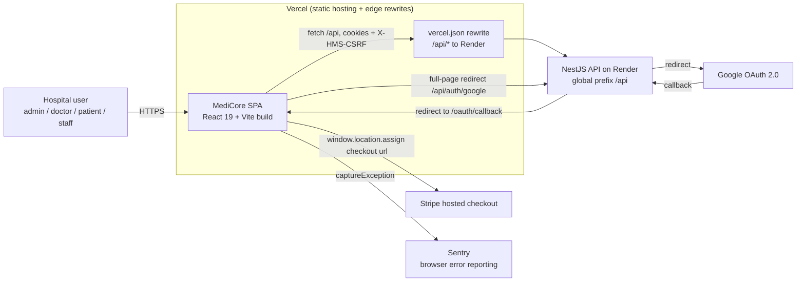

*(A)* The rewrite and headers come from `vercel.json`. The Stripe redirect is in `src/pages/billing/PatientBillingPage.tsx` (`createInvoiceCheckout` then `window.location.assign`). Sentry is configured in `src/main.tsx`. The OAuth redirects are in `backend/api/src/auth/auth.controller.ts` (`google`, `google/callback`).

### 6.2 Frontend system architecture

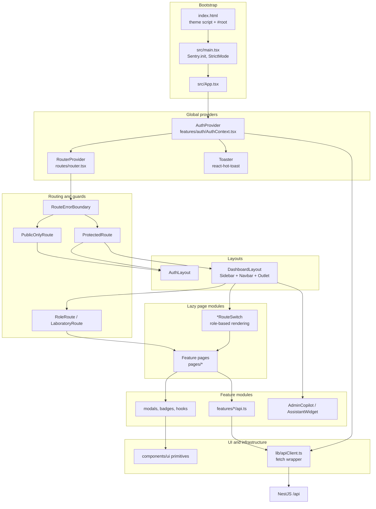

## 7. Component Architecture

### 7.1 Application hierarchy

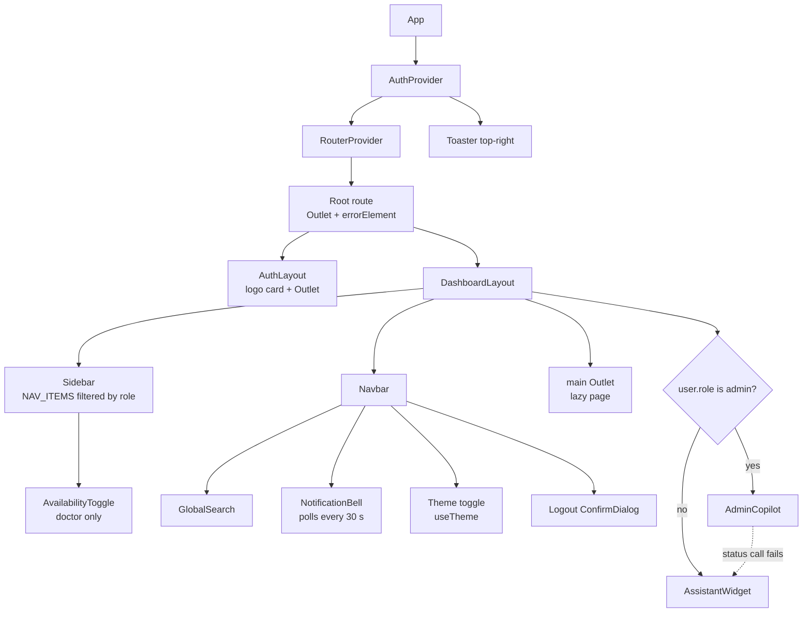

Sources: `src/App.tsx`, `src/layouts/DashboardLayout.tsx`, `src/components/layout/Sidebar.tsx`, `src/components/layout/Navbar.tsx`, `src/features/adminCopilot/AdminCopilot.tsx`. The copilot falls back to `<AssistantWidget />` when `GET /admin-ai/status` fails.

### 7.2 Significant component groups

| Group | Components | Path | Status |
| --- | --- | --- | --- |
| Layouts | `AuthLayout`, `DashboardLayout` | `src/layouts/` | IMPLEMENTED |
| Navigation | `Sidebar` (filters `NAV_ITEMS` by `roles` and `visible(user)`), `Navbar` | `src/components/layout/`, `src/constants/nav.ts` | IMPLEMENTED |
| Header widgets | `GlobalSearch` (patients + doctors), `NotificationBell` | `src/features/search/GlobalSearch.tsx`, `src/features/notifications/NotificationBell.tsx` | IMPLEMENTED |
| Admin dashboard widgets | `DashboardStatCard`, `AdmissionsChart`, `RevenueChart`, `AppointmentsTable`, `DoctorsOnDuty`, `RecentPatients`, `QuickActions` | `src/components/dashboard/` | IMPLEMENTED (all fetch live data) |
| UI primitives | `Avatar`, `Badge`, `Button` (+ `button-variants`), `Card`, `ConfirmDialog`, `EmptyState`, `Input`, `Modal`, `Pagination`, `PasswordInput`, `PasswordRequirements`, `PhoneInput`, `Select`, `StatCard`, `Switch`, `Table`, `Tabs`, `TempPasswordDialog`, `Textarea` | `src/components/ui/` (barrel `index.ts`) | IMPLEMENTED |
| Chat primitives | `ChatMessageBubble`, `ChatImageAttachControl`, `ImageLightbox` | `src/components/chat/` | IMPLEMENTED |
| Forms | react-hook-form + zod in `ManualLoginForm`, `ManualSignupForm`, `SetPasswordCard`, `AccountInfoForm` and every `*Modal` form | `src/features/**` | IMPLEMENTED |
| Dialogs / modals | `Modal`, `ConfirmDialog`, `TempPasswordDialog` + 31 feature `*Modal.tsx` components | `src/components/ui/`, `src/features/**/*Modal.tsx` | IMPLEMENTED |
| Status badges | `*StatusBadge`, `*PriorityBadge`, `*TypeBadge` per domain | `src/features/**` | IMPLEMENTED |
| AI | `AdminCopilot`, `ProposalCard`, `Markdown`, `AssistantWidget` | `src/features/adminCopilot/`, `src/features/assistant/` | IMPLEMENTED |

## 8. Routing Architecture

All routes are defined in `src/routes/router.tsx`. Path constants are in `src/constants/routes.ts`. Every route except `/oauth/callback`, `/doctor/:id` and the `/` redirect also sets `handle.title`, which `useDocumentTitle` (`src/hooks/useDocumentTitle.ts`) turns into `"<Title> · MediCore HMS"`.

### 8.1 Route table

| Path | Element | Guard chain | Lazy | Notes |
| --- | --- | --- | --- | --- |
| `/oauth/callback` | `OAuthCallbackPage` | none | no | Completes Google sign-in |
| `/doctor/:id` | `PublicDoctorProfilePage` | none | no | Public shareable profile, `GET /public/doctors/:id` |
| `/login` | `LoginPage` | PublicOnlyRoute > AuthLayout | no | Login + signup tabs, Google button, demo logins |
| `/forgot-password` | `ForgotPasswordPage` | PublicOnlyRoute > AuthLayout | no | |
| `/reset-password` | `ResetPasswordPage` | PublicOnlyRoute > AuthLayout | no | |
| `/verify-email` | `VerifyEmailPage` | PublicOnlyRoute > AuthLayout | no | OTP verification |
| `/select-role` | `SelectRolePage` | ProtectedRoute > AuthLayout | no | First Google sign-in |
| `/set-password` | `SetPasswordPage` | ProtectedRoute > AuthLayout | no | `mustChangePassword` accounts |
| `/pending-approval` | `PendingApprovalPage` | ProtectedRoute > AuthLayout | no | Unapproved doctor/staff |
| `/dashboard` | `DashboardRouteSwitch` | ProtectedRoute > DashboardLayout | yes | Role-switched |
| `/notifications` | `NotificationsPage` | ProtectedRoute > DashboardLayout | yes | All roles |
| `/settings` | `SettingsRouteSwitch` | ProtectedRoute > DashboardLayout | yes | Role-switched |
| `/profile` | `ProfileRouteSwitch` | ProtectedRoute > DashboardLayout | yes | Role-switched |
| `/messages` | `MessagesRouteSwitch` | ProtectedRoute > DashboardLayout | yes | doctor / patient. Others are redirected. |
| `/medical-records` | `MedicalRecordsRouteSwitch` | ProtectedRoute > DashboardLayout | yes | doctor / patient. Others are redirected. |
| `/billing` | `BillingRouteSwitch` | ProtectedRoute > DashboardLayout | yes | patient vs admin/doctor. Staff is redirected. |
| `/announcements` | `AnnouncementsPage` | ProtectedRoute > DashboardLayout | yes | No route-level role guard. The sidebar shows it to admin/doctor/staff. |
| `/emergency` | `EmergencyRouteSwitch` | ProtectedRoute > DashboardLayout | yes | patient / admin / doctor / nurse staff |
| `/emergency/cases/:id` | `EmergencyCaseDetailPage` | ProtectedRoute > DashboardLayout | yes | No route-level role guard. The page derives `isOwner` / `isResponder` / `canAssign`. |
| `/find-doctor` | `FindDoctorPage` | ... > RoleRoute `['patient']` | yes | |
| `/book-appointment` | `BookAppointmentPage` | ... > RoleRoute `['patient']` | yes | |
| `/my-appointments` | `MyAppointmentsPage` | ... > RoleRoute `['patient']` | yes | |
| `/prescriptions` | `PrescriptionsPage` | ... > RoleRoute `['patient']` | yes | |
| `/my-shifts` | `MyShiftsPage` | ... > RoleRoute `['staff']` | yes | |
| `/available-shifts` | `AvailableShiftsPage` | ... > RoleRoute `['staff']` | yes | |
| `/my-tasks` | `TasksPage` | ... > RoleRoute `['staff']` | yes | |
| `/patients` | `PatientsPage` | ... > RoleRoute `['admin','doctor']` | yes | |
| `/appointments` | `AppointmentsPage` | ... > RoleRoute `['admin','doctor']` | yes | |
| `/doctors` | `DoctorsPage` | ... > RoleRoute `['admin','doctor']` | yes | |
| `/beds` | `BedsPage` | ... > RoleRoute `['admin','doctor']` | yes | |
| `/laboratory` | `LaboratoryPage` | ... > LaboratoryRoute | yes | admin, doctor, or staff with `staffType === 'lab_technician'` |
| `/reports` | `ReportsPage` | ... > RoleRoute `['admin']` | yes | |
| `/staff` | `StaffPage` | ... > RoleRoute `['admin']` | yes | |
| `/account-approvals` | `AccountApprovalsPage` | ... > RoleRoute `['admin']` | yes | |
| `/staff-scheduling` | `StaffSchedulingPage` | ... > RoleRoute `['admin']` | yes | |
| `/` | `<Navigate to="/dashboard">` | none | no | Root redirect |
| `*` | `NotFoundPage` | none | no | 404 |

### 8.2 Route tree: public and onboarding

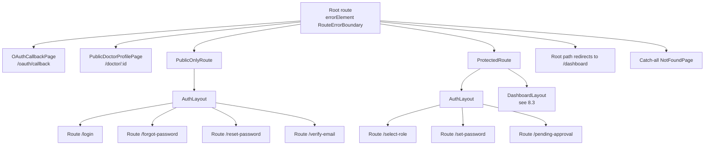

### 8.3 Route tree: dashboard (protected)

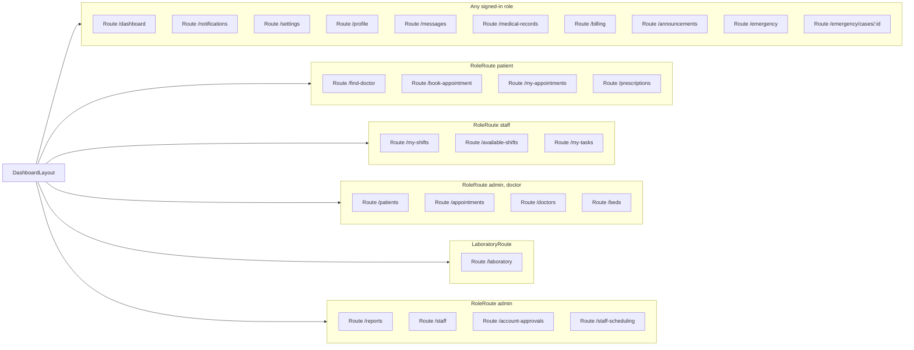

### 8.4 Guard and redirect logic

`ProtectedRoute` (`src/routes/ProtectedRoute.tsx`) runs these checks in order:

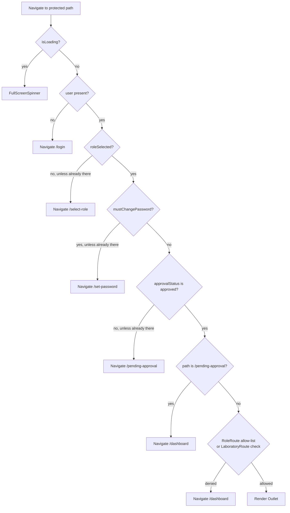

Unauthorized handling:

- A role that fails a guard is **silently redirected to `/dashboard`**. There is no dedicated "403" page. This is IMPLEMENTED in `RoleRoute`, `LaboratoryRoute` and the `*RouteSwitch` fallbacks.
- `PublicOnlyRoute` sends signed-in users from `/login` and the other public auth pages to `/dashboard`.
- Unknown paths render `src/pages/NotFoundPage.tsx`.

### 8.5 Roles and their dashboards

| Role | `/dashboard` renders | Other role-switched pages | Source |
| --- | --- | --- | --- |
| `admin` | `DashboardPage` (stats, charts, tables, QuickActions) | `SettingsPage`, `GenericProfilePage`, `BillingPage`, `EmergencyCenterPage`, plus **AdminCopilot** | `src/pages/dashboard/DashboardRouteSwitch.tsx` |
| `doctor` | `DoctorDashboardPage` (upcoming sessions + calendar) | `DoctorSettingsPage`, `DoctorProfilePage`, `DoctorMessagesPage`, `DoctorMedicalRecordsPage`, `BillingPage`, `EmergencyCenterPage` | same |
| `patient` | `PatientDashboardPage` (quick links) | `PatientSettingsPage`, `PatientProfilePage`, `MessagesPage`, `PatientMedicalRecordsPage`, `PatientBillingPage`, `PatientEmergencyPage` | same |
| `staff` | `StaffDashboardPage` (my shifts, tasks, announcements) | `StaffSettingsPage`, `GenericProfilePage`. `EmergencyCenterPage` only if `staffType === 'nurse'`. `/laboratory` only if `lab_technician`. | same |

Staff sub-types (`StaffType` in `src/types/staffScheduling.ts`) are `doctor | nurse | receptionist | pharmacist | lab_technician | other`. The value is not part of the login role. `AuthProvider` loads it from `GET /staff-portal/profile` and falls back to `null` when the account is not yet linked to the roster.

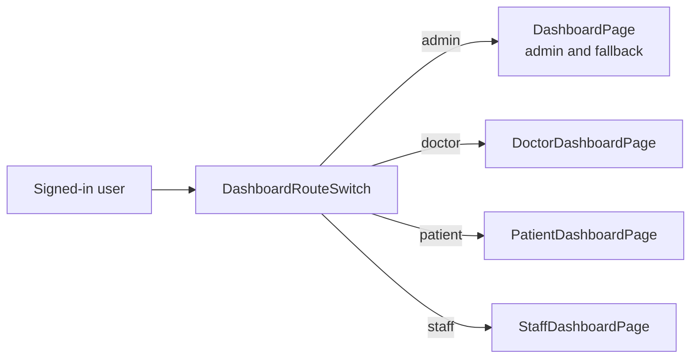

## 9. State Management

### 9.1 What exists

| State kind | Mechanism | Owner | Status |
| --- | --- | --- | --- |
| Authenticated user + auth actions | React Context `AuthContext` (`useState` user/isLoading) | `src/features/auth/AuthContext.tsx`, read via `src/features/auth/useAuth.ts` | IMPLEMENTED |
| Server data (lists, details) | `useState` + `useEffect` fetch per page or hook, no cache | each page / `use*` hook | IMPLEMENTED |
| Reusable data hooks | `usePatientAppointments`, `useDoctorAppointments`, `useDoctorInbox`, `useMyInvoices`, `useMyEmergencies`, `useMyMedicalRecords`, `useNotificationActions`, `useCopilot` | `src/features/**/use*.ts` | IMPLEMENTED |
| Form state | react-hook-form + zod resolvers | forms and modals | IMPLEMENTED |
| UI state (modals open, sidebar open, tabs) | local `useState`, `Tabs` uses a private `TabsContext` | components | IMPLEMENTED |
| Theme | `useTheme` toggles the `.dark` class on `<html>` and persists `hms-theme` in `localStorage` | `src/hooks/useTheme.ts`, `index.html` | IMPLEMENTED |
| Client pagination | `usePagination(items, pageSize)` | `src/hooks/usePagination.ts` | IMPLEMENTED |
| URL state | `useSearchParams` (for example `?mfa=` on login), `useParams` for case id | pages | IMPLEMENTED |
| Unsaved-changes guard | `useUnsavedChangesGuard` + `UnsavedChangesPrompt` | `src/features/profile/` | IMPLEMENTED |
| Global server-state cache / store library | none | | **NOT FOUND** |

### 9.2 State flow

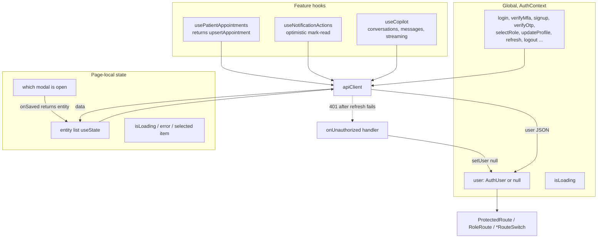

Ownership rules visible in code:

- Only `AuthProvider` writes `user`. Other code changes it through context actions or `refresh()`.
- After a mutation, a page either patches its list with the returned entity, as in `BedsPage.handleAssigned` and `usePatientAppointments.upsertAppointment`, or calls its own `refresh()` again.
- Nothing is shared between pages. Navigating back refetches.

### 9.3 Auth state machine

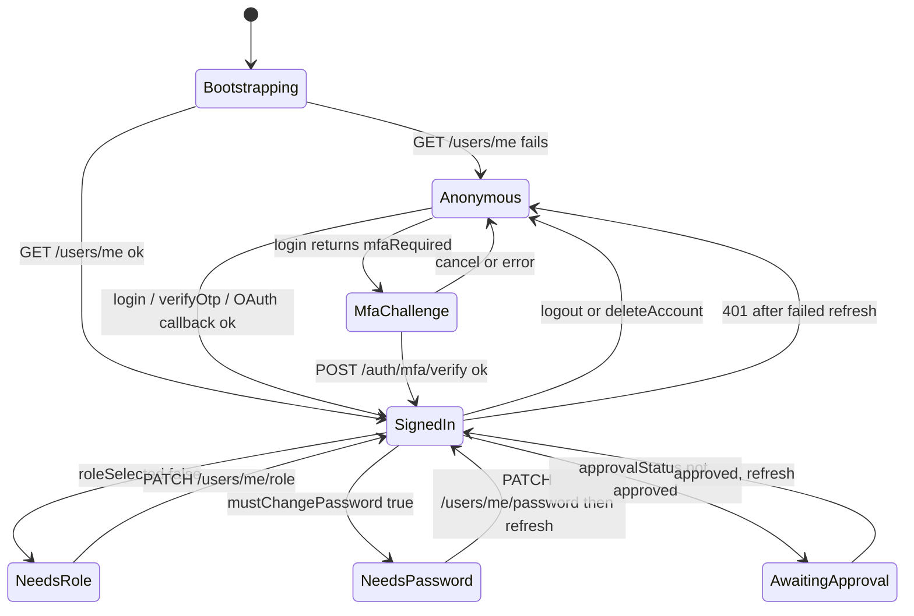

## 10. API Integration

### 10.1 Client configuration (`src/lib/apiClient.ts`)

| Aspect | Implementation |
| --- | --- |
| Transport | native `fetch` |
| Base URL | `` `${API_BASE_URL}/api${path}` `` where `API_BASE_URL = import.meta.env.VITE_API_URL ?? ''`. It is meant to stay empty so the API is same-origin. |
| Credentials | `credentials: 'include'`. httpOnly cookies are set by the backend (`backend/api/src/auth/auth-cookies.ts`). |
| Auth header | none. No bearer token in JS. |
| CSRF | `X-HMS-CSRF: 1` on every method except GET, HEAD and OPTIONS |
| Content type | `application/json` default |
| Response envelope | `{ success, message, data?, errors? }`. `request()` returns `data` and throws `ApiError(message, { status, errors })` when `!res.ok` or `!success`. A 204 returns `undefined`. |
| 401 handling | For paths not under `/auth/`, call `POST /auth/refresh` once. Concurrent 401s share one `refreshInFlight` promise. Retry once. If it is still 401, call the `onUnauthorized` handler. |
| Unauthorized hook | `AuthProvider` registers `onUnauthorized(() => setUser(null))`, so guards then redirect to `/login`. |
| Streaming | `fetchWithSession` returns the raw `Response` with the same cookies, CSRF and refresh behaviour. Used for the copilot SSE stream. |
| Exports | `api.get/post/patch/put/del`, `fetchWithSession`, `toApiError`, `ApiError`, `onUnauthorized`, `API_BASE_URL` |

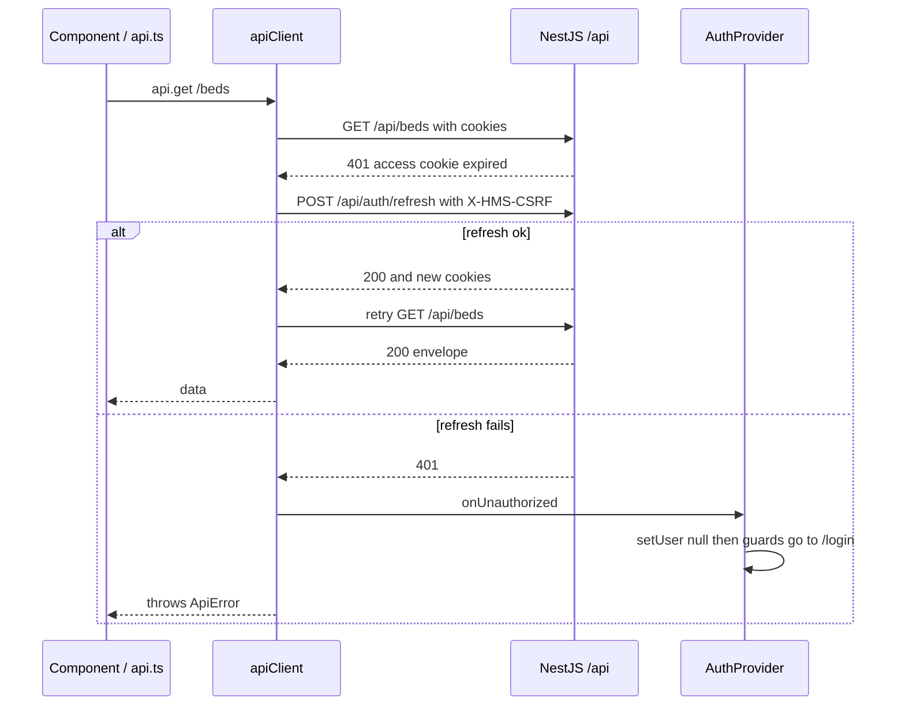

### 10.2 Service organization: feature to backend namespace

Every namespace below has a matching `@Controller` in `backend/api/src`. All routes are under the global `api` prefix set in `backend/api/src/main.ts`.

| Frontend API module | Exported functions (abridged) | Backend namespace(s) |
| --- | --- | --- |
| `features/auth/AuthContext.tsx` | login, verifyMfa, signup, verifyOtp, resendOtp, forgot/resetPassword, logout, refresh | `/auth/*`, `/users/me`, `/users/me/role`, `/staff-portal/profile` |
| `features/auth/api.ts` | setPassword | `/users/me/password` |
| `features/mfa/api.ts` | setupMfa, confirmMfa, disableMfa | `/users/me/mfa/*` |
| `features/patients/api.ts` | listPatients, getPatient, createPatient | `/patients` |
| `features/patientDashboard/api.ts` | listDoctors, listMyAppointments, bookAppointment, cancelAppointment, chat functions | `/doctors`, `/appointments`, `/chat` |
| `features/appointments/api.ts` | listAllAppointments, bookAppointmentForPatient | `/appointments`, `/appointments/admin` |
| `features/doctorDashboard/api.ts` | doctor appointments, inbox/chat, profile, availability | `/doctor-portal/*` |
| `features/doctorMedicalRecords/api.ts` | listPatientMedicalRecords, createMedicalRecord | `/doctor-portal/patients/:id/medical-records` |
| `features/patientMedicalRecords/api.ts` | listMyMedicalRecords | `/medical-records/me` |
| `features/doctors/publicApi.ts` | getPublicDoctorProfile | `/public/doctors/:id` |
| `features/beds/api.ts` | listBeds, assignBed, releaseBed | `/beds` |
| `features/laboratory/api.ts` | listLabTests, requestLabTest, updateLabTestStatus | `/laboratory/tests` |
| `features/billing/api.ts` | invoices, payments, refunds, checkout, overview, revenue, platform settings | `/billing/*`, `/platform-settings` |
| `features/reports/api.ts` | revenue trend, appointments by department/status | `/reports/*` |
| `features/staff/api.ts` | listStaff, createStaff | `/staff` |
| `features/staffScheduling/api.ts` | roster, shifts, recurring, templates, availability, leave, attendance, openings, applications, tasks | `/staff-scheduling/*` |
| `features/staffPortal/api.ts` | profile, my shifts, openings, applications, tasks | `/staff-portal/*` |
| `features/emergency/api.ts` | create, list, my, detail, status, assign, priority, notes, cancel, location, nurses, analytics | `/emergency/*` |
| `features/announcements/api.ts` | listAnnouncements, createAnnouncement | `/announcements` |
| `features/accountApprovals/api.ts` | listAccountRequests, reviewAccountRequest | `/account-approvals` |
| `features/notifications/api.ts` | list, mark read, mark all read | `/notifications` |
| `features/assistant/api.ts` | sendAssistantMessage | `/assistant/chat` |
| `features/adminCopilot/api.ts` | status, conversations CRUD, messages (SSE), proposals approve/reject, feedback | `/admin-ai/*` |

The backend also has `health` and `billing/webhooks` controllers. The frontend never calls them. This is *(A)*, confirmed by a code search.

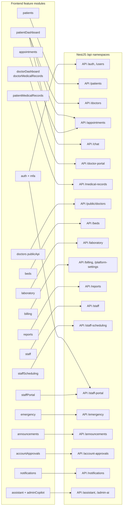

### 10.3 Core client types

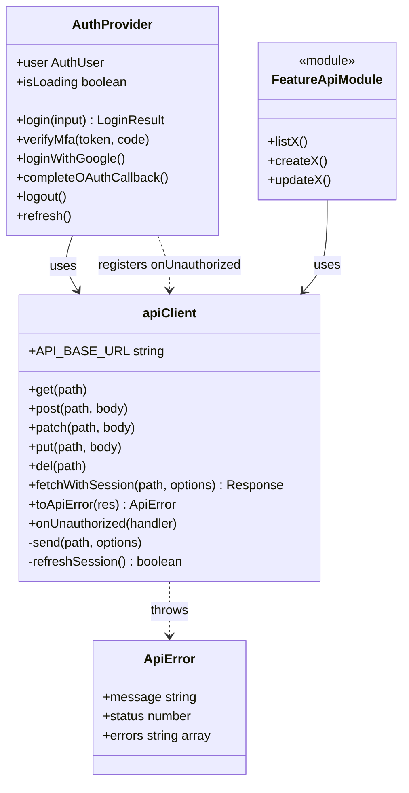

## 11. Authentication Architecture

All auth state lives in `src/features/auth/AuthContext.tsx`. The tokens themselves are httpOnly cookies that the frontend never reads. There is **no JWT handling in the browser**: no decoding and no storage.

| Flow | Entry point | Endpoints | Status |
| --- | --- | --- | --- |
| Session bootstrap | `AuthProvider` mount, `refresh()` | `GET /users/me` (+ `GET /staff-portal/profile` for staff) | IMPLEMENTED |
| Local login | `ManualLoginForm` (`src/features/auth/ManualLoginForm.tsx`) | `POST /auth/login` (body has email, password, **role**) | IMPLEMENTED |
| MFA (TOTP / backup code) at login | `ManualLoginForm` MFA step | `POST /auth/mfa/verify` | IMPLEMENTED |
| MFA enrolment / disable | `MfaCard` (`src/features/mfa/MfaCard.tsx`) on admin and doctor settings | `POST /users/me/mfa/setup`, `/confirm`, `/disable` | IMPLEMENTED (shown on `SettingsPage` and `DoctorSettingsPage` only) |
| Signup + email OTP | `ManualSignupForm`, `VerifyEmailPage` | `POST /auth/signup`, `/auth/verify-otp`, `/auth/resend-otp` | IMPLEMENTED |
| Forgot / reset password | `ForgotPasswordPage`, `ResetPasswordPage` | `POST /auth/forgot-password`, `/auth/reset-password` | IMPLEMENTED |
| Google OAuth | `LoginPage` GoogleButton, then `OAuthCallbackPage` | `GET /auth/google` (full redirect), `GET /users/me` | IMPLEMENTED |
| First-login role pick | `SelectRolePage` | `PATCH /users/me/role` | IMPLEMENTED |
| Forced password change | `SetPasswordPage` / `SetPasswordCard` | `PATCH /users/me/password` | IMPLEMENTED |
| Approval gate (doctor/staff signups) | `PendingApprovalPage` | `GET /users/me` via refresh | IMPLEMENTED |
| Session refresh | `apiClient.refreshSession` | `POST /auth/refresh` | IMPLEMENTED |
| Logout | Navbar ConfirmDialog, `logout()` | `POST /auth/logout` | IMPLEMENTED |
| Delete account | `deleteAccount()` | `DELETE /users/me` | IMPLEMENTED |
| Demo one-click logins | `DemoLogins` when `VITE_DEMO_MODE === 'true'` | `POST /auth/login` | IMPLEMENTED |

### 11.1 Local login with optional MFA

```mermaid
sequenceDiagram
    actor U as User
    participant F as ManualLoginForm
    participant A as AuthProvider
    participant C as apiClient
    participant B as NestJS auth
    U->>F: email, password, role
    F->>A: login(input)
    A->>C: POST /auth/login
    C->>B: POST /api/auth/login with X-HMS-CSRF
    alt MFA enabled
        B-->>C: data mfaRequired and mfaToken
        C-->>A: challenge
        A-->>F: mfaRequired true
        U->>F: 6-digit or backup code
        F->>A: verifyMfa(mfaToken, code)
        A->>C: POST /auth/mfa/verify
        B-->>C: Set-Cookie session and user
    else no MFA
        B-->>C: Set-Cookie session and user
    end
    C-->>A: user
    A->>A: toAuthUser, fetch staffType if role is staff
    A-->>F: resolved
    F->>F: toast success and navigate /dashboard
    Note over F,B: A 401 on /auth/* is never auto-refreshed. It surfaces as an ApiError toast.
```

### 11.2 Google OAuth

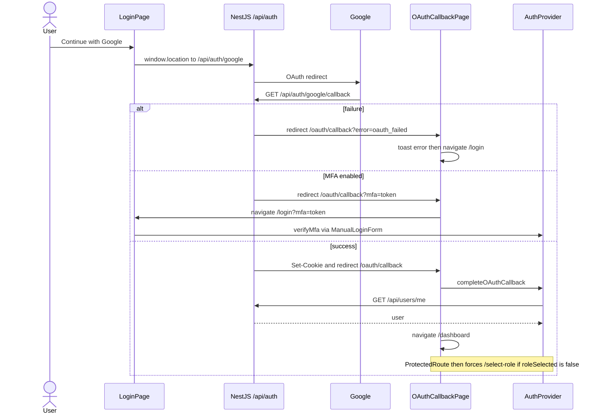

### 11.3 Session persistence, expiry and logout

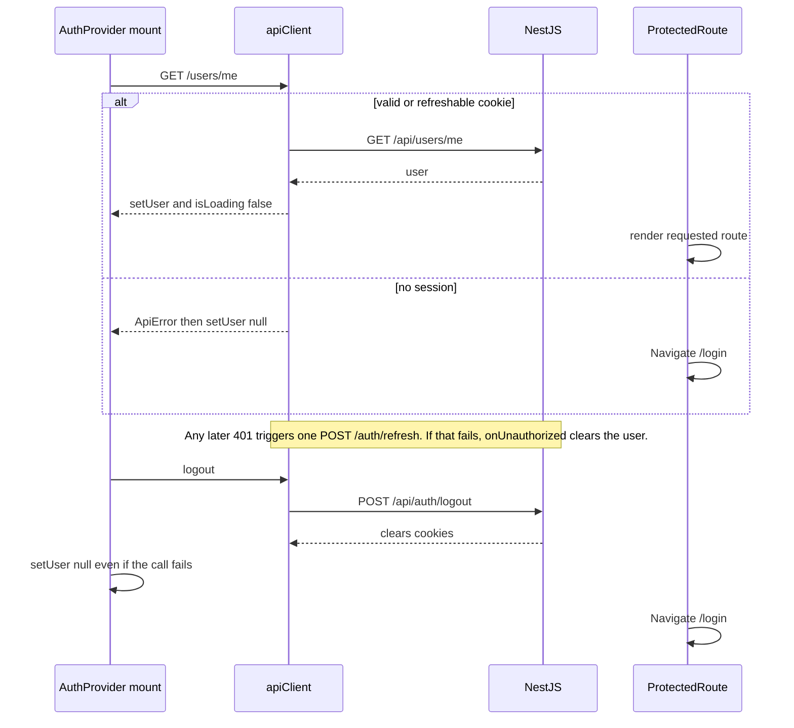

## 12. Request and Data Flow

### 12.1 Generic flow

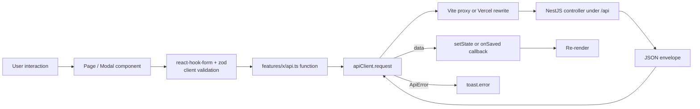

### 12.2 Worked example: assigning a bed

Sources: `src/pages/beds/BedsPage.tsx`, `src/features/beds/AssignBedModal.tsx`, `src/features/beds/api.ts`, `backend/api/src/beds/`.

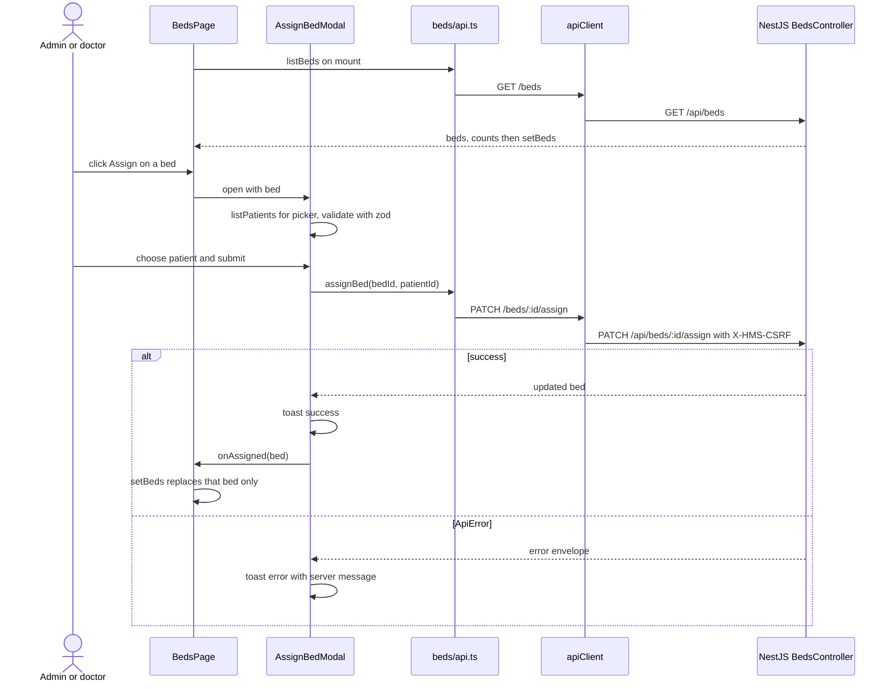

### 12.3 Admin Copilot streaming

Sources: `src/features/adminCopilot/useCopilot.ts`, `api.ts`, `sse.ts`, `ProposalCard.tsx`.

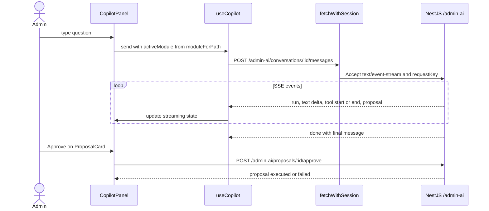

## 13. Feature Modules

Status is **IMPLEMENTED** unless stated otherwise. "Backend" is the namespace under `/api`.

| Feature | Main page(s) | Key children | Hooks / state | API module | Backend | Status |
| --- | --- | --- | --- | --- | --- | --- |
| **Admin dashboard** | `pages/dashboard/DashboardPage.tsx` | `DashboardStatCard`, `AdmissionsChart`, `RevenueChart`, `AppointmentsTable`, `DoctorsOnDuty`, `RecentPatients`, `QuickActions` (opens AddPatient, AddDoctor, BookAppointment, CreateInvoice, RequestLabTest modals) | local `useState` per stat | patients, appointments, beds, billing, reports, patientDashboard (`listDoctors`) | `/patients`, `/appointments`, `/beds`, `/billing/revenue`, `/reports/revenue-trend`, `/doctors` | IMPLEMENTED |
| **Doctor dashboard** | `pages/dashboard/DoctorDashboardPage.tsx` | `doctorDashboard/UpcomingSessionsCard`, `SessionCalendar`, `AvailabilityToggle` (in Sidebar) | `useDoctorAppointments` | `features/doctorDashboard/api.ts` | `/doctor-portal` | IMPLEMENTED |
| **Patient dashboard** | `pages/dashboard/PatientDashboardPage.tsx` | quick-link cards | `useAuth` | none (links only) | none | IMPLEMENTED |
| **Staff dashboard** | `pages/dashboard/StaffDashboardPage.tsx` | `TaskStatusBadge`, `ShiftStatusBadge` | local state | staffPortal, announcements | `/staff-portal`, `/announcements` | IMPLEMENTED |
| **Emergency** | `EmergencyRouteSwitch` to `PatientEmergencyPage` or `EmergencyCenterPage`; `EmergencyCaseDetailPage` | `CreateEmergencyModal`, `AssignTeamModal`, `AddNoteModal`, `EmergencyTimeline`, `EmergencyVolumeChart`, status/priority badges | `useMyEmergencies`; center polls every 15 s | `features/emergency/api.ts` | `/emergency` | IMPLEMENTED |
| **Announcements** | `pages/announcements/AnnouncementsPage.tsx` | `CreateAnnouncementModal`, `AnnouncementPriorityBadge` | local state | `features/announcements/api.ts` | `/announcements` | IMPLEMENTED |
| **Patients** | `pages/patients/PatientsPage.tsx` | `AddPatientModal`, `PatientProfileModal`, `PatientStatusBadge`, `TempPasswordDialog` | `usePagination` | `features/patients/api.ts` | `/patients` | IMPLEMENTED |
| **Doctors** | `pages/doctors/DoctorsPage.tsx`, `PublicDoctorProfilePage.tsx` | `AddDoctorModal` (uses `createStaff`), `DoctorProfileModal` (share link) | `usePagination` | `patientDashboard/api.ts` (`listDoctors`), `staff/api.ts`, `doctors/publicApi.ts` | `/doctors`, `/staff`, `/public/doctors` | IMPLEMENTED |
| **Appointments (ops)** | `pages/appointments/AppointmentsPage.tsx` | `AppointmentDetailsModal`, `AppointmentStatusBadge`, `BookAppointmentModal` (QuickActions) | `usePagination` | `features/appointments/api.ts` | `/appointments`, `/appointments/admin` | IMPLEMENTED |
| **Appointments (patient)** | `FindDoctorPage`, `BookAppointmentPage`, `MyAppointmentsPage` | `DoctorSearch` (opens `DoctorChatModal`), `BookSessionModal`, `UpcomingSessionsCard`, `SessionCalendar` | `usePatientAppointments` | `features/patientDashboard/api.ts` | `/doctors`, `/appointments` | IMPLEMENTED |
| **Messages** | `MessagesRouteSwitch` to `MessagesPage` (patient) or `DoctorMessagesPage` | `DoctorChatPanel`, `DoctorInboxPanel`, `components/chat/*` | `usePatientAppointments`, `useDoctorInbox`, `useChatImageAttachment`, `useAutoScrollToBottom` | patientDashboard, doctorDashboard | `/chat`, `/doctor-portal/chat` | IMPLEMENTED (request/response, no push) |
| **Medical records** | `MedicalRecordsRouteSwitch` to `PatientMedicalRecordsPage` or `DoctorMedicalRecordsPage` | `PatientMedicalRecordsCard`, `DoctorMedicalRecordsPanel`, `NewMedicalRecordModal`, `MedicalRecordList` | `useMyMedicalRecords`, `useDoctorInbox` | patientMedicalRecords, doctorMedicalRecords | `/medical-records/me`, `/doctor-portal/patients/:id/medical-records` | IMPLEMENTED |
| **Prescriptions** | `pages/prescriptions/PrescriptionsPage.tsx` | none | `useMyMedicalRecords` | patientMedicalRecords | `/medical-records/me` | PARTIALLY IMPLEMENTED: read-only view derived from medical records, with no prescription endpoint of its own |
| **Beds** | `pages/beds/BedsPage.tsx` | `AssignBedModal`, `BedStatusBadge` | `usePagination` | `features/beds/api.ts` | `/beds` | IMPLEMENTED |
| **Laboratory** | `pages/laboratory/LaboratoryPage.tsx` | `RequestLabTestModal`, `UpdateLabTestModal`, `LabTestStatusBadge` | `usePagination` | `features/laboratory/api.ts` | `/laboratory/tests` | IMPLEMENTED |
| **Billing** | `BillingRouteSwitch` to `BillingPage` (admin/doctor) or `PatientBillingPage` | `CreateInvoiceModal`, `PatientPicker`, `InvoiceDetailsModal`, `RecordPaymentModal`, `RefundPaymentModal`, `ConsultationMarginCard`, `generateInvoicePdf`, `RevenueChart` (admin only) | `useMyInvoices`, `usePagination` | `features/billing/api.ts` | `/billing`, `/platform-settings` | IMPLEMENTED (online payment hands off to Stripe checkout) |
| **Reports** | `pages/reports/ReportsPage.tsx` | `ChartTooltip`, `chartColors`, `aggregations` types | `useTheme` | `features/reports/api.ts` | `/reports` | IMPLEMENTED |
| **Staff** | `pages/staff/StaffPage.tsx` | `features/staff/AddStaffModal`, `TempPasswordDialog` | `usePagination` | `features/staff/api.ts` | `/staff` | IMPLEMENTED |
| **Account approvals** | `pages/accountApprovals/AccountApprovalsPage.tsx` | inline review UI | local state | `features/accountApprovals/api.ts` | `/account-approvals` | IMPLEMENTED |
| **Staff scheduling (admin)** | `pages/staffScheduling/StaffSchedulingPage.tsx` | `CalendarView`, `ShiftFormModal`, `ShiftDetailModal`, `RecurringShiftModal`, `TemplatesPanel` + `TemplateFormModal`, `AvailabilityPanel`, `AttendancePanel` + `AttendanceModal`, `OpeningsPanel` + `ShiftOpeningFormModal`, `ApplicationsPanel` + `RespondApplicationModal`, `TasksPanel` + `TaskFormModal`, `AddStaffModal`, badges | `usePagination` | `features/staffScheduling/api.ts` | `/staff-scheduling/*` | IMPLEMENTED |
| **Staff portal** | `MyShiftsPage`, `AvailableShiftsPage`, `TasksPage` | `ShiftDetailCard`, `ApplyShiftModal`, status/priority badges, shared `CalendarView` | local state | `features/staffPortal/api.ts` | `/staff-portal` | IMPLEMENTED |
| **Profile** | `ProfileRouteSwitch` to `PatientProfilePage`, `DoctorProfilePage`, `GenericProfilePage` | `ProfileHeader`, `UnsavedChangesPrompt`, `AccountInfoForm`, `SetPasswordCard`, `AvailabilityToggle` | `useUnsavedChangesGuard`, `useAuth.updateProfile` | auth, doctorDashboard | `/users/me`, `/doctor-portal/profile` | IMPLEMENTED |
| **Settings** | `SettingsRouteSwitch` to `SettingsPage` (admin), `DoctorSettingsPage`, `PatientSettingsPage`, `StaffSettingsPage` | `AccountInfoForm`, `SetPasswordCard`, `MfaCard`, theme toggle | `useTheme` | auth, mfa, staffPortal | `/users/me*`, `/staff-portal/profile` | IMPLEMENTED |
| **Notifications** | `pages/notifications/NotificationsPage.tsx` + `NotificationBell` | `notificationIcons` | `useNotificationActions` (optimistic read, fallback deep links) | `features/notifications/api.ts` | `/notifications` | IMPLEMENTED (30 s polling in bell) |
| **Global search** | `GlobalSearch` in Navbar | none | local state | patients, patientDashboard | `/patients`, `/doctors` | IMPLEMENTED |
| **Admin AI Copilot** | `AdminCopilot` (admins, all dashboard pages) | `ProposalCard`, `Markdown`, history view | `useCopilot`; module context from `modules.ts` | `features/adminCopilot/api.ts`, `sse.ts` | `/admin-ai` | IMPLEMENTED |
| **Assistant widget** | `AssistantWidget` (non-admins, or admin fallback) | none | local message history | `features/assistant/api.ts` | `/assistant/chat` | IMPLEMENTED |

### 13.1 Module composition (admin-facing pages)

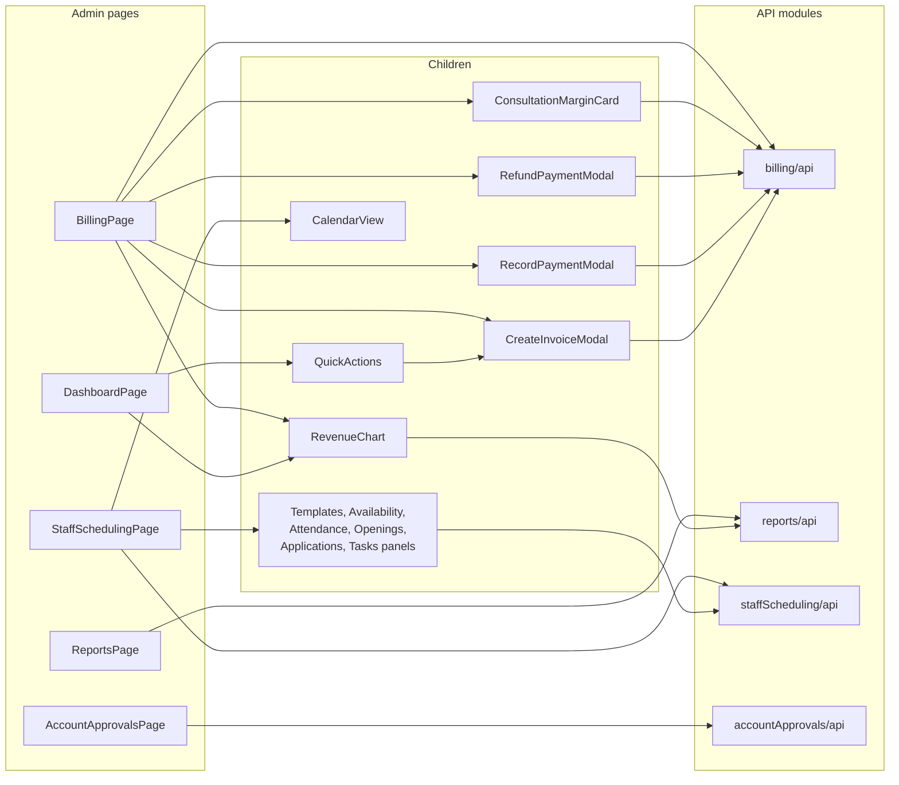

## 14. Error Handling and Notifications

| Concern | Mechanism | Source | Status |
| --- | --- | --- | --- |
| Route / render / lazy-chunk errors | Root `errorElement: <RouteErrorBoundary />`. It detects stale chunks ("This app was just updated" + reload) and 404s, and otherwise shows "Something went wrong" with Reload / Back to dashboard. It calls `Sentry.captureException`, except for stale chunks and 404s. | `src/routes/RouteErrorBoundary.tsx` | IMPLEMENTED |
| Error reporting | `Sentry.init({ dsn: VITE_SENTRY_DSN })`. Errors only, with no tracing or replay. A missing DSN makes it a no-op. | `src/main.tsx` | IMPLEMENTED |
| API errors | `ApiError` carries the server `message`, `status` and `errors[]`. Callers use the pattern `error instanceof ApiError ? error.message : '<fallback>'` and then `toast.error`. | `src/lib/apiClient.ts` + about 100 call sites in 78 files | IMPLEMENTED |
| Session expiry | refresh-once, then `onUnauthorized`, then redirect to login | `apiClient.ts`, `AuthContext.tsx` | IMPLEMENTED |
| Form validation | zod schemas with field-level `error` props on `Input`/`Select`. Password rules in `src/lib/passwordPolicy.ts`, phone rules in `src/lib/phone.ts`. | forms / modals | IMPLEMENTED |
| Toasts | Single `<Toaster position="top-right" />`. `toast.success` / `toast.error` after mutations. Background polling uses `silent` to suppress them. | `src/App.tsx`, `useNotificationActions` | IMPLEMENTED |
| Loading states | `FullScreenSpinner` in guards, `Loader2` spinners, `isLoading` flags, button `isSubmitting` | various | IMPLEMENTED |
| Empty states | `EmptyState` component | `src/components/ui/EmptyState.tsx` | IMPLEMENTED |
| Unauthorized UI | Redirect to `/dashboard`, or to `/pending-approval` for unapproved accounts. No 403 screen. | guards | PARTIALLY IMPLEMENTED |
| Not found | `NotFoundPage` for unknown URLs. `RouteErrorBoundary` covers thrown 404 responses. | `src/pages/NotFoundPage.tsx` | IMPLEMENTED |
| Copilot errors | `CopilotError` with optional retry (same `requestKey`); malformed SSE events are skipped | `useCopilot.ts`, `api.ts` | IMPLEMENTED |
| React error boundary outside the router | | | NOT FOUND (`AuthProvider` and `Toaster` sit outside `RouteErrorBoundary`) |

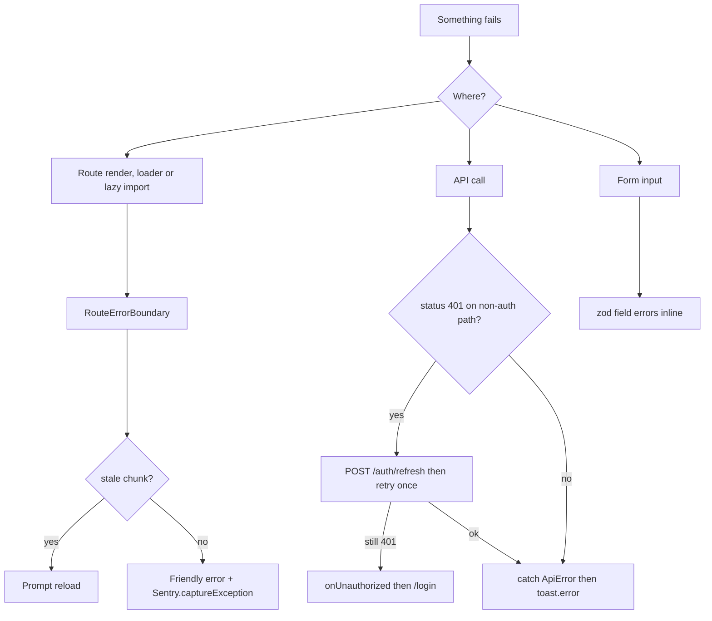

The `ok` edge from Refresh to Toast is taken only if the retried request itself fails with a non-401 error. A successful retry returns data normally.

## 15. Build and Deployment

| Item | Value | Source |
| --- | --- | --- |
| Dev server | `npm run dev` (Vite). `/api` is proxied to `http://localhost:3000` with `changeOrigin`. | `vite.config.ts`, `package.json` |
| Production build | `npm run build` runs `node scripts/check-deploy-config.mjs && tsc -b && vite build` and outputs `dist/` | `package.json` |
| Pre-build guard | When `VERCEL=1`, the build fails if the `/api` rewrite still points at the `YOUR-RENDER-SERVICE` placeholder, or if `VITE_API_URL` is set | `scripts/check-deploy-config.mjs` |
| Path alias | `@` resolves to `./src` | `vite.config.ts`, `vitest.config.ts` |
| Code splitting | route-level `lazy` for every dashboard page | `src/routes/router.tsx` |
| Static assets | `public/favicon.svg`. `index.html` holds an inline pre-paint theme script. | `public/`, `index.html` |
| Env vars (names only) | `VITE_API_URL` (keep empty), `VITE_SENTRY_DSN`, `VITE_SENTRY_ENVIRONMENT`, `VITE_DEMO_MODE` | `.env.example` |
| Hosting | Vercel. The rewrite sends `/api/:path*` to the Render backend and `/(.*)` to `/index.html` (SPA fallback). | `vercel.json` |
| Security headers | `X-Content-Type-Options: nosniff`, `X-Frame-Options: SAMEORIGIN`, `Referrer-Policy: strict-origin-when-cross-origin`, `Permissions-Policy: camera=(), microphone=(), geolocation=()` | `vercel.json` |
| CI | GitHub Actions `frontend` job: `npm ci`, `npm run lint`, `npm run test`, `npm run build` in `frontend/` | `.github/workflows/ci.yml` |
| Backend URL in production | The committed `vercel.json` holds the placeholder `https://YOUR-RENDER-SERVICE.onrender.com`. The real value is **unknown** from source. | `vercel.json` |

```mermaid
flowchart LR
    subgraph Dev["Local development"]
        Browser1["Browser localhost:5173"]
        Vite["Vite dev server"]
        Nest1["NestJS localhost:3000"]
        Browser1 --> Vite
        Vite -->|"proxy /api"| Nest1
    end
    subgraph CI["GitHub Actions"]
        Lint["npm run lint"]
        Test["npm run test"]
        Build["npm run build"]
        Lint --> Test --> Build
    end
    subgraph Prod["Production"]
        Browser2["Browser"]
        VercelEdge["Vercel<br/>dist + vercel.json"]
        Render["Render NestJS /api"]
        Browser2 --> VercelEdge
        VercelEdge -->|"rewrite /api/*"| Render
        VercelEdge -->|"else index.html"| Browser2
    end
    Build -.->|"same build on Vercel,<br/>gated by check-deploy-config"| VercelEdge
```

Why same-origin matters (from comments in `apiClient.ts` and `.env.example`): the session cookies are httpOnly and must be first-party. Pointing `VITE_API_URL` at another domain would break sign-in, so the build refuses to run when it is set on Vercel.

## 16. Testing

| Item | Detail |
| --- | --- |
| Runner | Vitest (`npm run test` runs `vitest run`, `npm run test:watch` runs watch mode) |
| Environment | `jsdom`, `globals: true`, `css: false` (`vitest.config.ts`) |
| Setup | `src/test/setup.ts`: jest-dom matchers, `cleanup()` and `localStorage.clear()` after each test |
| Test files | 29 `*.test.ts(x)` files co-located with source |
| Covered areas | route guards (`ProtectedRoute`, `RoleRoute`, `RouteErrorBoundary`), `apiClient`, `AuthContext`, auth forms and pages (login, signup, set-password, OAuth callback, select-role, verify-email, pending-approval), billing modals and PDF, emergency modal/badge/route switch, notifications bell, profile/settings pages, account approvals, admin copilot + SSE parser, assistant widget, `QuickActions`, `chatMessage` type helpers |
| Mocking | `vi.mock` of `useAuth`, API modules and `react-hot-toast` |
| E2E (Playwright/Cypress) | NOT FOUND in `frontend/` |

## 17. Security Boundaries

| Boundary | Frontend behaviour | Enforced by |
| --- | --- | --- |
| Authentication | Session in httpOnly cookies, never readable by JS. A legacy `localStorage` token is removed at startup. | backend cookies + `apiClient.ts` |
| CSRF | `X-HMS-CSRF: 1` on non-safe methods | `apiClient.ts`, verified server-side |
| Authorization | Route guards and sidebar filtering are **UX only**. Every protected call is re-authorized by the API (comments in `ProtectedRoute.tsx` and `RoleRoute.tsx`). | backend guards |
| Approval gate | Unapproved doctor/staff accounts can only reach `/pending-approval` | `ProtectedRoute` + backend |
| Staff sub-type gating | Emergency (nurse) and Laboratory (lab technician) mirror backend checks such as `LaboratoryService.requireLabAccess` | `RoleRoute.tsx`, `EmergencyRouteSwitch.tsx`, `nav.ts` |
| Public surface | Only `/doctor/:id` (`GET /public/doctors/:id`) and the auth pages work unauthenticated | `router.tsx` |
| Copilot writes | AI-proposed actions run only after an explicit admin Approve on `ProposalCard`, which calls `POST /admin-ai/proposals/:id/approve` | `ProposalCard.tsx`, `useCopilot.ts` |
| Clickjacking / sniffing | `X-Frame-Options: SAMEORIGIN`, `nosniff`, restrictive `Permissions-Policy` | `vercel.json` |
| Secrets | None in frontend code. Env vars are public `VITE_*` values. The Sentry DSN is public by design. | `.env.example` |
| Demo credentials | `DemoLogins` hard-codes the seeded demo password and is rendered only when `VITE_DEMO_MODE === 'true'` | `src/features/auth/DemoLogins.tsx` |

## 18. Source References

| Component | Path | Symbol |
| --- | --- | --- |
| Entry point | `src/main.tsx` | `Sentry.init`, `createRoot` |
| App shell | `src/App.tsx` | `App` |
| Router | `src/routes/router.tsx` | `router` |
| Guards | `src/routes/ProtectedRoute.tsx`, `src/routes/RoleRoute.tsx` | `ProtectedRoute`, `PublicOnlyRoute`, `RoleRoute`, `LaboratoryRoute` |
| Error boundary | `src/routes/RouteErrorBoundary.tsx` | `RouteErrorBoundary` |
| Route constants | `src/constants/routes.ts` | `ROUTES`, `buildPublicDoctorProfileUrl`, `buildEmergencyCaseUrl` |
| Nav config | `src/constants/nav.ts` | `NAV_ITEMS` |
| Roles | `src/types/role.ts` | `Role`, `AUTH_ROLES`, `LOGIN_ROLES`, `ROLE_LABELS` |
| Layouts | `src/layouts/AuthLayout.tsx`, `src/layouts/DashboardLayout.tsx` | |
| Auth context | `src/features/auth/AuthContext.tsx`, `src/features/auth/useAuth.ts` | `AuthProvider`, `AuthContext`, `useAuth` |
| HTTP client | `src/lib/apiClient.ts` | `api`, `fetchWithSession`, `ApiError`, `onUnauthorized` |
| Role switches | `src/pages/dashboard/DashboardRouteSwitch.tsx`, `src/pages/settings/SettingsRouteSwitch.tsx`, `src/pages/profile/ProfileRouteSwitch.tsx`, `src/pages/messages/MessagesRouteSwitch.tsx`, `src/pages/medicalRecords/MedicalRecordsRouteSwitch.tsx`, `src/pages/billing/BillingRouteSwitch.tsx`, `src/pages/emergency/EmergencyRouteSwitch.tsx` | |
| Admin Copilot | `src/features/adminCopilot/AdminCopilot.tsx`, `useCopilot.ts`, `api.ts`, `sse.ts`, `modules.ts`, `ProposalCard.tsx` | |
| Assistant | `src/features/assistant/AssistantWidget.tsx`, `src/features/assistant/api.ts` | |
| Notifications | `src/features/notifications/NotificationBell.tsx`, `useNotificationActions.ts` | |
| Theme | `src/hooks/useTheme.ts`, `index.html` | |
| Build config | `vite.config.ts`, `vitest.config.ts`, `vercel.json`, `scripts/check-deploy-config.mjs`, `package.json` | |
| CI | `.github/workflows/ci.yml` | `frontend` job |
| Backend controllers referenced | `backend/api/src/main.ts` (`setGlobalPrefix('api')`), `backend/api/src/auth/auth.controller.ts`, `backend/api/src/users/`, and one folder per namespace in section 10.2 | |

Related docs (not re-verified here beyond what is cited): `README.md`, `DOCTOR_PROFILE_FEATURE.md`, `../docs/DEPLOYMENT.md`, `../docs/SECURITY.md`, `../docs/TESTING.md`.

## 19. Known Gaps

These are category *(C)*: absent or limited, as observed in code.

1. **No server-state cache.** Every page refetches on mount. There is no deduplication or stale-while-revalidate, and the same list (for example doctors or patients) is fetched independently by several widgets on the admin dashboard.
2. **No realtime push.** Chat, notifications and the emergency board rely on polling (30 s and 15 s) or manual refresh. There is no WebSocket or EventSource.
3. **No dedicated 403 page.** Denied routes silently redirect to `/dashboard`.
4. **`/announcements` and `/emergency/cases/:id` have no route-level role guard.** Access depends on sidebar visibility, in-page role logic and backend authorization.
5. **Staff with a null `staffType`** (not yet linked to the roster) see no Emergency or Laboratory entries. That is intended, but there is no in-app message explaining it.
6. **Admin has no Messages or Medical Records page.** Both switches redirect admins to `/dashboard`.
7. **Prescriptions** is a read-only projection of medical records, with no prescription workflow or endpoint.
8. **MFA enrolment UI** (`MfaCard`) appears only on the admin `SettingsPage` and `DoctorSettingsPage`, not on the patient or staff settings pages.
9. **No error boundary above the router.** A render error in `AuthProvider` or `Toaster` would not be caught by `RouteErrorBoundary`.
10. **Stale comment.** `src/constants/nav.ts` says items without a `path` render disabled, but every current `NAV_ITEMS` entry has a path.
11. **Production backend URL is a placeholder** in the committed `vercel.json`. The deployed value cannot be verified from source.
12. **No frontend E2E tests.**

## 20. Future Recommendations

These are category *(D)*: suggestions only, none of which are implemented.

1. Consider a server-state library such as TanStack Query, or a small shared cache, to deduplicate admin-dashboard fetches and standardize loading and error states.
2. Add a top-level React error boundary around `AuthProvider` to complement `RouteErrorBoundary`.
3. Add a "Not authorized" screen in place of silent redirects, so users understand why a link did nothing.
4. Add explicit `RoleRoute` wrappers to `/announcements` and `/emergency/cases/:id` so the frontend gating matches the sidebar.
5. Replace polling with server push (SSE or WebSocket) for notifications, chat and the emergency board.
6. Expose `MfaCard` on the patient and staff settings pages if MFA is meant for all roles.
7. Add Playwright smoke tests for login, role routing and one CRUD flow per role.
8. Remove or update the stale "disabled nav item" comment in `src/constants/nav.ts`.
